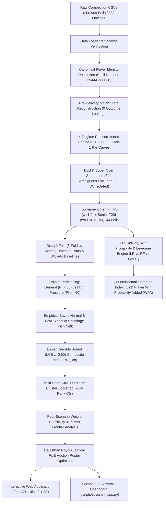

# Rajasthan Royals SupeRR Selector 2.0
### IPL Player Reliability, High-Pressure Clutch Evaluation & Auction Intelligence Platform

[](https://github.com/Sushruthshetty07/RR/actions/workflows/ci.yml)
[](https://www.python.org/downloads/)
[](https://fastapi.tiangolo.com)
[](https://opensource.org/licenses/MIT)

---

## 1. Project Title & Executive Summary
**Rajasthan Royals SupeRR Selector 2.0** is an enterprise-grade cricket analytics and machine learning scouting intelligence platform designed for the **IPL 2027 Mega/Mini-Auction**.

Evaluating T20 performance purely on unadjusted strike rates, batting averages, or raw economy rates leads to severe misallocations of franchise auction purse. This project reconstructs **200,999 ball-by-ball deliveries** across **867 professional T20 matches** to evaluate players under causal, zero-leakage conditions across three strictly separated analytical dimensions:
1. **Dimension A — Overall Reliability:** Consistent scoring volume, wicket avoidance, and run prevention across all match phases using Empirical Bayesian shrinkage and Kish effective sample size ($N_{\text{eff}}$).
2. **Dimension B — High-Pressure Performance:** True clutch impact strictly under difficult game states ($\text{PI} \ge 60$), guarded by an explicit evidence threshold ($N_{\text{eff}}^{\text{HP}} \ge 30$) to prevent mislabeling unexposed Powerplay openers as crunch closers.
3. **Dimension C — Rajasthan Royals Tactical Fit:** Addressing Rajasthan Royals' verified 2026 performance gaps (SMS Jaipur pace leak: 10.13 RPO vs 9.26 league average; death batting lag: 163.4 SR vs 169.4 benchmark) while respecting official BCCI retention and transfer governance.

---

## 2. Problem Statement
In T20 franchise cricket, conventional statistics systematically conflate:
- **Low-leverage accumulation** (e.g. scoring quickly during an uncontested blowout) with **high-pressure execution** (e.g. chasing 14 RPO with 4 wickets down).
- **Statistical noise from small sample sizes** (e.g. an uncapped player striking at 210 over 18 balls) with **repeatable underlying skill**.
- **Role specialization** (e.g. a top-order batter facing fields up in overs 1–6 vs a finisher batting with 2 balls remaining and fielders on the rope).

The core challenge is to reconstruct every delivery's exact pre-delivery game state, isolate true player value above contextual expectation, apply rigorous empirical Bayes shrinkage, and translate findings into defensible auction recommendations.

---

## 3. Why the Problem Matters
Auction purse mistakes in the IPL cost franchises between **INR 10 Cr to 25 Cr per marquee player**. Signing an explosive Powerplay batter expecting them to close nail-biting death-over chases routinely fails because early-overs slogging and late-overs crunch chasing require fundamentally different skill sets and psychological composure. 

By grounding scouting intelligence in:
- Pre-delivery causality (no forward leakage),
- Empirical Bayes shrinkage (discounting small-sample volatility),
- Kish effective sample sizes (accounting for tournament weights), and
- Counterfactual Win Probability Added (WPA) & Leverage Index (LI),

franchise management gains a calibrated, defensible decision support engine.

---

## 4. Project Objectives
1. **Zero-Leakage Match-State Reconstruction:** Compute cumulative score, wickets in hand, legal balls remaining, revised DLS targets, and required run rate strictly *before* each ball is bowled.
2. **Four-Regime Continuous Pressure Index (0–100):** Formulate mathematically distinct pressure indices for 1st innings setting, 2nd innings chasing, 1st innings bowling, and 2nd innings defending, complete with an empirical hopeless-chase collapse guard.
3. **Strict Separation of Reliability vs Clutch:** Disentangle general performance ($N_{\text{eff}} \ge 30$) from verified high-pressure clutch performance ($N_{\text{eff}}^{\text{HP}} \ge 30$), explicitly flagging unproven players with "Insufficient Evidence".
4. **Win Probability & Leverage Engine:** Train zero-leakage WP models (comparing Logistic Regression, Random Forest, and Gradient Boosting) and quantify delivery-level Leverage Index and Win Probability Added (WPA).
5. **Statistical Robustness & Sensitivity Analysis:** Test 4 defensible tactical weight configurations, calculate Spearman rank stability, top-10 overlap, multi-seed $B=2,000$ match-cluster bootstrap intervals, and Pareto frontiers.
6. **Rajasthan Royals Auction Intelligence:** Map candidate profiles against RR's verified tactical voids at SMS Jaipur vs ACA Guwahati across confirmed, pending, and trade-watchlist availability buckets.
7. **Production Scouting Dashboard:** Deliver an interactive, responsive analytics platform featuring all 7 required analytical pages.

---

## 5. End-to-End System Architecture



---

## 6. Technology Stack
- **Core Languages & Data Science:** Python 3.11+, Pandas 2.2+, NumPy 1.26+, SciPy 1.12+
- **Machine Learning & Modeling:** Scikit-Learn 1.4+ (HistGradientBoostingClassifier, RandomForestClassifier, LogisticRegression, SplineTransformer, ColumnTransformer, GroupKFold)
- **Visualization & Reporting:** Matplotlib 3.8+, Seaborn 0.13+, Jinja2 Templates
- **Web Architectures:** FastAPI, Starlette, Uvicorn, Streamlit
- **Quality Assurance & CI/CD:** Python `unittest`, GitHub Actions (`.github/workflows/ci.yml`)

---

## 7. Dataset Description & Provenance
The competition dataset comprises official ball-by-ball records from top-flight professional T20 tournaments between 2021 and 2026:
- `ball_by_ball.csv`: 200,999 rows, 33 columns detailing batsman, bowler, extras, dismissal types, speeds, and strokes.
- `matches.csv`: 883 matches detailing match dates, competition IDs, venues, stage, toss, revised targets, and revised overs.
- `competitions.csv`: 141 tournaments categorized across Indian Premier League (IPL), Senior T20 Internationals (T20I), and Emerging Asia Cups.
- `playing_eleven.csv`: 28,381 player appearance rows with batting order, wicketkeeper, captain, and impact-player flags.
- `competition_team_player_mapping.csv`: 6,413 player registrations.
- `teams.csv`: 353 domestic and international franchises/teams.

---

## 8. Data Preprocessing & Canonical Identity Resolution
- **Canonical ID Resolution:** Player identity is maintained through evidence-backed canonical IDs (`src/player_identity.py`). For example, Basil Hameed (recorded under ID `39444` in delivery logs and `8638` in team registries) is resolved deterministically without collapsing distinct players sharing names (e.g. Abdul Samad India #7446 vs Pakistan #6922; Rashid Khan AFG #4722 vs Nepal #20172).
- **Playing XI Deduplication:** Deterministically resolves 40 duplicate `(match_id, team_id, player_id)` keys by preserving the earliest batting order and logical OR across played/captain/wk flags.
- **Tournament Weighting:**
  $$\text{Weight} = \begin{cases} 1.00 & \text{IPL (Primary Tournament)} \\ 0.50 & \text{Senior T20I (Supporting Tier)} \\ 0.00 & \text{Emerging Teams Asia Cup (Supplementary Only)} \end{cases}$$

---

## 9. Ball-by-Ball Match-State Reconstruction
Every situational context metric is derived **strictly before** each delivery is bowled:
- **Legal Delivery Budget:** Only fair deliveries count against the legal ball budget. Wides, overstep no-balls, and non-overstep no-balls (`other`) must be re-bowled.
- **Wickets in Hand:** Initialized at 10 for standard innings, and 2 for Super Overs.
- **Extras Attribution:** Byes, leg-byes, and penalty runs are excluded from the bowler's runs conceded.
- **DLS & Weather Handling:** Distinguishes pre-innings confirmed revisions (797 balls) from ambiguous mid-innings stoppages (844 balls), strictly preventing future post-stoppage revised targets from leaking into pre-rain deliveries.

---

## 10. Continuous Pressure Index Methodology (0–100)
Pressure is modeled across four distinct operational regimes (`src/pressure.py`):

### A. Innings 2 Chasing ($\text{PI}_{\text{bat}}$)
Combines Required Run Rate ($\text{RRR}$), rate deficit ($\text{RRR} - \text{CRR}$), wickets lost, and legal balls remaining:
$$\text{PI}_{\text{bat}} = \min\left(100, \left[ 0.40 \cdot \sigma(\text{RRR}) + 0.20 \cdot \sigma(\text{Diff}) + 0.25 \cdot \left(\frac{W_{\text{lost}}}{10}\right)^{1.3} + 0.15 \cdot \left(1 - \frac{B_{\text{rem}}}{120}\right) \right] \cdot \Phi_{\text{achievable}} \cdot 100 \right)$$

#### Hopeless-Chase Collapse Guard ($\Phi_{\text{achievable}}$)
Naively scaling pressure monotonically with $\text{RRR}$ incorrectly labels hopeless garbage time as maximum pressure. When $\text{RRR} \ge 24$, victory is virtually impossible; the match is decided, and real competitive pressure collapses:
- $\text{RRR} < 8.0$: Mean Bat $\text{PI} = 22.8$ (0.0% High Pressure)
- $\text{RRR} \in [8.0, 12.0)$: Mean Bat $\text{PI} = 41.4$ (6.1% High Pressure)
- $\text{RRR} \in [12.0, 16.0)$: Mean Bat $\text{PI} = 66.5$ (**72.8% High Pressure**, Peak Crunch)
- $\text{RRR} \ge 24.0$: Mean Bat $\text{PI} = 16.3$ (**0.0% High Pressure**, Hopeless Guard Active)

### B. Innings 1 Setting ($\text{PI}_{\text{bat}}$)
Evaluated against Leave-One-Match-Out (LOO) empirical par score and par wickets curves:
$$\text{PI}_{\text{bat}} = 0.45 \cdot \left(\frac{W_{\text{lost}}}{W_{\text{par}}}\right) + 0.35 \cdot \sigma\left(\frac{S_{\text{par}} - S_{\text{actual}}}{\text{Std}_{\text{par}}}\right) + 0.20 \cdot \left(\frac{B_{\text{bowled}}}{120}\right)$$

---

## 11. Three Clearly Separated Player Evaluation Dimensions
A key upgrade in SupeRR Selector 2.0 is the formal separation of three distinct evaluation questions:

### Dimension A: Overall Reliability
Evaluates consistent performance across all phases using the Bayesian Lower Credible Bound composite index ($\text{PRI}_{\text{lcb}}$).
- **Eligibility:** Kish $N_{\text{eff}} \ge 30$, IPL balls $\ge 30$.
- **Batting Composite:** 45% Runs Above Average (RAA) + 25% Survival Avoidance + 15% Match-to-Match Consistency + 15% High-Pressure RAA.
- **Bowling Composite:** 55% Runs Saved Above Average (RSAA) + 15% Wickets Above Average (WAA) + 15% Consistency + 15% High-Pressure Impact.

### Dimension B: High-Pressure Clutch Performance
Evaluates performance strictly on deliveries where $\text{PI} \ge 60$.
- **Robust Evidence Threshold:** Requires $N_{\text{eff}}^{\text{HP}} \ge 30$.
- **Insufficient Evidence Policy:** Players with $N_{\text{eff}}^{\text{HP}} = 0$ or $N_{\text{eff}}^{\text{HP}} < 15$ are explicitly labeled **"Insufficient Evidence"**. Absence of high-pressure evidence is never treated as poor performance; it is treated as statistical absence of proof.

### Dimension C: Rajasthan Royals Tactical Fit
Evaluates candidate suitability against RR's specific 2026 performance bottlenecks:
- **Jaipur vs Guwahati Divergence:** RR was 3/3 in Guwahati (spin friendly), but 1/4 at SMS Jaipur due to a 10.13 RPO pace economy leak in overs 16–20.
- **Acquisition Pathways:** Strict segregation across Confirmed Auction, Pending Registration, and Trade Watchlist.

---

## 12. Empirical Bayesian Shrinkage & Effective Sample Size
To eliminate small-sample flukes, all player rate metrics undergo Marginal Maximum Likelihood (MML) Normal-Normal hierarchical shrinkage:
$$\theta_i^{\text{post}} = B_i \mu + (1 - B_i) y_i, \quad B_i = \frac{\sigma_i^2}{\sigma_i^2 + \tau^2}$$
where $\tau^2$ is the prior population variance across qualified players, and $\sigma_i^2 = \frac{s^2}{N_{\text{eff}, i}}$ is the player's sampling error governed by their Kish effective sample size:
$$N_{\text{eff}} = \frac{\left(\sum w_i\right)^2}{\sum w_i^2}$$

Posterior uncertainty is penalized using a custom conservative lower-bound score ($z = 0.50$, representing the 30.85th percentile of the posterior distribution, distinct from a conventional 95% lower credible bound):
$$\theta_i^{\text{lcb}} = \theta_i^{\text{post}} - 0.50 \cdot \sqrt{\text{Var}(\theta_i^{\text{post}})}$$

---

## 13. Win Probability & Leverage Analysis (Phase 4)
We formulated a pre-delivery Win Probability (WP) engine across 191,212 valid delivery observations.

### Model Benchmarking (5-Fold Match-Grouped GroupKFold)
| Model Architecture | ROC-AUC | PR-AUC | Brier Score | Log Loss | Precision | Recall | Calibration Error |
| :--- | :---: | :---: | :---: | :---: | :---: | :---: | :---: |
| **Logistic Regression (Splines)** | **0.8099** | **0.8049** | **0.1771** | **0.5198** | **0.7170** | 0.7223 | **0.0093** |
| **Random Forest (100 Trees)** | 0.8006 | 0.7969 | 0.1810 | 0.5297 | 0.7029 | **0.7237** | 0.0077 |
| **Gradient Boosting (HistGB)** | 0.7963 | 0.7907 | 0.1837 | 0.5407 | 0.6989 | **0.7237** | 0.0266 |

### Pressure vs Leverage: The Empirical Proof
Computing counterfactual Leverage Index ($\text{LI} = |P(\text{Win} \mid \text{Six}) - P(\text{Win} \mid \text{Wicket})| \times 100$) reveals:
$$\text{Pearson } r(\text{PI}, \text{LI}) = -0.1959, \quad \text{Spearman } \rho(\text{PI}, \text{LI}) = -0.1994$$
**Key Finding:** Pressure and Leverage are **not** identical. Pressure measures game-state difficulty, whereas Leverage measures outcome volatility.

---

## 14. Weight Sensitivity & Pareto Robustness (Phase 5)
To ensure composite rankings are defensible, we evaluated four distinct tactical weight configurations:

| Scenario Name | Batting Weights (RAA / Surv / Cons / HP) | Bowling Weights (RSAA / WAA / Cons / HP) | Spearman $\rho$ vs Baseline | Top-10 Overlap |
| :--- | :---: | :---: | :---: | :---: |
| **Baseline** | 45% / 25% / 15% / 15% | 55% / 15% / 15% / 15% | **1.0000** | **10 / 10** |
| **Balanced** | 30% / 25% / 25% / 20% | 35% / 25% / 20% / 20% | **0.9788** | **8 / 10** |
| **Reliability-Focused** | 50% / 30% / 15% / 5% | 60% / 20% / 15% / 5% | **0.9845** | **8 / 10** |
| **Pressure-Focused** | 25% / 15% / 15% / 45% | 30% / 15% / 15% / 40% | **0.8711** | **7 / 10** |

**Conclusion:** Elite performers remain robustly at the top under reasonable shifts in methodology ($\rho \ge 0.87$, Top-10 overlap $\ge 70\%$).

---

## 15. Final Verified Leaderboards

### Batting Leaderboards
| PRIMARY COMPETITION DELIVERABLE: Top 10 High-Pressure Batters ($N_{\text{eff}}^{\text{HP}} \ge 30$, Sorted by LCB) | SECONDARY ANALYSIS: Top 10 Overall Reliable Batters (`PRI_lcb`) |
| :--- | :--- |
| 1. **Suryakumar Yadav** (LCB: **+24.33**, Post: **+29.15** runs/100b, $N_{\text{eff}}^{\text{HP}}=231.1$) | 1. **Suryakumar Yadav** (99.91) |
| 2. **David Miller** (LCB: **+21.89**, Post: **+26.36** runs/100b, $N_{\text{eff}}^{\text{HP}}=283.4$) | 2. **Vaibhav Sooryavanshi** (99.80, $N_{\text{eff}}^{\text{HP}}=0$, Insufficient Evidence) |
| 3. **Dhruv Jurel** (LCB: **+18.77**, Post: **+24.88** runs/100b, $N_{\text{eff}}^{\text{HP}}=109.4$) | 3. **Andre Russell** (99.43, IPL Retired) |
| 4. **Sanju Samson** (LCB: **+18.71**, Post: **+25.72** runs/100b, $N_{\text{eff}}^{\text{HP}}=61.2$) | 4. **Dinesh Karthik** (98.89, IPL Retired) |
| 5. **Ashutosh Sharma** (LCB: **+17.67**, Post: **+23.15** runs/100b, $N_{\text{eff}}^{\text{HP}}=158.1$) | 5. **Finn Allen** (97.63, $N_{\text{eff}}^{\text{HP}}=0$, Insufficient Evidence) |
| 6. **Tim David** (LCB: **+16.96**, Post: **+21.50** runs/100b, $N_{\text{eff}}^{\text{HP}}=270.5$) | 6. **Nicholas Pooran** (96.82) |
| 7. **Mohammad Nabi** (LCB: **+16.89**, Post: **+23.03** runs/100b, $N_{\text{eff}}^{\text{HP}}=106.6$) | 7. **Shreyas Iyer** (96.78) |
| 8. **Namboori Tilak Varma** (LCB: **+16.28**, Post: **+20.85** runs/100b, $N_{\text{eff}}^{\text{HP}}=267.0$) | 8. **Heinrich Klaasen** (96.73) |
| 9. **Jos Buttler** (LCB: **+16.08**, Post: **+23.05** runs/100b, $N_{\text{eff}}^{\text{HP}}=63.0$) | 9. **Tim David** (96.60) |
| 10. **Daryl Mitchell** (LCB: **+15.94**, Post: **+22.40** runs/100b, $N_{\text{eff}}^{\text{HP}}=87.9$) | 10. **Phil Salt** (96.53) |

*Next Active Contenders under High Pressure:* **Nicholas Pooran** (LCB: +14.99, Post: +18.63, Active #11), **Shashank Singh** (LCB: +13.63, Post: +17.50, Active #12).

### Bowling Leaderboards
| PRIMARY COMPETITION DELIVERABLE: Top 10 High-Pressure Bowlers ($N_{\text{eff}}^{\text{HP}} \ge 30$, Sorted by LCB) | SECONDARY ANALYSIS: Top 10 Overall Reliable Bowlers (`PRI_lcb`) |
| :--- | :--- |
| 1. **Sunil Narine** (LCB: **+0.325**, Post: **+0.635** r/ov saved, $N_{\text{eff}}^{\text{HP}}=293.4$) | 1. **Jasprit Bumrah** (99.96) |
| 2. **Lungi Ngidi** (LCB: **+0.321**, Post: **+0.662** r/ov saved, $N_{\text{eff}}^{\text{HP}}=167.1$) | 2. **Sunil Narine** (99.96) |
| 3. **Rashid Khan** (LCB: **+0.271**, Post: **+0.553** r/ov saved, $N_{\text{eff}}^{\text{HP}}=450.4$) | 3. **Varun Chakravarthy** (99.87) |
| 4. **Harpreet Brar** (LCB: **+0.257**, Post: **+0.594** r/ov saved, $N_{\text{eff}}^{\text{HP}}=180.2$) | 4. **Rashid Khan** (99.66) |
| 5. **Nathan Ellis** (LCB: **+0.256**, Post: **+0.588** r/ov saved, $N_{\text{eff}}^{\text{HP}}=203.8$) | 5. **Axar Patel** (98.65) |
| 6. **Wanindu Hasaranga** (LCB: **+0.247**, Post: **+0.546** r/ov saved, $N_{\text{eff}}^{\text{HP}}=353.3$) | 6. **Bhuvneshwar Kumar** (98.18) |
| 7. **Krunal Pandya** (LCB: **+0.211**, Post: **+0.521** r/ov saved, $N_{\text{eff}}^{\text{HP}}=293.4$) | 7. **Nathan Ellis** (97.73) |
| 8. **Patrick Cummins** (LCB: **+0.194**, Post: **+0.524** r/ov saved, $N_{\text{eff}}^{\text{HP}}=210.2$) | 8. **Josh Hazlewood** (96.74) |
| 9. **Mitchell Santner** (LCB: **+0.170**, Post: **+0.487** r/ov saved, $N_{\text{eff}}^{\text{HP}}=264.3$) | 9. **Adil Rashid** (95.94) |
| 10. **Eshan Malinga** (LCB: **+0.111**, Post: **+0.452** r/ov saved, $N_{\text{eff}}^{\text{HP}}=168.0$) | 10. **Wanindu Hasaranga** (95.60) |

*Next Active Contenders under High Pressure:* **Kuldeep Yadav** (LCB: +0.097, Post: +0.394, Active #11), **Arshdeep Singh** (LCB: +0.055, Post: +0.330, Active #12).

---

## 16. Rajasthan Royals 2027 Auction Target Matrix

```
┌──────────────────────────────────────────────────────────────────────────────────┐
│                   RAJASTHAN ROYALS IPL 2027 TACTICAL ACQUISITION MATRIX          │
├─────────────────────────┬──────────┬──────────────────────┬──────────────────────┤
│ Tactical Void           │ Priority │ Primary Target       │ Acquisition Pathway  │
├─────────────────────────┼──────────┼──────────────────────┼──────────────────────┤
│ Death Pace Specialist   │ HIGH     │ Nathan Ellis         │ Trade Target         │
│                         │          │ Josh Hazlewood       │ Trade Target         │
│                         │          │ Sakib Hussain        │ Auction / Sleeper    │
├─────────────────────────┼──────────┼──────────────────────┼──────────────────────┤
│ Attacking / Cont. Spin  │ HIGH     │ Wanindu Hasaranga    │ Pending Registration │
│                         │          │ Adil Rashid          │ Auction Pool         │
│                         │          │ Mitchell Santner     │ Trade Target         │
├─────────────────────────┼──────────┼──────────────────────┼──────────────────────┤
│ Middle-Order RHB Closer │ MEDIUM   │ Tim David            │ Trade Target         │
│                         │          │ Shashank Singh       │ Trade Target         │
│                         │          │ Rajat Patidar        │ Trade Target         │
└─────────────────────────┴──────────┴──────────────────────┴──────────────────────┘
```

---

## 17. Installation & Quickstart

```bash
# 1. Clone the repository
git clone https://github.com/Sushruthshetty07/RR.git
cd RR

# 2. Set up virtual environment
python -m venv .venv

# Windows:
.\.venv\Scripts\Activate.ps1
# Linux/macOS:
source .venv/bin/activate

# 3. Install dependencies
pip install -r requirements.txt
```

---

## 18. Execution Instructions

### A. Run the Full Reproducible Pipeline (Single Command)
```bash
python scripts/run_full_pipeline.py
```
*Generates processed data, runs empirical Bayes shrinkage, trains WP benchmark models, executes sensitivity analysis, and updates dashboard JSON artifacts.*

### B. Launch the Web Analytics & Scouting Dashboard
```bash
python scripts/run_dashboard.py --port 8000
```
Open **`http://127.0.0.1:8000`** in your browser.

### C. Launch Companion Streamlit App
```bash
streamlit run scripts/streamlit_app.py
```

### D. Run Automated Test Suite
```bash
python -m unittest discover tests -v
```
*(71 tests covering match-state reconstruction, pressure indices, EB shrinkage, WP models, weight sensitivity, and live server endpoints).*

---

## 19. Repository Structure

```
rr_superr_selector/
├── .github/
│   └── workflows/ci.yml       # GitHub Actions continuous integration pipeline
├── data/
│   ├── raw/                   # Unmodified competition CSV datasets
│   ├── processed/             # Reconstructed situational tables & model outputs
│   └── external/              # Verified IPL 2027 availability & transfer registries
├── reports/
│   ├── figures/               # High-resolution analytical figures & plots
│   └── final_analytical_report.md
├── scripts/
│   ├── run_full_pipeline.py   # Unified end-to-end pipeline runner
│   ├── run_dashboard.py       # FastAPI / Uvicorn server launcher
│   └── streamlit_app.py       # Companion multi-page Streamlit application
├── src/
│   ├── data_loader.py         # CSV loading & memory reporting
│   ├── match_state.py         # Causal pre-delivery match state reconstruction
│   ├── player_identity.py     # Canonical ID resolution & alias tracking
│   ├── pressure.py            # 4-regime Pressure Index engine (0-100)
│   ├── performance.py         # Kish Neff & Empirical Bayes MML shrinkage
│   ├── win_probability.py     # Multi-model WP, WPA & Leverage engine
│   ├── weight_sensitivity.py  # 4-scenario sensitivity & Pareto frontier
│   ├── player_evaluation.py   # Three separated evaluation dimensions
│   ├── scouting_data.py       # In-memory scouting store & queries
│   └── web_app.py             # FastAPI REST endpoints & HTML templates
├── templates/
│   └── dashboard.html         # 7-page interactive modern dashboard UI
├── tests/                     # 71 comprehensive unit and integration tests
├── .gitignore
├── requirements.txt
└── README.md
```

---

## 20. Limitations
1. **Historical Era Shift:** Data spans 2021–2026. Scoring rates surged post-2023 with the Impact Player rule. While Same-Season PDI adjusts for league-wide scoring inflation, older matches reflect slightly different tactical pacing.
2. **Pre-Auction Availability Volatility:** Official BCCI IPL 2027 retention lists are finalized in mid-November. Uncontracted players are classified as *Pending Registration* until official BCCI auction lists are published.
3. **Ball-Tracking Granularity:** The dataset lacks ball-tracking pitch coordinates (Hawkeye trajectory), so swing, seam, and bounce deviations cannot be modeled directly.

---

## 21. Future Extensions
1. **Hawkeye / Telemetry Integration:** Incorporate pitch tracking to evaluate release height, drift, and seam movement under pressure.
2. **Matchup Simulation Engine:** Real-time Monte Carlo delivery simulators for auction-day auction simulation wars.
3. **Player Fitness & Biometric Feeds:** Layering workload, injury downtime, and bowling speed decline tracking ahead of mini-auctions.

---

## License & Attribution
Developed for the **Rajasthan Royals SupeRR Selector 2.0 Challenge**.  
Licensed under the [MIT License](LICENSE).
