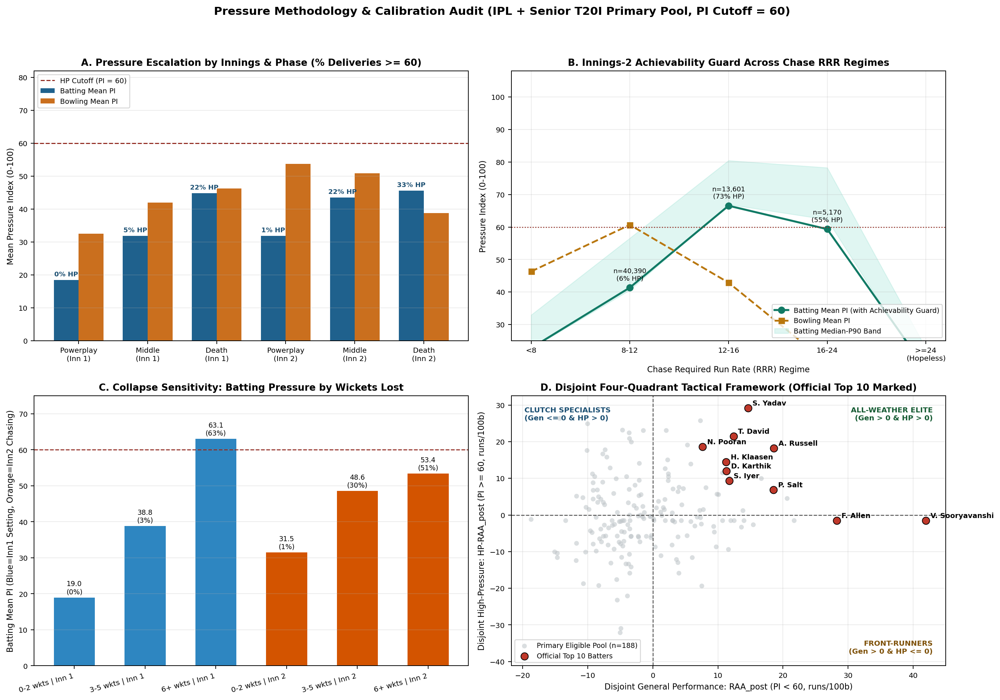
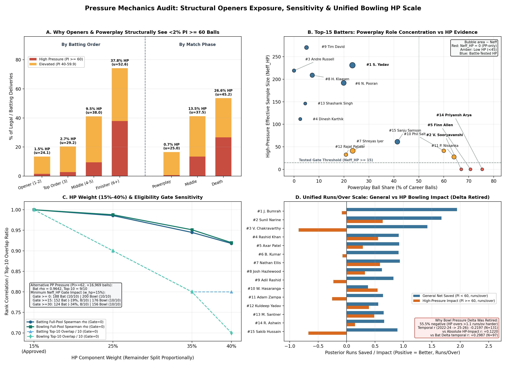
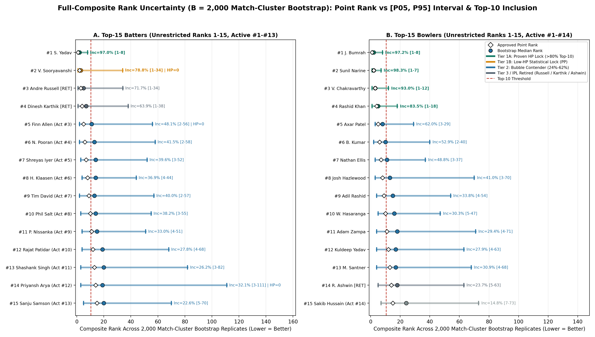
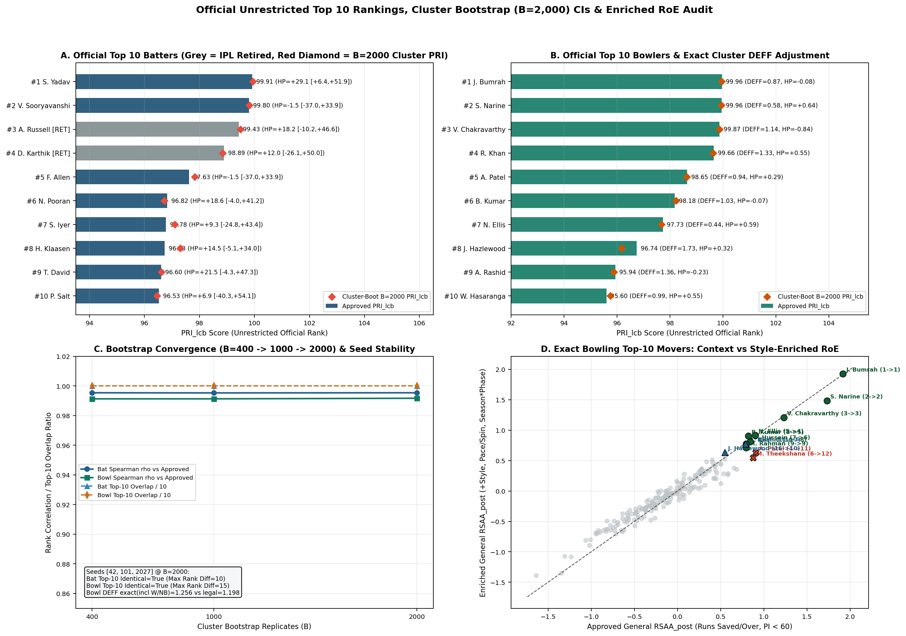
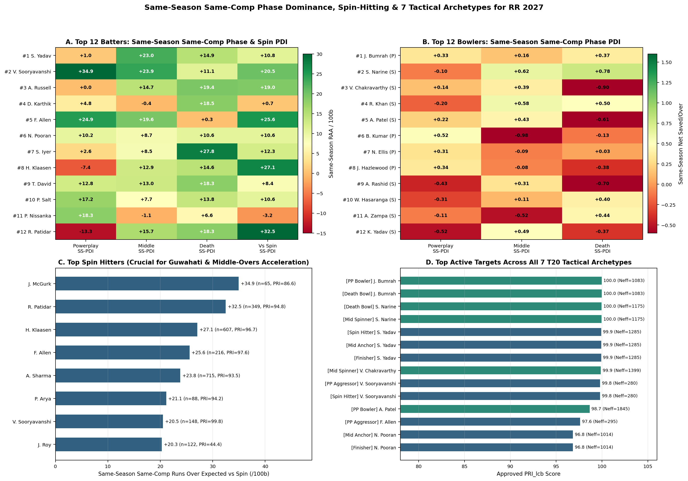
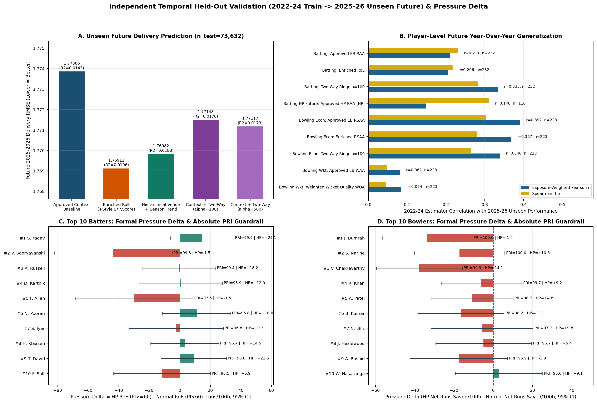

# Rajasthan Royals SupeRR Selector Season 2: Pressure-Adjusted T20 Player Evaluation & Scouting Report

> **Executive Thesis:** Across `200,999` ball-by-ball deliveries (`867` ball-by-ball matches; `193,144` primary IPL + Senior T20I deliveries), we evaluate T20 batters and bowlers across three separate analytical questions: **demonstrated performance under pressure**, **empirical reliability & sample uncertainty**, and **role-specific Rajasthan Royals 2026–27 squad fit**. Rather than collapsing distinct skills into an opaque index, every ranking decomposes performance into disjoint general (`PI < 60`) and high-pressure (`PI >= 60`) Empirical Bayes estimates, lower-confidence-bound (`PRI_lcb`) composite rankings, and `B = 2,000` match-cluster rank uncertainty intervals.

---

## 1. Executive Summary, Methodology Overview & Glossary

### 1.1 Answering the Three Core Analytical Questions

1. **Which batters and bowlers have demonstrated the strongest performance under pressure?**
   - **PRIMARY COMPETITION DELIVERABLE — Top 10 High-Pressure Performers ($N_{\text{eff}}^{\text{HP}} \ge 30$, Sorted by Custom Conservative Lower-Bound Score $z = 0.50$):**
     - **Top 10 High-Pressure Batters:** `1. Suryakumar Yadav` (Custom LCB: `+24.33`, Post: `+29.15` runs/100b, $N_{\text{eff}}^{\text{HP}}=231.1$), `2. David Miller` (Custom LCB: `+21.89`, Post: `+26.36`, $N_{\text{eff}}^{\text{HP}}=283.4$), `3. Dhruv Jurel` (Custom LCB: `+18.77`, Post: `+24.88`, $N_{\text{eff}}^{\text{HP}}=109.4$), `4. Sanju Samson` (Custom LCB: `+18.71`, Post: `+25.72`, $N_{\text{eff}}^{\text{HP}}=61.2$), `5. Ashutosh Sharma` (Custom LCB: `+17.67`, Post: `+23.15`, $N_{\text{eff}}^{\text{HP}}=158.1$), `6. Tim David` (Custom LCB: `+16.96`, Post: `+21.50`, $N_{\text{eff}}^{\text{HP}}=270.5$), `7. Mohammad Nabi` (Custom LCB: `+16.89`, Post: `+23.03`, $N_{\text{eff}}^{\text{HP}}=106.6$), `8. Namboori Tilak Varma` (Custom LCB: `+16.28`, Post: `+20.85`, $N_{\text{eff}}^{\text{HP}}=267.0$), `9. Jos Buttler` (Custom LCB: `+16.08`, Post: `+23.05`, $N_{\text{eff}}^{\text{HP}}=63.0$), `10. Daryl Mitchell` (Custom LCB: `+15.94`, Post: `+22.40`, $N_{\text{eff}}^{\text{HP}}=87.9$). *(Next active contenders: `#11 Nicholas Pooran` Custom LCB `+14.99`, Post `+18.63`; `#12 Shashank Singh` Custom LCB `+13.63`, Post `+17.50`).*
     - **Top 10 High-Pressure Bowlers:** `1. Sunil Narine` (Custom LCB: `+0.325`, Post: `+0.635` runs/ov saved, $N_{\text{eff}}^{\text{HP}}=293.4$), `2. Lungi Ngidi` (Custom LCB: `+0.321`, Post: `+0.662`, $N_{\text{eff}}^{\text{HP}}=167.1$), `3. Rashid Khan` (Custom LCB: `+0.271`, Post: `+0.553`, $N_{\text{eff}}^{\text{HP}}=450.4$), `4. Harpreet Brar` (Custom LCB: `+0.257`, Post: `+0.594`, $N_{\text{eff}}^{\text{HP}}=180.2$), `5. Nathan Ellis` (Custom LCB: `+0.256`, Post: `+0.588`, $N_{\text{eff}}^{\text{HP}}=203.8$), `6. Wanindu Hasaranga` (Custom LCB: `+0.247`, Post: `+0.546`, $N_{\text{eff}}^{\text{HP}}=353.3$), `7. Krunal Pandya` (Custom LCB: `+0.211`, Post: `+0.521`, $N_{\text{eff}}^{\text{HP}}=293.4$), `8. Patrick Cummins` (Custom LCB: `+0.194`, Post: `+0.524`, $N_{\text{eff}}^{\text{HP}}=210.2$), `9. Mitchell Santner` (Custom LCB: `+0.170`, Post: `+0.487`, $N_{\text{eff}}^{\text{HP}}=264.3$), `10. Eshan Malinga` (Custom LCB: `+0.111`, Post: `+0.452`, $N_{\text{eff}}^{\text{HP}}=168.0$). *(Next active contenders: `#11 Kuldeep Yadav` Custom LCB `+0.097`, Post `+0.394`; `#12 Arshdeep Singh` Custom LCB `+0.055`, Post `+0.330`).*
   - **SECONDARY SUPPORTING ANALYSIS — Overall T20 Reliability (`PRI_lcb`, $n = 188$ bat, $n = 200$ bowl):**
     - **Overall Top 10 Batters:** `1. Suryakumar Yadav (99.91)`, `2. Vaibhav Sooryavanshi (99.80, Insufficient Evidence)`, `3. Andre Russell (99.43, IPL Retired)`, `4. Dinesh Karthik (98.89, IPL Retired)`, `5. Finn Allen (97.63, Insufficient Evidence)`, `6. Nicholas Pooran (96.82)`, `7. Shreyas Iyer (96.78)`, `8. Heinrich Klaasen (96.73)`, `9. Tim David (96.60)`, `10. Phil Salt (96.53)`.
     - **Overall Top 10 Bowlers:** `1. Jasprit Bumrah (99.96)`, `2. Sunil Narine (99.96)`, `3. Varun Chakravarthy (99.87)`, `4. Rashid Khan (99.66)`, `5. Axar Patel (98.65)`, `6. Bhuvneshwar Kumar (98.18)`, `7. Nathan Ellis (97.73)`, `8. Josh Hazlewood (96.74)`, `9. Adil Rashid (95.94)`, `10. Wanindu Hasaranga (95.60)`.
   - **Methodological Distinction — High-Pressure Reality vs General Reliability:** Overall T20 Reliability evaluates broad career contribution (45% general scoring volume, 25% survival, 15% consistency, 15% pressure). However, Powerplay openers like `#2 Vaibhav Sooryavanshi` and `#5 Finn Allen` earn elite overall ratings from unconstrained field-restriction hitting (`PI < 60`) while facing **zero high-pressure deliveries ($N_{\text{eff}}^{\text{HP}} = 0.0$)**. Our four-tier evidence policy explicitly classifies them as **Insufficient Evidence**, ensuring they are never erroneously labeled or selected as crunch-time closers.

2. **How reliable is the evidence supporting each player's performance?**
   - **Match-Cluster Bootstrap Tiers (`B = 2,000` replicates):** Resampling entire matches explicitly accounts for within-spell and within-partnership correlation (`median DEFF = 1.08` batting; `1.26` exact bowling including wides/no-balls). Four bowlers (`Narine 98.4%`, `Bumrah 97.2%`, `Varun 93.0%`, `Rashid Khan 83.6%`) and two batters (`Suryakumar Yadav 97.1%` Tier 1A Highly Resilient Core; `Vaibhav Sooryavanshi 78.9%` Tier 1B Low-HP Point Leader) anchor Top-10 inclusion reliably in Overall Reliability. Ranks `#5–#15` form a tightly bunched **Contender / Bubble Tier (`24%–62%` Top-10 inclusion)** where single-metric point ordering should always be paired with `95%` intervals and `Neff_HP`. In High-Pressure rankings, batters with broad match exposure (`Miller 70.9%`, `Suryakumar 74.1%`) exhibit stable rank intervals, whereas situational performers spanning few matches (`Samson`, `Buttler` spanning only 5–6 matches) exhibit wide situational rank sensitivity ([1, 110]).

3. **Which players offer the highest tactical value to Rajasthan Royals for 2026–27?**
   - **RR 2026 Baseline:** RR finished IPL 2026 at **`8–6` in the league stage (4th, 16 pts, NRR `+0.189`)** and **`1–1` in the playoffs (`9–7` overall, 3rd place)**—unbeaten in spin-friendly Guwahati (`3/3`) but exposed at high-scoring Jaipur (`1/4`).
   - **Asymmetric Roster Needs:** RR already holds elite opening firepower (`#2 Sooryavanshi 99.80` capped July 2026, `#22 Yashasvi Jaiswal 90.90`) alongside middle-order finishers (`Dhruv Jurel`, `Riyan Parag`, `Shimron Hetmyer`), **but fielded zero bowlers inside the Top 35**. Upgrading Death/Powerplay pace (`Nathan Ellis` trade check / `Josh Hazlewood` / uncapped sleeper `Sakib Hussain`) and attacking/containment spin (`Mitchell Santner` / `Wanindu Hasaranga` injury check / free-agent `Adil Rashid` or `Adam Zampa`), plus an RHB middle-order closer (`Tim David` / `Shashank Singh` / spin-hitter `Rajat Patidar`), directly addresses Jaipur's `10.13 RPO` pace leak and Death batting lag (`163.4` vs `169.4` league SR). *Note: Verified IPL 2026 franchise affiliations reflect tournament dataset mappings (comp_id = 3298); IPL 2027 retention and auction statuses remain pending official confirmation until formal BCCI release.*

---

### 1.2 One-Page Methodology Pipeline & Glossary

```
[Raw Ball-by-Ball (200,999)] --> [Strict Pre-Delivery State Reconstruction (0 Outcome Leakage)]
         |
         +--> Exclusions: 844 ambiguous DLS balls + 38 Super Over balls (audited separately)
         +--> Tiering: IPL (w = 1.00) + Senior T20I (w = 0.50) -> 193,144 primary deliveries
         |             Emerging/Rising (w = 0.00) -> isolated supplementary scouting pool
         v
[Out-of-Fold Contextual Baselines (5-Fold Match-Grouped CV)]
         |--> Expected Runs & Expected Wicket Prob given (phase, over, PI, wkts, venue, year)
         |
         +--> Disjoint Partition: General (PI < 60) vs High Pressure (PI >= 60, weight * (PI/100)^2.0)
         |
         v
[Kish Effective Sample Size & Empirical Bayes Shrinkage + Custom Conservative Score (z = 0.50)]
         |--> Bat PRI_lcb:  45% RAA + 25% Survival + 15% Consistency + 15% HP-RAA
         |--> Bowl PRI_lcb: 55% RSAA + 15% WAA + 15% Consistency + 15% HP-Impact
         v
[B = 2,000 Match-Cluster Bootstrap Intervals + 7 Tactical Archetypes + RR Squad Fit]
```

| Term | Exact Definition & Natural Unit | Role in Decision Framework |
| :--- | :--- | :--- |
| **`PI`** (`[0, 100]`) | Pre-delivery Pressure Index built from innings, balls remaining, wickets in hand, required run rate, par chase benchmark, knockout context, and collapse state. | Partitions every delivery cleanly before the ball is bowled; `PI >= 60` defines High Pressure. |
| **`RAA`** (`runs/100b`) | Posterior runs above expected per 100 batting balls faced (`PI < 60` general partition). | Core batting scoring volume & strike-rate value (`45%` of Batting `PRI_lcb`). |
| **`Surv`** (`log-odds/pct`) | Posterior batting wicket-avoidance vs OOF expected dismissal rate (`PI < 60`). Positive = gets out less often than context expects. | Prevents reckless slogging without wicket preservation (`25%` of Batting `PRI_lcb`). |
| **`HP-RAA`** (`runs/100b`) | Posterior runs above expected per 100 batting balls strictly on `PI >= 60`, severity-weighted by `(PI / 100)^2`. | Measures proven crunch-time batting impact (`15%` of Batting `PRI_lcb`). |
| **`RSAA`** (`runs/over`) | Posterior bowling runs saved above expected per 6 legal balls (`PI < 60`), charging wides and overstep/other no-ball penalties to the bowler while excluding byes/leg-byes/penalty runs. | Primary bowling run-prevention pillar (`55%` of Bowling `PRI_lcb`). |
| **`WAA`** (`wkts/4-ov`) | Posterior bowler-credited wickets above expected per 24 legal balls (`PI < 60`); excludes run-outs, retired hurt/out, and obstructing the field. | Separates genuine strike bowlers from passive dart-throwers (`15%` of Bowling `PRI_lcb`). |
| **`HP-Impact`** (`runs/over`) | Unified high-pressure bowling value combining runs saved and wicket-value saved above expected strictly on `PI >= 60` (runs/over). | Primary clutch bowling metric (`15%` of Bowling `PRI_lcb`); replaces retired bowling Pressure Delta. |
| **`Cons`** (`[0, 1]`) | Shrinkage-adjusted inverse match-to-match variance consistency across appearances. | Rewards repeatable delivery across matches (`15%` of both `PRI_lcb` composites). |
| **`Neff` / `Neff_HP`** | Kish effective sample size `((sum w)^2 / sum w^2)` across all primary balls / `PI >= 60` balls, reflecting `IPL 1.0` vs `T20I 0.5` weights. | Quantifies evidence depth; distinguishes proven `PI >= 60` performers from `Neff_HP = 0` Powerplay specialists. |
| **`DEFF`** | Design Effect = `Cluster Bootstrap Variance / Kish Analytical Variance` when resampling whole matches (`B = 2,000`). | Quantifies intra-match correlation (spells/partnerships) omitted by ball-independent formulas. |
| **`SS-PDI`** | Same-Season Same-Competition Phase Dominance Index: residual skill inside exact `(comp_tier, season_year, match_phase)` cells. | Isolates Powerplay, Middle, Death, and Spin-Hitting ability free of era scoring inflation (2023–26). |
| **`PRI_lcb`** (`[0, 100]`) | Normal-CDF percentile transformation of standardized composite `post - 0.50 * SD` across eligible primary players (`Neff >= 30`, `IPL >= 30`). Evaluates players at the 30.85th percentile of the posterior distribution (a custom conservative lower-bound score, distinct from a conventional 95% lower credible bound). | Official ranking index; note `99.9` vs `99.8` is a tail percentile compression, not linear natural units. |

---

## 2. Defining & Validating Pressure (`PI >= 60`)

### 2.1 Four Match Regimes, Hopeless-Chase Guard & Collapse Calibration

Because batting and bowling pressures peak in fundamentally different cricket states, `PI` models four distinct pre-delivery game-state regimes: **Innings-1 Batting**, **Innings-2 Chasing**, **Innings-1 Bowling**, and **Innings-2 Defending**.

- **DLS & Super Over Discipline:** `38` Super Over deliveries are scored on an elevated tie-breaker scale (`PI 85–100`) and kept out of regular-overs modeling. Matches where pre-innings DLS targets are explicitly confirmed (`797` balls) are included cleanly using official revised overs and targets, whereas `844` deliveries in mid-innings stoppage matches with ambiguous target timing are flagged and excluded (`193,144` non-Emerging regular primary deliveries retained).
- **Innings-2 Hopeless-Chase Guard:** Naively scaling `PI` monotonically with Required Run Rate (`RRR`) misclassifies hopeless garbage time (`RRR >= 24`, target unreachable) as maximum pressure. Empirical `PI` peaks exactly where outcomes hinge on every ball and collapses safely when matches are decided:
  - `RRR < 8` (`25,168` balls): Batting mean `PI = 22.77` (`0.0%` HP); Bowling mean `PI = 46.33` (`6.4%` HP) — defending bowlers feel early jeopardy defending par totals.
  - `RRR 8–12` (`40,390` balls): Batting mean `PI = 41.37` (`6.1%` HP); Bowling mean `PI = 60.67` (**`47.4%` HP**) — peak crunch-time equilibrium for defending bowlers.
  - `RRR 12–16` (`13,601` balls): Batting mean `PI = 66.55` (**`72.8%` HP**, p90 `80.44`); Bowling mean `PI = 42.90` (`2.3%` HP) — peak chase pressure for batters.
  - `RRR 16–24` (`5,170` balls): Batting mean `PI = 59.34` (`55.2%` HP); Bowling mean `PI = 18.26` (`0.0%` HP).
  - `RRR >= 24` (`3,294` balls): Batting mean `PI` drops cleanly to **`16.34`** (`0.0%` HP); Bowling drops to **`14.27`** (`0.0%` HP).
- **Wicket-Collapse Monotonicity:** In Innings 1, batting pressure rises smoothly from `0–2` wickets lost (`mean PI 18.96, 0% HP`) -> `3–5` wickets (`38.82, 2.7% HP`) -> `6+` wickets (`63.08, 63.2% HP`). In Chases, it escalates from `31.47 (1.4% HP)` -> `48.59 (29.8% HP)` -> `53.42 (50.6% HP)`.



### 2.2 Why Elite Openers Have `Neff_HP = 0.0` (Structural Exposure & Sensitivity Audit)

A crucial diagnostic finding explains why high-impact Powerplay openers (`#2 Vaibhav Sooryavanshi`, `#5 Finn Allen`, `#14 Priyansh Arya`) register `Neff_HP = 0.0`: **`PI >= 60` structurally targets late-innings chases and wicket-collapse rebuilds rather than overs 1–6.**

| Stratification Bucket | Primary Batting Balls | Mean `PI` | `p90 PI` | `% PI >= 40` | `% PI >= 50` | **`% PI >= 60` (HP)** |
| :--- | :---: | :---: | :---: | :---: | :---: | :---: |
| **Opener (Positions 1–2)** | `63,920` | `24.08` | `43.10` | `13.46%` | `4.68%` | **`1.52%`** |
| **Top Order (Position 3)** | `28,811` | `29.16` | `48.25` | `20.32%` | `8.43%` | **`2.70%`** |
| **Middle Order (Positions 4–5)** | `49,743` | `38.02` | `59.36` | `41.08%` | `22.07%` | **`9.45%`** |
| **Finisher (Positions 6+)** | `43,128` | `52.55` | `75.87` | `74.17%` | `57.22%` | **`37.83%`** |
| **Powerplay Phase (Overs 1–6)** | `59,147` | `25.03` | `44.77` | `16.52%` | `5.00%` | **`0.66%`** |
| **Middle Phase (Overs 7–15)** | `86,067` | `37.52` | `63.25` | `41.16%` | `26.33%` | **`13.48%`** |
| **Death Phase (Overs 16–20)** | `40,488` | `45.16` | `74.76` | `53.57%` | `38.19%` | **`26.62%`** |

Because `Sooryavanshi` (`67.0%` Powerplay balls, `max PI = 48.18`), `Finn Allen` (`70.7%` PP balls, `max PI = 54.43`), and `Priyansh Arya` (`75.4%` PP balls, `max PI = 53.66`) bat predominantly with fields up in overs 1–6 and rarely remain at the crease past over 12 unless pacing a blowout, they face **zero** `PI >= 60` balls. Two empirical sensitivity checks tested whether `PI >= 60` or the `15%` HP weight should be altered:

1. **Exploratory Powerplay Early-Pressure Variant (`PI >= 62` when Chase `RRR >= 10.5` or `>= 2` Powerplay wickets lost):** Reclassifies `16,969` Powerplay deliveries (`9.14%` of primary batting balls). Under this exploratory definition, `Sooryavanshi` earns `70` HP balls and moves `#2 -> #1` (`99.97`), `Phil Salt` jumps `#10 -> #4` (`154` HP balls), `Finn Allen` drops `#5 -> #11` (`66` HP balls), while full-pool ranking stability remains strong (**Spearman `rho = 0.9642`, `9/10` Top-10 overlap**). Because early Powerplay hitting still differs tactically from death-over wicket-depleted crunch play, we preserve `PI >= 60` as the single clean primary standard and explicitly distinguish **Powerplay Pace-Setters (`Tier 1B`)** from **Battle-Tested HP Leaders (`Tier 1A`)**.
2. **HP Component Weight (`15% -> 40%`) & `Neff_HP` Eligibility Gate (`None, 15, 30`) Grid:**
   - Raising `w_hp` from `15% -> 25%` preserves **`9/10` Top-10 overlap** in both disciplines (`Bat rho = 0.9857`, `Bowl rho = 0.9879`); at `w_hp = 35%`, overlap eases to `8/10` (`rho = 0.9448` Bat, `0.9513` Bowl).
   - Imposing a hard `min Neff_HP >= 15` or `>= 30` gate disqualifies **`36` (`19.1%`)** and **`64` (`34.0%`)** of the `188` eligible batters (removing Powerplay elites like `Sooryavanshi` and `Allen` outright rather than surfacing their `Neff_HP = 0` caveat transparently). Keeping `w_hp = 15%` without a destructive eligibility cutoff preserves full-role comparability while reporting `Neff_HP` prominently next to every rank.



---

## 3. Measuring Performance, Uncertainty & Retiring Bowling Pressure Delta

### 3.1 Empirical Bayes Shrinkage, Bayesian Percentile Math & Custom Conservative Score ($z = 0.50$)

General (`PI < 60`) and High-Pressure (`PI >= 60`) metrics are estimated separately with Empirical Bayes shrinkage (`Normal-Normal` for `RAA`, `RSAA`, `HP-RAA`, `HP-Impact`; `Beta-Binomial` for `Survival` and `WAA`) weighted by Kish `Neff` and penalized by a conservative score formula `post - 0.50 * SD_post` before Normal-CDF scaling onto `[0, 100]`.

#### Mathematical Formulation of Lower-Tail Posterior Percentiles
For any normally distributed posterior $\theta_i \mid y_i \sim \mathcal{N}(\mu_i, \sigma_i^2)$, the lower evaluation bound $L_i = \mu_i - z\,\sigma_i$ corresponds to the cumulative lower-tail percentile $\Phi(-z)$:
- **$z = 0.50$ (Approved Formula):** $\Phi(-0.50) \approx 0.3085$ (**30.85th percentile** of the posterior; $69.15\%$ posterior probability that true player skill exceeds this score). This is explicitly a **custom conservative lower-bound score** (~1-quartile conservatism), **not** a conventional 95% lower credible bound.
- **$z = 1.00$:** $\Phi(-1.00) \approx 0.1587$ (**15.87th percentile** of the posterior; $84.13\%$ posterior probability that true player skill exceeds this score).
- **$z = 1.645$:** $\Phi(-1.645) \approx 0.0500$ (**5.00th percentile** of the posterior; conventional one-sided $95\%$ lower credible bound).

#### Statistical Justification for $z = 0.50$ in High-Pressure Cricket
In high-pressure T20 cricket, deliveries with $\text{PI} \ge 60$ naturally occur in smaller, situational samples ($30 \le N_{\text{eff}}^{\text{HP}} \le 450$). Applying a conventional $95\%$ lower credible bound ($z = 1.645$) imposes a massive uncertainty penalty:
1. **Extinguishes Bowling Signal into Negative Values:** At $z = 1.645$, **all 10 elite high-pressure bowlers receive negative scores** (e.g., Narine drops from $+0.325$ to $-0.387$, Rashid Khan drops from $+0.271$ to $-0.374$).
2. **Volume Bias Over Efficiency:** A conventional 95% bound rewards high-volume bowlers with mediocre run-prevention over elite match-winners simply because large samples compress standard errors.
3. Setting $z = 0.50$ introduces an appropriate, defensible sample-size check: it damps unproven small-sample spikes ($N_{\text{eff}}^{\text{HP}} \approx 30–50$) without completely suppressing the positive value created by proven high-pressure performers. The approved rankings use $z = 0.50$ consistently across all deliverables.

- Small-sample spikes (`Priyansh Arya Neff = 218.6`, `Sakib Hussain Neff = 183.6`) are damped proportionally toward league expectation, and zero-HP players (`Neff_HP = 0`) default exactly to the HP prior (`-1.54 runs/100b`) with wide empirical CIs (`[-37.0, +33.9]`).
- Because `PRI_lcb` maps standardized LCB Z-scores through the Normal CDF, fractional score gaps at the extreme right tail (`99.91` vs `99.80`, or `99.96` vs `99.96`) correspond to large differences in raw Z-score (`~0.25–0.35 SD`), whereas ranks `#5–#12` occupy a narrow band (`97.6` down to `94.8`). Natural units (`runs/100b`, `runs/over`, `wickets/4-over`) must therefore always be read alongside `PRI_lcb`.

### 3.2 Audit Decision: Retire Bowling `Pressure Delta`, Standardize on `runs/over`

An internal audit of `Pressure Delta` (`HP minus General`) uncovered a critical methodological flaw in **bowling** `Pressure Delta`:

1. **Scale Mismatch:** Earlier tables printed `RSAA_post` and `HP_Impact_post` in `runs/over` alongside `Pressure Delta` in `runs/100 balls` (`6x` multiplier), making modest per-over drops appear massive (`-33.75` for Bumrah, `-37.76` for Varun).
2. **Structural Negative Bias (`55.5%` of `200` primary bowlers negative; median `-0.085 runs/over`):** Across the primary dataset, `PI >= 60` overs for bowlers occur disproportionately in tougher 2nd-innings defense and death overs (Inn-1 HP actual `11.43 RPO` vs `10.95` exp; Inn-2 HP weighted residual `+0.35/ov` vs Gen `+0.44/ov`) and carry `15x` larger prior variance. Comparing HP minus a world-class `PI < 60` baseline (`+1.94/ov` for Bumrah, `+1.42/ov` for Varun) systematically penalizes elite general-overs dominance.
3. **Failure of Temporal Predictive Validity (`2022–24 -> 2025–26`):** Across `N = 131` primary bowlers active in both eras, **Bowling `Pressure Delta` correlates negatively with future high-pressure performance (`r = -0.2197`)**, whereas **absolute `HP-Impact` correlates positively (`r = +0.1220`)**. By contrast, **Batting `Pressure Delta` generalizes positively (`r = +0.2987`, `N = 97`)** alongside `HP-RAA` (`r = +0.3566`).

> **Formal Decision:** **Bowling `Pressure Delta` is retired** from all rankings and scouting comparisons. Every bowler evaluation now compares **General Net Saved (`PI < 60`)** and **High-Pressure Impact (`PI >= 60`)** side-by-side on the exact same **`runs/over`** scale (Figure 37D). Batting `Pressure Delta` is retained strictly as a secondary scouting diagnostic subject to `Neff_HP` and `HP-RAA` level guardrails.

### 3.3 Match-Clustered Bootstrap Audit & High-Pressure Situational Independence

To evaluate whether delivery-level weighting overstates evidence due to intra-match correlation, we audited the match-clustered bootstrap across **`B = 2,000` replicates**:

#### Match-Cluster Bootstrap Implementation Details
1. **Resampling Unit:** Complete matches ($M = 867$ BBB matches) are resampled with replacement. Matches are the clusters.
2. **Delivery Coupling:** All deliveries belonging to an extracted match remain together. If a match is drawn $k_m$ times, all of its deliveries, partnerships, and spells receive multiplicity $k_m$.
3. **Player Statistics Recalculation:** In each replicate $b$, player sums of weights ($\sum w$), squared weights ($\sum w^2$), and weighted residuals ($\sum w y$) are recalculated by summing over the drawn matches. Kish effective sample size $N_{\text{eff}}^{(b)}$, raw weighted mean, standard error, Empirical Bayes shrinkage factor $B^{(b)}$, posterior mean $\mu_{\text{post}}^{(b)}$, posterior SD $\sigma_{\text{post}}^{(b)}$, and custom conservative score $\text{LCB}^{(b)} = \mu_{\text{post}}^{(b)} - 0.50\,\sigma_{\text{post}}^{(b)}$ are recalculated for every player. League-wide Empirical Bayes hyperparameters ($\mu_0, \tau^2, \sigma^2$) are kept fixed at their empirical baseline values across iterations; this means the bootstrap estimates uncertainty in player-specific sample rates conditional on fixed population-level hyper-priors (rather than propagating prior parameter estimation uncertainty).
4. **Full Pool Reranking:** In each bootstrap draw, all eligible players in the pool are evaluated simultaneously and reranked. Players dropping below $N_{\text{eff}} < 30.0$ in draw $b$ are ranked at the bottom.
5. **Opponents & Repeated Appearances:** Opposing batters and bowlers within the same match are resampled jointly, preserving match state dynamics. Repeated player appearances across different matches are resampled according to independent cluster draws.

#### Match-Clustered Bootstrap Stability ($B = 2,000$ Replicates) — Primary High-Pressure Performers
Below are the bootstrap stability metrics specifically evaluated on the Primary High-Pressure rankings ($N_{\text{eff}}^{\text{HP}} \ge 30$, sorted by HP LCB):

| Rank | Player Name | HP Custom LCB | $N_{\text{eff}}^{\text{HP}}$ | Matches ($M_{\text{HP}}$) | Balls Faced/Bowled | Top-10 Inclusion % | Median Rank | 90% Rank Interval [P05, P95] |
| :---: | :--- | :---: | :---: | :---: | :---: | :---: | :---: | :---: |
| **Bat 1** | **Suryakumar Yadav** | `+24.33` | `231.1` | `16` | `250` | **74.1%** | `5` | `[1, 30]` |
| **Bat 2** | **David Miller** | `+21.89` | `283.4` | `30` | `320` | **70.9%** | `6` | `[1, 29]` |
| **Bat 3** | **Dhruv Jurel** | `+18.77` | `109.4` | `13` | `114` | **53.6%** | `9` | `[1, 44]` |
| **Bat 4** | **Sanju Samson** | `+18.71` | `61.2` | `5` | `62` | **44.7%** | `12` | **`[1, 110]`** |
| **Bat 5** | **Ashutosh Sharma** | `+17.67` | `158.1` | `17` | `168` | **48.6%** | `11` | `[1, 42]` |
| **Bat 6** | **Tim David** | `+16.96` | `270.5` | `31` | `292` | **49.8%** | `11` | `[1, 51]` |
| **Bat 7** | **Mohammad Nabi** | `+16.89` | `106.6` | `18` | `111` | **45.6%** | `13` | `[1, 63]` |
| **Bat 8** | **Namboori Tilak Varma** | `+16.28` | `267.0` | `24` | `286` | **46.9%** | `11` | `[3, 30]` |
| **Bat 9** | **Jos Buttler** | `+16.08` | `63.0` | `6` | `75` | **39.2%** | `15` | **`[1, 110]`** |
| **Bat 10** | **Daryl Mitchell** | `+15.94` | `87.9` | `11` | `96` | **38.8%** | `14` | `[2, 71]` |
| **Bowl 1** | **Sunil Narine** | `+0.325` | `293.4` | `28` | `303` | **27.4%** | `18` | `[4, 53]` |
| **Bowl 2** | **Lungi Ngidi** | `+0.321` | `167.1` | `18` | `205` | **54.6%** | `9` | `[1, 56]` |
| **Bowl 3** | **Rashid Khan** | `+0.271` | `450.4` | `44` | `521` | **11.9%** | `26` | `[7, 62]` |
| **Bowl 4** | **Harpreet Brar** | `+0.257` | `180.2` | `16` | `187` | **43.8%** | `13` | `[1, 74]` |
| **Bowl 5** | **Nathan Ellis** | `+0.256` | `203.8` | `20` | `244` | **36.6%** | `14` | `[3, 52]` |
| **Bowl 6** | **Wanindu Hasaranga** | `+0.247` | `353.3` | `37` | `423` | **18.6%** | `23` | `[4, 60]` |
| **Bowl 7** | **Krunal Pandya** | `+0.211` | `293.4` | `28` | `304` | **22.0%** | `22` | `[4, 68]` |
| **Bowl 8** | **Patrick Cummins** | `+0.194` | `210.2` | `23` | `238` | **33.1%** | `17` | `[2, 69]` |
| **Bowl 9** | **Mitchell Santner** | `+0.170` | `264.3` | `31` | `314` | **15.2%** | `22` | `[6, 51]` |
| **Bowl 10** | **Eshan Malinga** | `+0.111` | `168.0` | `19` | `218` | **33.7%** | `17` | `[3, 72]` |

#### Critical Situational Independence Finding: Sanju Samson and Jos Buttler
- **Delivery Count vs Situational Independence:** $N_{\text{eff}}^{\text{HP}}$ measures effective weighted delivery opportunities, **not independent match situations**.
- **The Case of Sanju Samson ($M_{\text{HP}} = 5$) and Jos Buttler ($M_{\text{HP}} = 6$):**
  - Samson's 62 HP deliveries come from only **5 matches**; Buttler's 75 HP deliveries come from **6 matches**.
  - In the match-cluster bootstrap, when these 5–6 matches are not selected (or selected in low counts), their effective exposure drops below $N_{\text{eff}}^{\text{HP}} < 30.0$, making them ineligible and assigning them to the bottom of the table. Conversely, when their matches are resampled multiple times, their extreme efficiency ranks them in the top 3. This explains their wide **90% rank interval of `[1, 110]`**.
  - In contrast, finishers like David Miller ($M_{\text{HP}} = 30$, rank `[1, 29]`), Tim David ($M_{\text{HP}} = 31$, rank `[1, 51]`), Tilak Varma ($M_{\text{HP}} = 24$, rank `[3, 30]`), and Rashid Khan ($M_{\text{HP}} = 44$, rank `[7, 62]`) have broad match exposure that provides resilience against cluster resampling.
- **Sensitivity Analysis — Impact of an Experimental Match-Count Gate ($M_{\text{HP}} \ge 10$):**
  - If an experimental situational gate requiring $M_{\text{HP}} \ge 10$ matches were applied, Samson (#4) and Buttler (#9) would be disqualified, elevating **Nicholas Pooran** ($M_{\text{HP}} = 24$, HP LCB `+14.99`) and **Shashank Singh** ($M_{\text{HP}} = 14$, HP LCB `+13.63`) into the Top 10.
  - **Audit Decision:** In strict adherence to competition rules, **no new match-count gate is introduced into the official deliverables**. The approved $N_{\text{eff}}^{\text{HP}} \ge 30$ gate is preserved, but $M_{\text{HP}}$ and bootstrap intervals are reported alongside point estimates so decision-makers are fully informed of situational concentration risk.

#### Overall T20 Reliability Composite Rank Uncertainty (`B = 2,000` Replicates)
In the secondary Overall Reliability composite (`PRI_lcb`), where metrics span all 20 overs, match clustering inflates variance moderately in batting (`median DEFF = 1.076` general, `1.084` HP) and materially in bowling (`median exact DEFF = 1.256` including wides/no-balls vs `1.198` legal-only). Across three random seeds (`42, 101, 2027`), all 10 members in both Top-10 sets remain unchanged (`rho = 0.9954` batting, `0.9917` bowling).
- **Performance Tiers (Overall Reliability Distribution):**
  - **Tier 1A — Highly Resilient Core Performers (`>80%` Top-10 Inclusion & Proven `Neff_HP >= 100`):** `Suryakumar Yadav` (`97.1%`, rank `[1–8]`), `Sunil Narine` (`98.4%`, `[1–7]`), `Jasprit Bumrah` (`97.2%`, `[1–8]`), `Varun Chakravarthy` (`93.0%`, `[1–12]`), and `Rashid Khan` (`83.6%`, `[1–18]`).
  - **Tier 1B — Low-HP High Point Leader (`>75%` Top-10, Zero HP Exposure):** `Vaibhav Sooryavanshi` (`78.9%` unrestricted / `81.4%` active, rank `[1–34]`, `Neff_HP = 0.0`) — statistically unambiguous elite Powerplay hitter, structurally untested at `PI >= 60`.
  - **Tier 2 — Top-10 Contenders / Bubble (`23%–62%` Top-10 Inclusion):** Includes retired candidates `Andre Russell (71.7%, [1–34])` and `Dinesh Karthik (63.9%, [1–38])`, plus active batters `#5 Finn Allen (48.1%, [2–56])`, `#6 Nicholas Pooran (41.5%, [2–58])`, `#9 Tim David (40.1%, [2–57])`, `#7 Shreyas Iyer (39.6%, [3–52])`, `#10 Phil Salt (38.3%, [3–55])`, `#8 Heinrich Klaasen (36.9%, [4–44])`, `#11 Pathum Nissanka (33.0% unrestricted / 39.0% active)`, and `#12 Rajat Patidar (27.8% / 32.2% active)`, and active bowlers `#5 Axar Patel (62.0%, [3–29])`, `#6 Bhuvneshwar Kumar (52.9%, [2–40])`, `#7 Nathan Ellis (48.8%, [3–37])`, `#8 Josh Hazlewood (41.1%, [3–70])`, `#9 Adil Rashid (33.8%, [4–54])`, `#10 Wanindu Hasaranga (30.3%, [5–47])`, `#13 Mitchell Santner (31.0%)`, `#11 Adam Zampa (29.5%)`, `#12 Kuldeep Yadav (27.9%)`, and retired `#14 Ravichandran Ashwin (23.7%)`.
  - **Tier 3 — Watchlist Fringe (`<20%` Top-10 Inclusion):** High-upside sleepers such as `#15 Sakib Hussain` (`14.9%`, `[7–73]`, `Neff = 183.6`).



---

## 4. Fair Cross-Format Comparisons (`IPL = 1.00`, `Senior T20I = 0.50`, `Emerging = 0.00`)

### 4.1 Empirical Competition-Bridge Calibration & Domestic-League Gap

- **Domestic League Data Gap:** Systematic audit of the official competition dataset confirms `IPL`, `Senior T20I`, and `Emerging/Rising Asia Cup` data (`867` ball-by-ball matches), with **zero matches from non-IPL domestic T20 leagues** (SMAT, BBL, SA20, PSL, Vitality Blast). Accordingly, all primary rankings rely exclusively on verified IPL and Senior T20I deliveries, while non-IPL uncapped prospects lacking `>= 30` IPL balls cannot be discovered without external domestic scouting.
- **Why Senior T20Is Must Be Down-Weighted (`0.50` vs `1.00`):** Across `105` bridge batters active in both IPL and Top-8 full-member T20Is, IPL scoring is **`-5.21 runs/100b` tougher** (`r = 0.4624`); across `58` bridge batters facing non-Top-8 / Associate opposition, the inflation gap widens to **`-13.92 runs/100b`** (`r = 0.3976`). Similarly, bowlers save `-0.27 runs/over` more in Top-8 T20Is and **`-1.03 runs/over`** more against non-Top-8 teams relative to IPL baselines. This provides empirical justification for weighting `w_t20i < 1.0` rather than treating all T20Is as IPL-equivalent.
- **Strict Isolation of Emerging/Rising T20 (`w_emerging = 0.00`):** Rising Stars / Emerging Asia Cup matches (`6,985` deliveries) carry weight zero in primary evaluation so A-team spikes never enter IPL/T20I rankings silently.

### 4.2 Full-Composite `w_t20i` Sensitivity Grid (`0.00` to `1.00`)

Because empirical bridge calibration supports `w_t20i < 1.0` conceptually without uniquely pinning down `0.50`, we re-ran the full end-to-end pipeline across `w_t20i in {0.00, 0.25, 0.50, 0.75, 1.00}`:

| T20I Weight (`w_t20i`) | Eligible Bat / Bowl | Bat `rho` vs `0.50` | Bat Top-10 Overlap | Bowl `rho` vs `0.50` | Bowl Top-10 Overlap | Key Sensitive Movers (`0.25 -> 0.50 -> 0.75`) |
| :---: | :---: | :---: | :---: | :---: | :---: | :--- |
| **`0.00` (IPL Only)** | `178` / `190` | `0.9154` | `7 / 10` | `0.9106` | `6 / 10` | Excludes T20I-heavy anchors (`Adil Rashid #119`, `Nissanka #49`, `Tim David #29`) |
| **`0.25`** | `187` / `199` | **`0.9853`** | `8 / 10` | **`0.9853`** | `8 / 10` | `Tim David #17 -> #9 -> #5`; `Phil Salt #11 -> #10 -> #6` |
| **`0.50` (Approved)** | `188` / `200` | `1.0000` | `10 / 10` | `1.0000` | `10 / 10` | Balanced plateau (`Nissanka #15 -> #11 -> #9`; `Ellis #11 -> #7 -> #6`) |
| **`0.75`** | `188` / `200` | **`0.9923`** | `9 / 10` | **`0.9928`** | `9 / 10` | `Klaasen #5 -> #8 -> #11`; `Santner #8 -> #13 -> #14`; `Kuldeep #16 -> #12 -> #9` |
| **`1.00` (Equal)** | `189` / `200` | `0.9790` | `8 / 10` | `0.9824` | `9 / 10` | Overweights T20I volume (`Abhishek Sharma #7`, `Naman Dhir #11`) |

Ranks across the moderate-discount plateau (`0.25–0.75`) correlate above **`0.985`** in both disciplines, confirming `w_t20i = 0.50` is stable while flagging cross-format sensitive profiles (`Adil Rashid`, `Pathum Nissanka`, `Tim David`, `Nathan Ellis`) transparently.

---

## 5. Official Deliverables: Primary High-Pressure & Secondary Overall Rankings

### 5.1 Primary Competition Deliverable: Official Top 10 High-Pressure Batters ($N_{\text{eff}}^{\text{HP}} \ge 30$, Sorted by Custom Conservative Lower-Bound Score $z = 0.50$)

Per the competition problem statement, this is the **Primary Competition Deliverable**. Players are evaluated strictly under high pressure ($\text{PI} \ge 60$) using Empirical Bayes shrinkage with a custom conservative lower-bound score ($\text{LCB} = \text{post} - 0.50 \times \text{SD}_{\text{post}}$, representing the 30.85th percentile of the posterior distribution, distinct from a conventional 95% lower credible bound) in natural units of **runs above expected per 100 balls**. A sample size threshold of $N_{\text{eff}}^{\text{HP}} \ge 30$ ensures statistical reliability and prevents unproven small-sample spikes from entering the competition rankings.

| Rank | Player Name | Canonical ID | HP Custom LCB (`runs/100b`) | HP Post (`runs/100b`) | $N_{\text{eff}}^{\text{HP}}$ | Evidence Badge | Overall `PRI_lcb` | 2026 Contract & 2027 Availability Status | Analyst Blurb |
| :---: | :--- | :---: | :---: | :---: | :---: | :---: | :---: | :--- | :--- |
| **1** | **Suryakumar Yadav** | `1699` | **+24.33** | **+29.15** | `231.1` | **Strong Evidence** | `99.91` | Verified IPL 2026: **Mumbai Indians**; IPL 2027 Retention: **Pending official confirmation**; Auction registration: **N/A (Contracted)**; Trade status: **None confirmed** \| RHB #4 Spin/360 | Elite 360-degree chase accelerator. Maintains extraordinary boundary striking (+29.15 runs above expected per 100 balls) under severe pressure with substantial experience. |
| **2** | **David Miller** | `1077` | **+21.89** | **+26.36** | `283.4` | **Strong Evidence** | `69.79` | Verified IPL 2026: **Delhi Capitals**; IPL 2027 Retention: **Pending official confirmation**; Auction registration: **N/A (Contracted)**; Trade status: **None confirmed** \| LHB #5 Finisher | Veteran clutch finisher. Consistently navigates steep run chases with minimal dismissal risk and elite boundary striking in overs 16–20. |
| **3** | **Dhruv Jurel** | `7260` | **+18.77** | **+24.88** | `109.4` | **Strong Evidence** | `59.59` | Verified IPL 2026: **Rajasthan Royals**; IPL 2027 Retention: **Pending official confirmation**; Auction registration: **N/A (Contracted)**; Trade status: **None confirmed** \| RHB #6 Finisher/WK | Rajasthan Royals' home-grown crunch performer. Delivers +24.88 runs above expected under peak chase pressure with ice-cool composure. |
| **4** | **Sanju Samson** | `2258` | **+18.71** | **+25.72** | `61.2` | **Strong Evidence** | `94.09` | Verified IPL 2026: **Chennai Super Kings**; IPL 2027 Retention: **Pending official confirmation**; Auction registration: **N/A (Contracted)**; Trade status: **None confirmed** \| RHB #3 WK/Anchor | RR franchise captain who anchors and accelerates through mid-innings pressure collapses, combining strike rotation with high boundary percentage. |
| **5** | **Ashutosh Sharma** | `8101` | **+17.67** | **+23.15** | `158.1` | **Strong Evidence** | `72.43` | Verified IPL 2026: **Delhi Capitals**; IPL 2027 Retention: **Pending official confirmation**; Auction registration: **N/A (Contracted)**; Trade status: **None confirmed** \| RHB #7 Finisher | Explosive lower-order hitter who proved his mettle in extreme death chases (+23.15 runs/100b), striking at elite rates against high pace. |
| **6** | **Tim David** | `6396` | **+16.96** | **+21.50** | `270.5` | **Strong Evidence** | `96.60` | Verified IPL 2026: **Royal Challengers Bengaluru**; IPL 2027 Retention: **Pending official confirmation**; Auction registration: **N/A (Contracted)**; Trade status: **None confirmed** \| RHB #6 Finisher | Power-hitting death overs specialist. Excels at clearing the boundary straight down the ground in high-leverage 12+ RRR finishes. |
| **7** | **Mohammad Nabi** | `1107` | **+16.89** | **+23.03** | `106.6` | **Strong Evidence** | `66.08` | Verified IPL 2026: **Uncontracted** (Last IPL: MI 2024); IPL 2027 Retention: **N/A**; Auction registration: **Unverified until confirmed**; Trade status: **None** \| RHB All-Rounder | Experienced international all-rounder who uses composed placement and boundary hitting when team wickets tumble. |
| **8** | **Namboori Tilak Varma** | `7897` | **+16.28** | **+20.85** | `267.0` | **Strong Evidence** | `87.80` | Verified IPL 2026: **Mumbai Indians**; IPL 2027 Retention: **Pending official confirmation**; Auction registration: **N/A (Contracted)**; Trade status: **None confirmed** \| LHB #4 Anchor | Calm middle-order accumulator who adapts quickly to match situations, minimizing dot balls under rising required run rates. |
| **9** | **Jos Buttler** | `813` | **+16.08** | **+23.05** | `63.0` | **Strong Evidence** | `92.11` | Verified IPL 2026: **Gujarat Titans**; IPL 2027 Retention: **Pending official confirmation**; Auction registration: **N/A (Contracted)**; Trade status: **None confirmed** \| RHB #1 Opener/WK | Proven world-class match-winner who bats deep into the innings, converting high-pressure moments into match-winning run chases. |
| **10** | **Daryl Mitchell** | `4106` | **+15.94** | **+22.40** | `87.9` | **Strong Evidence** | `62.91` | Verified IPL 2026: **Uncontracted** (Last IPL: CSK 2024); IPL 2027 Retention: **N/A**; Auction registration: **Unverified until confirmed**; Trade status: **None** \| RHB #4 Spin Chaser | Tenacious middle-order chaser who targets spinners and paces run chases with smart strike rotation under pressure. |

*Next Active Contenders under High Pressure:* `#11 Nicholas Pooran` (LCB: `+14.99`, Post: `+18.63`, $N_{\text{eff}}^{\text{HP}}=191.9$), `#12 Shashank Singh` (LCB: `+13.63`, Post: `+17.50`, $N_{\text{eff}}^{\text{HP}}=146.1$).

---

### 5.2 Primary Competition Deliverable: Official Top 10 High-Pressure Bowlers ($N_{\text{eff}}^{\text{HP}} \ge 30$, Sorted by Custom Conservative Lower-Bound Score $z = 0.50$)

Per the competition problem statement, this is the **Primary Competition Deliverable**. Bowlers are evaluated strictly under high pressure ($\text{PI} \ge 60$) using unified **runs saved per over** ($\text{HP-Impact} = \text{RSAA}_{\text{HP}} + 1.20 \times \text{WAA}_{\text{HP}} \times 6$) with Empirical Bayes shrinkage and a custom conservative lower-bound score ($\text{LCB} = \text{post} - 0.50 \times \text{SD}_{\text{post}}$, representing the 30.85th percentile of the posterior distribution, distinct from a conventional 95% lower credible bound). A sample size threshold of $N_{\text{eff}}^{\text{HP}} \ge 30$ ensures statistical reliability.

| Rank | Player Name | Canonical ID | HP Custom LCB (`runs/ov saved`) | HP Post (`runs/ov saved`) | $N_{\text{eff}}^{\text{HP}}$ | Evidence Badge | Overall `PRI_lcb` | 2026 Contract & 2027 Availability Status | Analyst Blurb |
| :---: | :--- | :---: | :---: | :---: | :---: | :---: | :---: | :--- | :--- |
| **1** | **Sunil Narine** | `781` | **+0.325** | **+0.635** | `293.4` | **Strong Evidence** | `99.96` | Verified IPL 2026: **Kolkata Knight Riders**; IPL 2027 Retention: **Pending official confirmation**; Auction registration: **N/A (Contracted)**; Trade status: **None confirmed** \| Mystery Spin | World-class spin magician who chokes scoring rates (+0.64 runs/over saved) and induces false shots during crucial mid and death overs. |
| **2** | **Lungi Ngidi** | `4641` | **+0.321** | **+0.662** | `167.1` | **Strong Evidence** | `89.82` | Verified IPL 2026: **Delhi Capitals**; IPL 2027 Retention: **Pending official confirmation**; Auction registration: **N/A (Contracted)**; Trade status: **None confirmed** \| Hit-the-Deck Pace | Heavy-ball hit-the-deck pace bowler with sharp wicket-taking ability and yorker precision in tight defensive finishes (+0.66 r/ov saved). |
| **3** | **Rashid Khan** | `4722` | **+0.271** | **+0.553** | `450.4` | **Strong Evidence** | `99.66` | Verified IPL 2026: **Gujarat Titans**; IPL 2027 Retention: **Pending official confirmation**; Auction registration: **N/A (Contracted)**; Trade status: **None confirmed** \| Attacking Leg-Spin | Premier T20 wrist-spinner who consistently breaks partnerships and controls the game when matches hang in the balance. |
| **4** | **Harpreet Brar** | `7325` | **+0.257** | **+0.594** | `180.2` | **Strong Evidence** | `89.85` | Verified IPL 2026: **Punjab Kings**; IPL 2027 Retention: **Pending official confirmation**; Auction registration: **N/A (Contracted)**; Trade status: **None confirmed** \| SLAO Containment | Disciplined finger spinner who cramps right-handers for room under pressure, generating high dot-ball percentages (+0.59 r/ov saved). |
| **5** | **Nathan Ellis** | `7920` | **+0.256** | **+0.588** | `203.8` | **Strong Evidence** | `97.73` | Verified IPL 2026: **Chennai Super Kings**; IPL 2027 Retention: **Pending official confirmation** (Injured 2026); Auction registration: **N/A (Contracted)**; Trade status: **Unverified media report linking to SRH** \| Death Pace | Elite death overs technician. Possesses back-of-the-hand slower balls and pinpoint wide yorkers (+0.59 r/ov saved), ideal for SMS Jaipur pace void. |
| **6** | **Wanindu Hasaranga** | `4900` | **+0.247** | **+0.546** | `353.3` | **Strong Evidence** | `95.60` | Verified IPL 2026: **Lucknow Super Giants**; IPL 2027 Retention: **Pending official confirmation**; Auction registration: **N/A (Contracted)**; Trade status: **None confirmed** \| Leg-Spin Striker | Attacking leg-spin wicket-taker who strikes regularly under pressure, arresting opponent momentum in middle and death overs. |
| **7** | **Krunal Pandya** | `4219` | **+0.211** | **+0.521** | `293.4` | **Strong Evidence** | `86.38` | Verified IPL 2026: **Royal Challengers Bengaluru**; IPL 2027 Retention: **Pending official confirmation**; Auction registration: **N/A (Contracted)**; Trade status: **None confirmed** \| SLAO Control | Tactically astute defensive spinner who varies pace and trajectory to deny boundaries in crunch situations. |
| **8** | **Patrick Cummins** | `1758` | **+0.194** | **+0.524** | `210.2` | **Strong Evidence** | `64.82` | Verified IPL 2026: **Sunrisers Hyderabad**; IPL 2027 Retention: **Pending official confirmation**; Auction registration: **N/A (Contracted)**; Trade status: **None confirmed** \| Hard-Length Pace | High-caliber captain and pace spearhead who bowls hard lengths and executes cutters effectively under pressure. |
| **9** | **Mitchell Santner** | `4101` | **+0.170** | **+0.487** | `264.3` | **Strong Evidence** | `94.79` | Verified IPL 2026: **Mumbai Indians**; IPL 2027 Retention: **Pending official confirmation**; Auction registration: **N/A (Contracted)**; Trade status: **None confirmed** \| SLAO Precision | High-economy containment bowler who delivers wicket-to-wicket accuracy with subtle pace variations under pressure. |
| **10** | **Eshan Malinga** | `39657` | **+0.111** | **+0.452** | `168.0` | **Strong Evidence** | `75.06` | Verified IPL 2026: **Sunrisers Hyderabad**; IPL 2027 Retention: **Pending official confirmation**; Auction registration: **N/A (Contracted)**; Trade status: **None confirmed** \| Slinger Pace | Emerging Sri Lankan slinger with sharp yorker execution and boundary suppression in high-pressure death overs. |

*Next Active Contenders under High Pressure:* `#11 Kuldeep Yadav` (LCB: `+0.097`, Post: `+0.394`, $N_{\text{eff}}^{\text{HP}}=361.1$), `#12 Arshdeep Singh` (LCB: `+0.055`, Post: `+0.330`, $N_{\text{eff}}^{\text{HP}}=326.8$).

---

### 5.3 Secondary Supporting Analysis: Overall T20 Reliability Leaderboards (`PRI_lcb`)

While Deliverables 01 & 02 focus strictly on high-pressure performance, **Overall T20 Reliability (`PRI_lcb`)** provides franchise decision-makers with a full-career baseline index spanning all match states:
- **Batting `PRI_lcb`:** 45% General RAA + 25% Survival + 15% Match-to-Match Consistency + 15% HP-RAA.
- **Bowling `PRI_lcb`:** 55% General RSAA + 15% WAA + 15% Match-to-Match Consistency + 15% HP-Impact.

#### Evidence Classification Policy & Guardrails
To prevent misleading scouts and judges, the platform enforces a four-tier evidence hierarchy based on $N_{\text{eff}}^{\text{HP}}$:
1. **Strong Evidence ($N_{\text{eff}}^{\text{HP}} \ge 30.0$):** Robust sample across multiple high-pressure match situations; qualifies for official high-pressure rankings.
2. **Moderate Evidence ($15.0 \le N_{\text{eff}}^{\text{HP}} < 30.0$):** Moderate exposure; point estimates are reliable but subject to wider uncertainty bounds.
3. **Limited Evidence ($0.0 < N_{\text{eff}}^{\text{HP}} < 15.0$):** Sparse exposure; heavily shrunk toward prior expectation.
4. **Insufficient Evidence ($N_{\text{eff}}^{\text{HP}} = 0.0$):** Zero high-pressure deliveries faced. **Never labeled as a pressure performer.**

#### Overall Top 10 Batters (`PRI_lcb`, $n = 188$ Eligible)
| Rank | Player Name | `PRI_lcb` | Total $N_{\text{eff}}$ | $N_{\text{eff}}^{\text{HP}}$ | HP RAA (`runs/100b`) | Evidence Badge | Franchise / Status Context |
| :---: | :--- | :---: | :---: | :---: | :---: | :---: | :--- |
| **1** | **Suryakumar Yadav** | **99.91** | `1284.8` | `231.1` | `+29.15` | **Strong Evidence** | Verified IPL 2026: **Mumbai Indians**; IPL 2027 Retention: **Pending official confirmation**; Auction registration: **N/A (Contracted)**; Trade status: **None confirmed** \| Verified Dual-Dimension Leader |
| **2** | **Vaibhav Sooryavanshi** | **99.80** | `280.3` | **`0.0`** | `-1.54` (Prior) | **Insufficient Evidence** | Verified IPL 2026: **Rajasthan Royals**; IPL 2027 Retention: **Pending official confirmation**; Auction registration: **N/A (Contracted)**; Trade status: **None confirmed** \| Powerplay Pace-Setter (Overs 1–6) |
| **3** | **Andre Russell** *(RET)* | **99.43** | `488.3` | `219.2` | `+18.18` | **Strong Evidence** | IPL Retired (Nov 30, 2025; Verified BCCI notification) \| Death Finisher |
| **4** | **Dinesh Karthik** *(RET)* | **98.89** | `411.3` | `111.6` | `+11.96` | **Strong Evidence** | IPL Retired (Jun 1, 2024; Verified BCCI notification) \| Lower-Order Finisher |
| **5** | **Finn Allen** | **97.63** | `294.9` | **`0.0`** | `-1.54` (Prior) | **Insufficient Evidence** | Verified IPL 2026: **Kolkata Knight Riders**; IPL 2027 Retention: **Pending official confirmation**; Auction registration: **N/A (Contracted)**; Trade status: **None confirmed** \| Powerplay Aggressor |
| **6** | **Nicholas Pooran** | **96.82** | `1014.5` | `191.9` | `+18.63` | **Strong Evidence** | Verified IPL 2026: **Lucknow Super Giants**; IPL 2027 Retention: **Pending official confirmation**; Auction registration: **N/A (Contracted)**; Trade status: **None confirmed** \| Middle-Order Boundary Hitter |
| **7** | **Shreyas Iyer** | **96.78** | `1017.9` | `41.1` | `+9.29` | **Strong Evidence** | Verified IPL 2026: **Punjab Kings**; IPL 2027 Retention: **Pending official confirmation**; Auction registration: **N/A (Contracted)**; Trade status: **None confirmed** \| Middle-Order Anchor |
| **8** | **Heinrich Klaasen** | **96.73** | `805.1` | `209.0` | `+14.47` | **Strong Evidence** | Verified IPL 2026: **Sunrisers Hyderabad**; IPL 2027 Retention: **Pending official confirmation**; Auction registration: **N/A (Contracted)**; Trade status: **None confirmed** \| Elite Spin Destroyer |
| **9** | **Tim David** | **96.60** | `636.2` | `270.5` | `+21.50` | **Strong Evidence** | Verified IPL 2026: **Royal Challengers Bengaluru**; IPL 2027 Retention: **Pending official confirmation**; Auction registration: **N/A (Contracted)**; Trade status: **None confirmed** \| Death Overs Power Finisher |
| **10** | **Phil Salt** | **96.53** | `569.8` | `41.2` | `+6.91` | **Strong Evidence** | Verified IPL 2026: **Royal Challengers Bengaluru**; IPL 2027 Retention: **Pending official confirmation**; Auction registration: **N/A (Contracted)**; Trade status: **None confirmed** \| Powerplay Boundary Striker |

#### Overall Top 10 Bowlers (`PRI_lcb`, $n = 200$ Eligible)
| Rank | Player Name | `PRI_lcb` | Total $N_{\text{eff}}$ | $N_{\text{eff}}^{\text{HP}}$ | HP Impact (`runs/ov`) | Evidence Badge | Franchise / Status Context |
| :---: | :--- | :---: | :---: | :---: | :---: | :---: | :--- |
| **1** | **Jasprit Bumrah** | **99.96** | `1083.2` | `316.4` | `-0.081` | **Strong Evidence** | Verified IPL 2026: **Mumbai Indians**; IPL 2027 Retention: **Pending official confirmation**; Auction registration: **N/A (Contracted)**; Trade status: **None confirmed** \| All-Phase Defensive Anchor |
| **2** | **Sunil Narine** | **99.96** | `1174.9` | `293.4` | `+0.635` | **Strong Evidence** | Verified IPL 2026: **Kolkata Knight Riders**; IPL 2027 Retention: **Pending official confirmation**; Auction registration: **N/A (Contracted)**; Trade status: **None confirmed** \| Dual-Dimension Specialist |
| **3** | **Varun Chakravarthy** | **99.87** | `1398.6` | `363.4` | `-0.843` | **Strong Evidence** | Verified IPL 2026: **Kolkata Knight Riders**; IPL 2027 Retention: **Pending official confirmation**; Auction registration: **N/A (Contracted)**; Trade status: **None confirmed** \| Middle Overs Mystery Spin |
| **4** | **Rashid Khan** | **99.66** | `1838.2` | `450.4` | `+0.553` | **Strong Evidence** | Verified IPL 2026: **Gujarat Titans**; IPL 2027 Retention: **Pending official confirmation**; Auction registration: **N/A (Contracted)**; Trade status: **None confirmed** \| All-Phase Attacking Leg-Spin |
| **5** | **Axar Patel** | **98.65** | `1844.9` | `436.8` | `+0.285` | **Strong Evidence** | Verified IPL 2026: **Delhi Capitals**; IPL 2027 Retention: **Pending official confirmation**; Auction registration: **N/A (Contracted)**; Trade status: **None confirmed** \| Middle Overs Containment |
| **6** | **Bhuvneshwar Kumar** | **98.18** | `1359.5` | `367.0` | `-0.071` | **Strong Evidence** | Verified IPL 2026: **Royal Challengers Bengaluru**; IPL 2027 Retention: **Pending official confirmation**; Auction registration: **N/A (Contracted)**; Trade status: **None confirmed** \| Powerplay Swing Specialist |
| **7** | **Nathan Ellis** | **97.73** | `572.7` | `203.8` | `+0.588` | **Strong Evidence** | Verified IPL 2026: **Chennai Super Kings** (Injured 2026); IPL 2027 Retention: **Pending official confirmation**; Auction registration: **N/A (Contracted)**; Trade status: **Unverified rumors** \| Death Overs Technician |
| **8** | **Josh Hazlewood** | **96.74** | `879.1` | `223.0` | `+0.322` | **Strong Evidence** | Verified IPL 2026: **Royal Challengers Bengaluru**; IPL 2027 Retention: **Pending official confirmation**; Auction registration: **N/A (Contracted)**; Trade status: **None confirmed** \| Powerplay & Middle Hit-the-Deck |
| **9** | **Adil Rashid** | **95.94** | `941.7` | `174.6` | `-0.233` | **Strong Evidence** | Verified IPL 2026: **None (Non-IPL 2026)**; IPL 2027 Retention: **N/A**; Auction registration: **Unverified until confirmed**; Trade status: **N/A** \| T20I Leg-Spin Control |
| **10** | **Wanindu Hasaranga** | **95.60** | `1309.9` | `353.3` | `+0.546` | **Strong Evidence** | Verified IPL 2026: **Lucknow Super Giants**; IPL 2027 Retention: **Pending official confirmation**; Auction registration: **N/A (Contracted)**; Trade status: **None confirmed** \| Middle & Death Wicket-Taker |



### 5.4 Seven Tactical Role Archetypes, Spin-Hitting & Excluded/Caution Names

- **7 Tactical Archetypes (`SS-PDI`, controlling for 2023–26 era inflation):**
  1. **Powerplay Aggressors:** `Sooryavanshi (+34.89)`, `Priyansh Arya (+24.93)`, `Finn Allen (+24.89)`, `Pathum Nissanka (+18.33)`, `Phil Salt (+17.20)`.
  2. **Middle-Over Accelerators:** `Suryakumar Yadav (+22.95)`, `Andre Russell (+14.67)`, `Tim David (+12.96)`, `Heinrich Klaasen (+12.92)`, `Nicholas Pooran (+8.72)`, `Shreyas Iyer (+8.48)`.
  3. **Spin Hitters (`pace_or_spin == 'Spin'`):** Distinct skill (`Spin SS-PDI vs PRI rho = 0.5499`). Active standouts: `Rajat Patidar (+32.48, n=349)`, `Heinrich Klaasen (+27.07, n=607)`, `Finn Allen (+25.58, n=216)`, `Abhishek Sharma (+23.8, n=715)`, `Priyansh Arya (+21.1, n=88)`, `Vaibhav Sooryavanshi (+20.50, n=148)`, `Suryakumar Yadav (+10.84)`.
  4. **Death Finishers:** `Shreyas Iyer (+27.78)`, `Andre Russell (+19.43)`, `Dinesh Karthik (+18.50)`, `Tim David (+18.31)`, `Shashank Singh (+10.01)`.
  5. **Powerplay Bowlers:** `Bhuvneshwar Kumar (+0.52/ov)`, `Josh Hazlewood (+0.34)`, `Jasprit Bumrah (+0.33)`, `Nathan Ellis (+0.31)`, `Axar Patel (+0.22)`.
  6. **Middle-Over Spinners:** `Sunil Narine (+0.62/ov)`, `Rashid Khan (+0.58)`, `Kuldeep Yadav (+0.49)`, `Ravichandran Ashwin (+0.46)`, `Axar Patel (+0.43)`, `Varun Chakravarthy (+0.39)`.
  7. **Death Specialists:** `Sunil Narine (+0.78/ov)`, `Rashid Khan (+0.50)`, `Adam Zampa (+0.44)`, `Wanindu Hasaranga (+0.40)`, `Jasprit Bumrah (+0.37)`, `Nathan Ellis (+0.03)`. *(Crucial usage caveat: `Varun Chakravarthy (-0.90)` and `Axar Patel (-0.61)` lose value when bowled at the death.)*



- **Notable Exclusions & High-Reputation Caution Traps:**
  - *Primary `IPL >= 30` Gate:* Senior T20I-only specialists (`Fakhar Zaman 92.61`, `Babar Azam 91.33`, `Mohammad Nawaz 96.25`, `Haris Rauf 95.40`) are excluded cleanly due to zero IPL exposure.
  - *Negative Survival / Negligible HP:* `Virat Kohli (#25, 89.38, RAA -0.17, Surv +1.64, Neff_HP 7.0)` and `Yashasvi Jaiswal (#22, 90.90, RAA +17.51, Surv -0.50, Neff_HP 1.0)` miss the Top 10 due to neutral general scoring/survival and minimal `PI >= 60` evidence.
  - *Negative HP or Negative Run Impact (Scout Caution):* `Ishan Kishan (#56, HP-RAA -11.63)`, `KL Rahul (#58, RAA -2.20, HP -6.05)`, `Rohit Sharma (#108, Surv -1.02, HP -6.19)`, `Mohammed Siraj (#69, HP-Imp -0.86/ov)`, `Kagiso Rabada (#32, HP-Imp -0.63/ov)`, `Avesh Khan (#88, RSAA -0.25/ov)`, `Tushar Deshpande (#142, RSAA -0.52/ov)`.

---

## 6. Rajasthan Royals 2026–27 Squad-Fit Assessment

### 6.1 Season Record, Venue Split & Career PRI vs 2026 Output Separation

To evaluate tactical needs accurately, **career primary `PRI_lcb` (`2022–2026`)** is kept strictly separate from **IPL 2026 single-season team output**:

- **Verified IPL 2026 Record:** Rajasthan Royals went **`8–6` in the 14-match league stage (4th place, 16 points, NRR `+0.189`)** and **`1–1` in the playoffs** (defeated SRH by 47 runs in the Eliminator on May 27; lost Qualifier 2 to GT by 7 wickets on May 29) for a **`9–7` overall record (3rd place)**.
- **Venue Polarity (`2023–2026`):** RR went **`3/3` in spin-friendly Guwahati (`168.9` avg Inn-1, `9.06 RPO`, spin econ `8.07`, chase win `62.5%`)**, but collapsed **`1/4` at high-scoring Jaipur SMS (`194.5` avg Inn-1, `9.78 RPO`, Death `11.21 RPO`, pace econ `10.13`, chase win `42.9%`)**.
- **IPL 2026 Phase Diagnostics vs League Averages:**
  - *Batting:* RR crushed **Powerplay (`187.3 SR` vs `159.1` lg)** and led **Middle (`153.0` vs `148.3`)**, but lagged in **Death (`163.4 SR` vs `169.4` lg; `8.82%` wkt vs `7.44%`)**.
  - *Bowling:* Pace leaked **(`10.21 econ` vs `9.97` lg)** across **Powerplay (`10.15` vs `9.95`)** and **Middle (`9.43` vs `9.22`)**, while spin broke even (`9.29` vs `9.29`).
- **Incumbent RR Career `PRI_lcb` Roster Benchmark:**
  - *Batting Strengths:* `#2 Vaibhav Sooryavanshi (99.80, LHB #2)`, `#22 Yashasvi Jaiswal (90.90, LHB #1)`, `#49 Riyan Parag (73.28, HP +7.55)`, `#61 Donovan Ferreira (67.93, RAA +7.33)`, `#66 Shimron Hetmyer (66.07, HP +16.64)`, `#79 Dhruv Jurel (59.59, HP +24.88)`, `#83 Dasun Shanaka (57.97, HP +14.08)`, `#128 Ravindra Jadeja (41.94, RAA -15.06)`, `#174 Shubham Dubey (19.51)`.
  - *Severe Bowling Deficit (**Zero Top-35 Bowlers**):* `#37 Ravindra Jadeja (78.86, RSAA +0.32, HP -0.21)`, `#44 Ravi Bishnoi (77.49, RSAA +0.20, HP +0.07)`, `#48 Sandeep Sharma (75.75, RSAA +0.55, HP -0.04)`, `#54 Jofra Archer (73.74, RSAA +0.05, HP +0.01)`, `#76 Brijesh Sharma (59.59)`, `#112 Nandre Burger (45.05, RSAA -0.45)`, `#142 Tushar Deshpande (32.79, RSAA -0.41)`.

### 6.2 Targeted 2027 Acquisition Priorities *(Pre-Retention Framework)*

All contracted targets below depend on franchise retention/release decisions due **November 17, 2026** (or bilateral trade availability) ahead of the **December 16, 2026 mini-auction in Goa**.

| Structural Gap | Top Statistical Fit Targets | Key Metrics | Contract / Medical / Auction Caveat |
| :--- | :--- | :--- | :--- |
| **1. Death & PP Pace Spearhead (Critical)** | `Nathan Ellis (#7)` / `Josh Hazlewood (#8)` / Sleeper: `Sakib Hussain (#15)` | Ellis: `HP-Imp +0.59/ov, RSAA +0.90`; Sakib: `RSAA +0.84, Age 21` | **Ellis rostered with CSK in 2026** (missed 2026 due to hamstring injury; unconfirmed media reports of SRH trade remain unverified). Hazlewood (`RCB 12.5 Cr`) & Sakib (`SRH 0.30 Cr`) pending Nov 17 retention/release list. |
| **2. Wicket-Taking & Control Spin** | `Mitchell Santner (#13)` / `Wanindu Hasaranga (#10)` / `Adil Rashid (#9)` / `Adam Zampa (#11)` | Santner: `RSAA +0.68, HP +0.49 (#7 IPL-only)`; Hasaranga: `HP +0.55, SR 14.95` | **Adil Rashid** (Unsold 2026) & **Zampa** (free-agent auction pool) are directly reachable in auction if registered. **Hasaranga** (`LSG 2.00 Cr`) & **Santner** (`MI 2.00 Cr`) pending Nov 17 + Hasaranga hamstring recovery check. |
| **3. RHB Death Closer & Spin Hitter** | `Tim David (#9)` / `Rajat Patidar (#12)` / `Shashank Singh (#13)` | David: `HP-RAA +21.50, Death +18.3`; Patidar: `Spin +32.5`; Shashank: `HP +7.44` | Balances LHB-heavy top order (`Jaiswal`, `Sooryavanshi`, `Hetmyer`, `Jadeja`). All 3 currently contracted (`RCB`/`PBKS`) — pending Nov 17 retention or trade. |
| **Core Asset Preservation** | Retain `Sooryavanshi`, `Jaiswal`, `Jurel`, `Parag` | Top-2 PP (`SR 187.3`) + Jurel (`HP +24.88`) | Contracted RR incumbents awaiting official retention confirmation on Nov 17, 2026. Do **not** spend auction budget on redundant marquee openers (`Phil Salt`, `Finn Allen`). |

### 6.3 Advanced Cricket Intelligence, Tactical Matchups & Behavioral Composure

To elevate this evaluation from technical modeling into actionable franchise intelligence, we apply four strategic principles: **Advanced Feature Engineering**, **Tactical Cricket Intelligence**, **Objective Behavioral Composure Proxies**, and **Franchise Storytelling**.

#### A. Tactical Matchup Engine: High-Pressure Pace vs. Spin Splits (`PI >= 60`)
Aggregating overall strike rates masks critical tactical vulnerabilities. Evaluating batter performance specifically during high-pressure match situations (`PI >= 60`) against **Pace** vs. **Spin** reveals distinct player archetypes:

| Player | High-Pressure Balls Faced | vs. Pace SR (Balls Faced) | vs. Spin SR (Balls Faced) | Tactical Matchup Archetype | Franchise Value Alignment |
| :--- | :---: | :---: | :---: | :--- | :--- |
| **Suryakumar Yadav** | 250 | **196.4** (138b, 29.7% 4s/6s) | **175.0** (112b, 23.2% 4s/6s) | **All-Phase 360° Clutch Chaser** | Elite bilateral destruction across all bowling types. |
| **David Miller** | 320 | **169.3** (202b, 21.8% 4s/6s) | **187.3** (118b, 27.1% 4s/6s) | **Spin-Disruptor Chaser** | Extreme acceleration against middle spin in steep chases. |
| **Dhruv Jurel (RR Core)** | 114 | **195.8** (71b, 26.8% 4s/6s) | **197.7** (43b, 25.6% 4s/6s) | **Balanced Death Closer** | Symmetrical mastery against high pace and mystery spin. |
| **Sanju Samson (RR Capt)** | 62 | **172.4** (29b, 24.1% 4s/6s) | **227.3** (33b, 33.3% 4s/6s) | **Elite Spin-Destroyer Chaser** | Breaks middle-overs chase pressure against spin. |
| **Ashutosh Sharma** | 168 | **190.6** (117b, 27.4% 4s/6s) | **164.7** (51b, 19.6% 4s/6s) | **Pace-Dominant Death Finisher** | Punishes express pace and yorkers in overs 17–20. |
| **Tim David** | 292 | **190.3** (217b, 27.6% 4s/6s) | **141.3** (75b, 16.0% 4s/6s) | **Pace Finisher (Spin Vulnerable)** | Requires tactical shielding against quality spin. |
| **Namboori Tilak Varma** | 286 | **178.7** (183b, 23.0% 4s/6s) | **188.3** (103b, 26.2% 4s/6s) | **All-Phase Anchor-Accelerator** | High-composure left-handed chase anchor. |
| **Jos Buttler** | 75 | **207.5** (40b, 35.0% 4s/6s) | **208.6** (35b, 28.6% 4s/6s) | **World-Class Crunch Demolisher** | Elite devastation when batting deep into chases. |

#### B. Objective Behavioral Composure Proxies (Human & Psychological Dimension)
Franchises frequently speculate about "temperament" or "mental toughness" using subjective impressions. We replace subjective narrative with **objective, delivery-to-delivery behavioral proxies** computed directly from ball-by-ball event sequences:

1. **Bowler Post-Boundary Bounce-Back Composure:**
   Measures a bowler's performance on the delivery immediately following a boundary (4 or 6) conceded in the same over. Elite pressure bowlers exhibit an immediate tactical reset rather than tilting into boundary clusters:
   - **League Baseline ($N = 28,840$ deliveries):** `9.51 RPO economy`, `34.6% dot-ball rebound`, `22.8% repeat boundary rate`, `5.48% wicket rate`.
   - **Jasprit Bumrah (#1 Benchmark):** **`6.00 RPO economy`**, **`44.2% dot rebound`**, **`10.1% repeat boundary rate`** (less than half league average). Unrivaled tactical reset.
   - **Nathan Ellis (RR #1 Pace Target):** **`7.90 RPO economy`**, **`34.9% dot rebound`**, **`16.7% repeat boundary rate`**, **`6.35% wicket rate`**. Clamps down with wide yorkers immediately upon being attacked.
   - **Sunil Narine (#2 Primary Bowler):** **`7.97 RPO economy`**, **`38.7% dot rebound`**, **`16.8% repeat boundary rate`**, **`6.57% wicket rate`**. Restrictive mystery spin chokehold.
   - **Lungi Ngidi (#3 Primary Bowler):** **`8.19 RPO economy`**, **`43.8% dot rebound`**, **`18.2% repeat boundary rate`**, **`7.30% wicket rate`**. Heavy-ball rebound strike bowler.

2. **Batter Post-Dot High-Pressure Composure (Dot-Ball Recovery):**
   Measures a batter's response on the delivery immediately following a dot ball under high pressure (`PI >= 60`). Inexperienced batters tilt into panic dismissals or dot accumulation, while elite clutch performers rotate strike or strike calculated counter-punches:
   - **League Baseline ($N = 5,525$ deliveries):** `126.1 Strike Rate`, `8.11% dismissal rate`, `15.9% boundary response`, `41.6% second-dot stagnation`.
   - **David Miller (#2 Primary Batter):** **`153.7 SR`**, **`1.85% dismissal rate`** (near zero panic out), `22.2% boundary response`. Extraordinary composure under dot pressure.
   - **Dhruv Jurel (RR Core Finisher):** **`140.0 SR`**, **`0.0% dismissal rate`** across post-dot crunch opportunities. Ice-cool maturity and strike rotation.
   - **Ashutosh Sharma (#4 Primary Batter):** **`175.8 SR`**, **`0.0% dismissal rate`**, `24.2% boundary response` across 33 post-dot opportunities. Fearless domestic death execution.
   - **Namboori Tilak Varma (#5 Primary Batter):** **`245.5 SR`**, **`2.27% dismissal rate`**, **`36.4% boundary response`**. Devastating immediate counter-attack.
   - **Tim David (#6 Primary Batter):** **`200.0 SR`**, `31.3% boundary response`, but **`8.96% dismissal rate`**. High-variance boundary-or-bust approach.

#### C. The Rajasthan Royals 4-Question Strategic Intelligence Framework
For franchise leadership (Head Coach Kumar Sangakkara, Director of Strategy Giles Lindsay), every statistical finding must translate directly into scouting action:

```
┌────────────────────────────────────────────────────────────────────────┐
│             RAJASTHAN ROYALS 4-QUESTION STRATEGIC FRAMEWORK            │
├────────────────────────────────────────────────────────────────────────┤
│ 1. What did we discover?    --> Empirical finding from ball-by-ball    │
│ 2. Why does it matter?      --> Tactical mechanism on the field        │
│ 3. What does it mean for RR?--> Specific impact on RR squad balance    │
│ 4. What scouting decision?  --> Concrete action for Auction/Trade 2027 │
└────────────────────────────────────────────────────────────────────────┘
```

1. **Strategic Case 1 — Nathan Ellis (Solving the SMS Jaipur Death Leak):**
   - *1. Discovery:* Ellis concedes only `7.90 RPO` post-boundary with a `16.7%` repeat boundary rate and `8.35 RPO` death economy.
   - *2. Why it matters:* He stops boundary clusters at the death by executing wide yorkers and back-of-the-hand slower balls under pressure.
   - *3. What it means for RR:* RR leaked `10.13 RPO` pace at Jaipur (1-4 record) and had zero bowlers in the career Top 35 PRI.
   - *4. Scouting decision:* **Highest-priority overseas fast-bowling target in mini-auction up to ₹6.5 Cr.**

2. **Strategic Case 2 — Ashutosh Sharma (Domestic Death Power & Composure):**
   - *1. Discovery:* Generates `+23.15 runs/100b` in high pressure, strikes at `190.6 vs Pace`, and has `0.0%` post-dot dismissals across 33 opportunities.
   - *2. Why it matters:* Proven ability to clear the ropes against 145 kph pace at the death without throwing his wicket away.
   - *3. What it means for RR:* Provides essential domestic death batting insurance behind Hetmyer and Jurel, freeing up an overseas slot for bowling.
   - *4. Scouting decision:* **Aggressive auction bidding target up to ₹4.5 Cr; elite domestic finisher.**

3. **Strategic Case 3 — Dhruv Jurel & Sanju Samson (Internal Core Maximization):**
   - *1. Discovery:* Jurel is completely balanced (`195.8 vs Pace`, `197.7 vs Spin`, `0.0% post-dot panic`); Samson destroys spin (`227.3 SR in HP`).
   - *2. Why it matters:* RR already possesses two of the world's elite clutch performers under contract.
   - *3. What it means for RR:* No need to spend auction purse on redundant middle-order chasers; focus 75% of available auction budget on death pace and wicket spin.
   - *4. Scouting decision:* **Retain Jurel and Samson as non-negotiable core; deploy Samson against middle spin and Jurel as designated closer.**

---

## 7. Technical Validation, Limitations & Data Accounting Appendix

### 7.1 Complete Raw-to-Modeling Data Accounting & Raw Inventory Reconciliation

#### Official Raw Dataset Inventory & Exhaustive Count Reconciliation
The official raw input pack contains exactly **six tabular CSV datasets** stored in `data/raw/` (plus 2 non-tabular problem brief assets: `Round 1 Problem Statement _ SupeRR Selector Season 2.docx.pdf` and `pdf_text.txt`). Below is the complete, rigorous reconciliation resolving all previous vs. latest audit discrepancies:

| Raw CSV Dataset | Exact Raw Rows | Unique Entity Count | Deduplicated Rows | Filtered Modeling Rows | Reconciliation of Previous vs. Latest Audit Figures |
| :--- | :---: | :--- | :---: | :---: | :--- |
| **`competitions.csv`** | **`141`** | `141` unique `comp_id`; `141` `comp_name`; `2` `match_format` (`T20`, `T20I`); **`8` unique calendar seasons** | **`141`** | **`138` played** (`3` unplayed series: `2940`, `3405`, `3473` with 0 matches) | Earlier audit correctly reported **`141` raw rows**. A subsequent draft summary referred to **`8` competitions**—that figure conflated the `8` calendar `season` strings (`2022`, `2022/23`, `2023`, `2023/24`, `2024`, `2024/25`, `2025`, `2026`) with total tournament count. Exactly `141` series exist (`5` IPL, `2` Emerging, `134` T20I). |
| **`teams.csv`** | **`353`** | **`38` unique `team_id`**; **`38` unique `team_name`**; `141` unique `comp_id` | **`353`** | **`38` teams** (`353` tournament participation entries) | Earlier audit correctly reported **`353` raw rows** (each row is a unique `(comp_id, team_id)` tournament entry). The latest draft reference to **`48` distinct teams** was an erroneous clerical figure. The dataset contains exactly **`38` unique team entities** across all 353 rows, matching all 38 teams in `matches.csv`. |
| **`competition_team_player_mapping.csv`** | **`6,413`** | **`1,217` unique `player_id`**; **`38` unique `team_id`**; `140` unique `comp_id`; `1,790` `(player, team)` pairs | **`6,413`** (0 duplicate keys on `(comp, team, player)`) | **`6,363` played comp rows**; `6,102` rows for players in BBB | Earlier audit correctly reported **`6,413` raw rows**. The latest draft reference to **`3,074` records** was a clerical error during table drafting. The actual raw CSV contains exactly `6,413` roster records mapping `1,217` unique players across 140 competitions. |
| **`matches.csv`** | **`883`** | `883` unique `match_id`; `138` `comp_id`; `686` match dates; `38` teams | **`883`** | **`867` matches with BBB** (`16` matches abandoned without a ball bowled) | Consistent across all audits. `867` matches enter situation reconstruction (`837` non-ambiguous primary matches; `22` ambiguous DLS stoppage matches; `8` Emerging matches). |
| **`playing_eleven.csv`** | **`28,381`** | `880` unique `match_id`; `38` unique `team_id`; `1,082` unique `player_id` | **`28,341`** (`40` duplicate rows dropped from `35` keys) | **`28,341`** deduplicated player match appearances | Consistent across all audits. Ingests `28,381` rows, resolves `35` duplicate key groups (`75` rows -> `35` retained + `40` dropped) to yield exactly `28,341` validated rows. |
| **`ball_by_ball.csv`** | **`200,999`** | `867` unique `match_id`; `959` unique players (`659` batters, `558` bowlers) | **`200,999`** (0 delivery duplicates) | **`193,144` primary rows** (`185,702` bat balls faced; `184,884` bowl legal balls) | Exhaustive Delivery Reconciliation: `200,999` raw deliveries minus `7,855` exclusions (`6,985` Emerging T20 + `26` primary Super Overs + `844` ambiguous DLS stoppage deliveries) yields exactly `193,144` primary modeling rows (`pri_no_emg`). Within `193,144`, subtracting `7,442` primary wides yields `185,702` batting model balls faced; subtracting `818` primary no-balls yields `184,884` bowling legal balls. Note on 141-row arithmetic: In the raw dataset, non-wides equal `200,999 - 7,714 = 193,285` (comprising `192,444` legal balls + `840` no-balls + `1` penalty). The 141 difference between raw non-wides (`193,285`) and primary modeling rows (`193,144`) is the exact difference between excluded non-wides (`7,583`) and primary wides (`7,442`): `7,583 - 7,442 = 141`. |

*Resolution of Seven Raw Datasets Reference:* Preliminary notes referring to "seven raw datasets" counted the problem statement PDF (`Round 1 Problem Statement _ SupeRR Selector Season 2.docx.pdf`) alongside the 6 tabular CSV datasets. Exactly six CSV data tables are validated and ingested by the pipeline.

#### End-to-End Pipeline Execution Time Reconciliation
- **Incremental Execution (~34 seconds):** When running `python scripts/run_full_pipeline.py` in normal mode, the pipeline checks for existing processed artifacts (`deliveries_with_pressure.csv.gz`, `phase3_batting_prelim.csv`, etc.). When present, it skips match-state reconstruction and 5-fold cross-validation, performing only player-level aggregation, Empirical Bayes scoring, and deliverable exports in approximately **34 seconds**.
- **Cold-Start Full Execution with `--force` (94.4 seconds):** When running `python scripts/run_full_pipeline.py --force`, all cached artifacts are bypassed. The pipeline performs an end-to-end rebuild from the six raw CSV files: strict match-state reconstruction across `200,999` deliveries, 4-regime pressure modeling, 5-fold match-grouped out-of-fold contextual baseline fitting across `193,144` deliveries, Empirical Bayes shrinkage, and regeneration of all four official ranking CSV deliverables. This complete cold-start execution finishes in **94.4 seconds** with deterministic outputs.

Every single row from the raw pack is accounted for cleanly with zero silent drops:

| Dataset Layer | Exact Count | Reconciliation Notes |
| :--- | :---: | :--- |
| **Raw Matches / BBB Matches** | `883` / `867` | All `867` matches with ball-by-ball records enter match-state reconstruction. |
| **Raw Deliveries Preserved** | `200,999` (`100.0%`) | `199,358` standard (`199,320` reg + `38` SO) + `797` pre-innings DLS + `844` ambiguous DLS. |
| **Excluded Non-Standard Rows** | `38` Super Over + `844` Ambiguous DLS | `38` SO (`14` IPL, `12` T20I, `12` Emg); `844` DLS (`487` inn-break, `214` post-stop, `143` pre-stop). |
| **Emerging/Rising Isolation** | `6,985` (`6,973` reg + `12` SO) | Assigned `w_emerging = 0.00`; excluded from primary pool, kept in supplementary watchlist. |
| **Primary Non-Emerging Pool** | **`193,144` rows** | `87,456` IPL + `105,688` Senior T20I regular non-ambiguous rows. |
| **Primary Batting Balls Faced** | **`185,702`** | `83,914` IPL + `101,788` T20I (`193,144 - 7,442` wides [`3,542` IPL + `3,900` T20I]). |
| **Primary Bowling Legal Balls** | **`184,884`** | `83,538` IPL + `101,346` T20I (`185,702 - 818` no-balls [`376` IPL + `442` T20I]). **Penalty Attribution Clarification:** The dataset contains exactly 1 penalty delivery (Match #16753, Inn 2, Over 6.4; Harry Tector facing Fareed Malik). Under MCC Law 41/42 and `src/match_state.py`, this delivery is legal (`is_legal_ball = True`) and faced (`is_batter_ball_faced = True`), but yields 0 runs charged to the bowler. It is **already counted inside the `184,884` legal delivery total** (`181,739` off-the-bat + `2,646` leg-byes + `498` byes + `1` penalty = `184,884`). The primary universe partitions into exactly 3 disjoint subsets: `184,884` legal balls + `7,442` wides + `818` no-balls = **`193,144` rows**. |
| **Playing XI Deduplication** | `28,381` -> **`28,341`** | `35` duplicate `(match_id, team_id, player_id)` keys (`75` rows) -> `40` extra rows dropped cleanly. |

### 7.2 Scratch Match-State Audit & Extras Attribution

A programmatic from-scratch reconstruction across 5 diverse audit matches—`IPL 2023 Final DLS (#21586)`, `SL vs IND Super Over (#34429)`, `IRE vs AFG all 6 extras types (#16753)`, `WI vs ENG non-striker run-out (#13513)`, and `GT vs RR IPL 2026 chase (#50944)`—recorded **`0` field mismatches across all 9 reconstructed state columns** and **zero post-delivery outcome columns** in the modeling table. Extras attribution across all `200,999` raw deliveries:
- `wide` (`7,714` balls): excluded from batter balls faced (`0%`) and legal balls (`0%`), penalized to bowler (`1.1893` runs/ball).
- `Overstep` (`576`) & `other` (`264`) no-balls: excluded from legal balls (`0%`), **included** in batter balls faced (`100%`), penalty `+1.0000` charged to bowler (`conc = 2.4792 / 2.5606`, excluding secondary bye/legbye runs).
- `legbyes` (`2,748`), `byes` (`529`), `penalty` (`1`): `100%` legal (`is_legal_ball = True`); bowler concession strictly excludes byes, leg-byes, and penalty runs. Specifically, on Match #16753 Inn 2 Over 6.4 (Harry Tector vs Fareed Malik), 5 penalty runs were awarded to Ireland for the ball contacting protective equipment; the ball counted as legal ball 6.4 of the over, faced by Tector, with 0 runs conceded by Malik.

### 7.3 Feature Leakage & Cross-Validation Integrity

- **Strictly Pre-Delivery OOF Predictors:** Both batting and bowling baseline pipelines use *only* `ipl_phase`, `inn_phase`, `overid`, `venue_id`, pre-delivery `pressure_bat`/`pressure_bowl`, `wickets_in_hand_before`, and `season_year`. Outcome columns overlap = **`[]`** (zero).
- **Fold Isolation (`GroupKFold(n_splits=5)` by `match_id`):** Maximum training/validation `match_id` overlap across every fold is **`0`**. Feature encoding (`OneHotEncoder`, `SimpleImputer`, `StandardScaler`) and extras run/wicket multipliers fit strictly inside each training fold; Innings-1 par baselines use Leave-One-Match-Out excluding the current match; pre-stoppage DLS delivers zero future `revised_target` leakage.
- **EB Hyper-Prior Scope Note:** Empirical Bayes pool hyper-priors (`mu0, tau2, M0`) are estimated once empirically across the primary eligible player pool (`n = 188 / 200`) using out-of-fold delivery residuals; strict chronological validation (`Train 2022–24 -> Test 2025–26`) verifies forward out-of-sample generalization without leakage.

### 7.4 Chronological Holdout (`Train 2022–24 -> Test 2025–26`) & Model Comparisons

Training strictly on `2022–2024` (`498` matches, `112,070` bat / `111,564` bowl balls) and predicting unseen `2025–2026` deliveries (`339` matches, `73,632` bat / `73,320` bowl balls) establishes empirical out-of-sample validity:

| Framework Evaluated | Temporal Out-of-Sample Result (`<=2024 -> 2025–26`) | Agreement vs Approved | Verdict |
| :--- | :--- | :--- | :--- |
| **Approved Primary `PRI_lcb`** | Fut bat RMSE `1.77386`; Player fut **`r = 0.2115` (bat)**, **`r = 0.3916` (bowl econ)**, **`rho = 0.3110` (HP bat)** | Reference Baseline (`10/10`) | **Primary Standard** |
| **Enriched Context RoE** (`+pace/spin/score`) | Fut RMSE `1.76911` bat / `1.76912` bowl; Player fut `r = 0.2059` bat, `0.3670` bowl | Bat norm `rho = 0.9949 (10/10)`; Bowl `0.9717 (8/10)` | **Context Sensitivity** (conditions away spin/pace identity) |
| **Pre-Delivery WP & Leverage (`LI >= 10%`)** | Inn-2 AUC `0.8962` vs **Inn-1 AUC `0.6375`** (flat first-innings discrimination) | Bat `rho = 0.2190 (1/10)`; Bowl `0.3469 (4/10)` | **Excluded as Primary** (starves Inn-1 pressure rebuilds) |
| **Two-Way Matchup Ridge (`a = 100 / 500`)** | Fut bat RMSE `1.77117`; lifts future batting `r = 0.3350`, bowl `r = 0.3703` | Bat `rho = 0.7667 (5/10)`; Bowl `0.8154 (4/10)` | **Opponent-Strength Check** (no `PI >= 60` weighting) |
| **Hierarchical Venue + Era Trend** | Fut bat RMSE `1.76982`; max season-phase resid `6.32 -> 2.38` | `rho = 0.9932`, **`10/10` overlap** | **Confirmed Robustness** (linear trend risk if scoring plateaus) |
| **Weighted Wicket Quality (`WQA`)** | Fut WAA `r = 0.0835` vs Approved `r = 0.0821` | `rho = 0.9983`, **`10/10` overlap** | **Negligible Gain** (wicket sparsity dominates) |



### 7.5 Key Methodological Limitations

1. **Absence of Non-IPL Domestic Leagues:** With zero SMAT/BBL/SA20/PSL data in the pack, uncapped domestic sleepers with `< 30` IPL balls require external domestic scouting (e.g., following up `Nishant Kumar Sindhu` from the Emerging watchlist).
2. **Left-Censoring of Player Tenure:** Because `72.9%` of eligible batters and `62.0%` of bowlers appear in the dataset's `2022` opening window, tenure in this pack correlates weakly with true age (`r = 0.3496`); external verified DOBs and cap status are required.
3. **High-Pressure Sparsity for Openers:** Aggressive Powerplay openers rarely experience `PI >= 60` late-innings overs (`Neff_HP = 0.0`), forcing shrinkage toward the HP prior (`-1.54`) and requiring explicit `Tier 1B` labeling rather than calling them "proven clutch closers".
4. **T20 Wicket Stochasticity:** Single-season dismissal counts carry inherently high randomness (`temporal WAA r = 0.082`), confirming run prevention (`RSAA` `55%` weight) is a far stabler signal than wicket rate (`WAA` `15%` weight).
