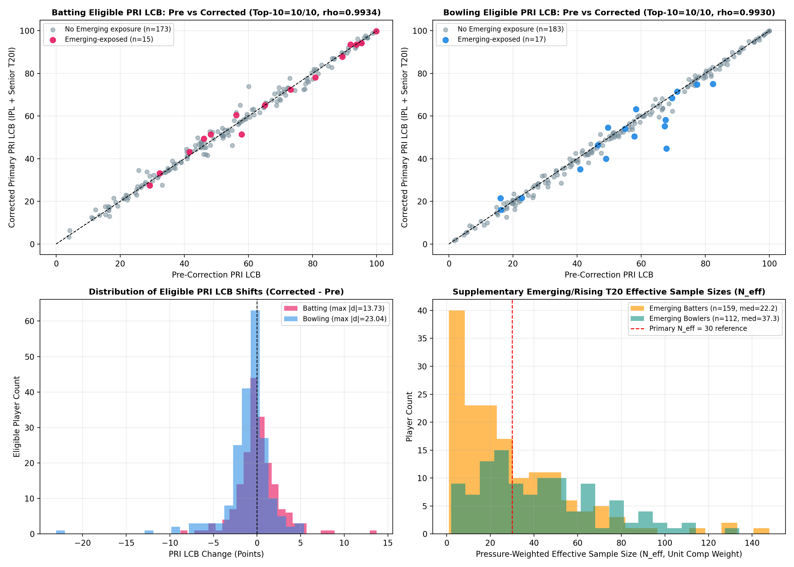

# Phase 3 Competition-Tier (`comp_tier`) Correction & Supplementary Emerging Evidence Report

**Status:** Phase 3 Correction Verified — **Awaiting User Review Before Phase 4 Rankings**  
**Governing Policy:** Strictly **anonymous** (zero player names, zero Top 10 lists). Preserves all approved Phase 1–3 pressure formulas, DLS exclusions (`143` ambiguous excluded, `701` suspected isolated for sensitivity), Super Over separation (`38` Super Overs), `GroupKFold` OOF structure, disjoint `PI < 60` / `PI >= 60` partitioning, EB settings, `45/25/15/15` batting & `55/15/15/15` bowling weights, `lcb_z = 0.50`, normal-CDF PRI, and `(Neff >= 30, IPL_balls >= 30)` eligibility. Preserves untouched pre-correction outputs in `data/processed/archive_pre_comp_tier/` and prior reports (`phase3_methodology_report.md`, Figures `13`–`21`).

---

## 1. Executive Summary & Root Cause Resolved

1. **Root Cause Fixed:** In the pre-correction Phase 3 pipeline (`src/performance.py`), competition weighting assigned `1.00` to `is_ipl == True` and `w_t20i = 0.50` to **all** `is_ipl == False` deliveries. Consequently, the **`6,985` total deliveries** (**`6,973` regular non-Super-Over** deliveries across `30` matches in `Mens T20 Emerging Teams Asia Cup 2024` and `Asia Cup Rising Stars 2025`) silently received the Senior T20I weight (`0.50`), inflated primary `t20i_balls` / `t20i_legal_balls` / `Neff` counts, entered OOF baseline fitting, and contributed to Empirical Bayes priors.
2. **Implemented `comp_tier` Architecture (`src/performance.py`):**
   - `IPL` (`comp_tier == "IPL"`): Primary competition weight **`1.00`** (`87,456` primary pool deliveries across `367` matches).
   - `Senior_T20I` (`comp_tier == "Senior_T20I"`): Supporting weight **`0.50`** (`105,688` primary pool deliveries across `470` matches).
   - `Emerging_Rising_T20` (`comp_tier == "Emerging_Rising_T20"`): **Excluded from primary baselines, EB priors, eligibility, and PRI** (`w_emerging = 0.00`, `exclude_emerging_from_primary = True`), and evaluated **separately as supplementary evidence** (`6,973` regular deliveries across `30` matches -> `159` batters / `112` bowlers) scored out-of-sample against the primary `IPL + Senior_T20I` contextual benchmark.
3. **Impact Summary vs Pre-Correction Baseline (`archive_pre_comp_tier/`):**
   - **Primary Top-10 Stability (`elig_primary` by `pri_score_lcb`):** **`10 / 10` Top-10 overlap** in both batting (`Top-15 = 15/15`, `Top-20 = 19/20`, Spearman $\rho = 0.9934$) and bowling (`Top-15 = 14/15`, `Top-20 = 19/20`, Spearman $\rho = 0.9930$).
   - **Clean Table Membership:** **`63` Emerging-only batters** (`887 -> 824`) and **`50` Emerging-only bowlers** (`645 -> 595`) are removed from the primary tables and isolated in supplementary Emerging files (`phase3_emerging_batting_supp.csv`, `phase3_emerging_bowling_supp.csv`).
   - **Primary Eligibility (`Neff >= 30` and `IPL >= 30`):** Batting shifted cleanly by **`-1` player (`189 -> 188`)** — canonical ID `7327` (`38` IPL balls) dropped from `t20i_balls = 1 -> 0` and `neff = 30.39 -> 29.66`. Bowling remained invariant at **`200 -> 200`** (`0` gained, `0` lost).
   - **Broad Non-IPL Eligibility (`Neff >= 30` only):** Batting dropped from `490 -> 456` (`34` IDs lost broad eligibility), and bowling dropped from `477 -> 444` (`33` IDs lost broad eligibility).
   - **Exact Code & Test Verification:** Re-ran the complete test suite (`tests/`): **`33 / 33` tests pass (`0` failures, `0` skipped)**, including new unit and integration regression tests for `comp_tier`, Emerging exclusion, and non-leaking supplementary evaluation.

---

## 2. Architecture & Code Mapping

| Symbol | File | Responsibility |
|---|---|---|
| `COMP_TIER_IPL`, `COMP_TIER_SENIOR_T20I`, `COMP_TIER_EMERGING`, `PRIMARY_COMP_TIERS` | [`src/performance.py`](../src/performance.py) | Canonical tier constants (`"IPL"`, `"Senior_T20I"`, `"Emerging_Rising_T20"`) |
| `PerformanceConfig` | [`src/performance.py`](../src/performance.py) | Adds `w_emerging: float = 0.00` and `exclude_emerging_from_primary: bool = True` while preserving `w_t20i = 0.50`, `45/25/15/15`, `55/15/15/15`, `lcb_z = 0.50`, `(30, 30)` |
| `classify_comp_tier` | [`src/performance.py`](../src/performance.py) | Deterministic tier classifier from `comp_name` (`IPL` vs `Emerging\|Rising` vs Senior T20I), with `is_ipl` fallback when `comp_name` is absent |
| `filter_dls_pool` | [`src/performance.py`](../src/performance.py) | Preserves Super Over / `143` ambiguous DLS / `701` suspected DLS gating, with optional `exclude_emerging` flag |
| `fit_predict_oof_baselines`, `_fit_predict_baseline_slice`, `_init_expected_columns` | [`src/performance.py`](../src/performance.py) | Excludes `Emerging_Rising_T20` (`exclude_emerging=True`) before 5-fold `GroupKFold(match_id)` fitting (`193,144` primary deliveries vs `200,117` pre-correction) |
| `_prepare_tier_weighted_pool`, `_aggregate_batting_core`, `_aggregate_bowling_core` | [`src/performance.py`](../src/performance.py) | Attaches `comp_tier`, filters Emerging rows in primary scoring, maps explicit tier weights `{IPL: 1.0, Senior_T20I: w_t20i, Emerging_Rising_T20: w_emerging}`, counts `t20i_balls` / `t20i_legal_balls` strictly from `comp_tier == Senior_T20I` |
| `evaluate_emerging_supplementary` | [`src/performance.py`](../src/performance.py) | Trains contextual baselines strictly on `PRIMARY_DLS_STATUSES & PRIMARY_COMP_TIERS` (`193,144` rows) and predicts out-of-sample onto `Emerging_Rising_T20` (`6,973` rows) for separate supplementary metrics |
| [`scripts/run_phase3_comp_tier_correction.py`](../scripts/run_phase3_comp_tier_correction.py) | Scripts | Reproducible Phase 3 re-run, pre/post comparison JSON, supplementary CSVs, and Figure 22 without overwriting archived baselines or Figures `13`–`21` |

---

## 3. Corrected Primary Pool (`193,144` Deliveries) & OOF Baseline Validation

After excluding Super Overs (`38` matches), ambiguous DLS (`143` rows), suspected DLS (`701` rows in primary), and `Emerging_Rising_T20` (`6,973` regular rows across `30` matches), the primary modeling pool consists of **`193,144` deliveries** across **`837` matches** (`185,702` batter balls faced; `184,884` legal bowling deliveries):

| `comp_tier` | Weight | Matches | Regular Deliveries | Batter Balls Faced | Legal Bowling Balls |
|---|---:|---:|---:|---:|---:|
| **`IPL`** | `1.00` | `367` | `87,456` | `83,914` | `83,538` |
| **`Senior_T20I`** | `0.50` | `470` | `105,688` | `101,788` | `101,346` |
| **Corrected Primary Total** | — | **`837`** | **`193,144`** | **`185,702`** | **`184,884`** |
| *Pre-Correction Pool (`IPL + Senior_T20I + Emerging`)* | *1.00 / 0.50* | *867* | *200,117* | *192,437* | *191,599* |

5-fold Match-Grouped OOF (`GroupKFold`) expectation conservation and predictive metrics remain tightly calibrated after removing `Emerging_Rising_T20`:

| Metric | Pre-Correction (`200,117` rows) | Corrected (`193,144` rows) |
|---|---:|---:|
| `bat_runs_actual_mean` / `bat_runs_exp_mean` | `1.3944 / 1.3948` | **`1.3996 / 1.4025`** (`+0.21%` rel. drift) |
| `bat_runs_rmse` / `bat_runs_mae` / `bat_runs_r2` | `1.7245 / 1.3053 / —` | **`1.7271 / 1.3115 / 0.0207`** |
| `bat_wkt_actual` / `bat_wkt_exp` | — | **`0.05456 / 0.05453`** (`-0.04%` rel. drift) |
| `bat_wkt_logloss` / `bat_wkt_brier` / `bat_wkt_auc` | `0.2088 / 0.0513 / —` | **`0.2087 / 0.0512 / 0.5897`** |
| `bowl_runs_total_actual` / `bowl_runs_total_exp` | — | **`269,570.0 / 270,234.6`** (`+0.25%` rel. drift) |
| `bowl_runs_legal_rmse` | `1.7238` | **`1.7265`** |
| `bowl_wkt_total_actual` / `bowl_wkt_total_exp` | — | **`9,848.0 / 9,841.2`** (`-0.07%` rel. drift) |
| `bowl_wkt_legal_logloss` / `bowl_wkt_legal_auc` | `0.2054 / —` | **`0.2053 / 0.5808`** |

---

## 4. Corrected Empirical Bayes Shrinkage Hyperparameters

Removing the `6,973` Emerging deliveries and Emerging-only players from EB prior estimation shifts all priors modestly while preserving the established structural hierarchy (and confirms bowling WAA prior $k_0 = 4,139.2$ remains high, validating the prior `55% RSAA / 15% WAA` weight balance):

| Role & Metric | Regime | Pre $\mu_0$ -> **New $\mu_0$** | Pre Within $\sigma$ -> **New $\sigma$** | Pre Between $\tau$ -> **New $\tau$** | Pre $k_0/M_0$ -> **New $k_0/M_0$** | Pre Fit $n$ -> **New Fit $n$** |
|---|---|---:|---:|---:|---:|---:|
| **Bat: `raa`** (`/100b`) | $PI < 60$ | `-1.6587` -> **`-2.0345`** | `170.85` -> **`171.15`** | `11.721` -> **`11.572`** | `212.5` -> **`218.7`** | `525` -> **`477`** |
| **Bat: `surv`** (`/100b`) | $PI < 60$ | `-0.2163` -> **`-0.2369`** | `22.25` -> **`22.25`** | `0.894` -> **`0.947`** | `619.7` -> **`552.4`** | `525` -> **`477`** |
| **Bat: `hp_raa`** (`/100b`) | $PI \ge 60$ | `-0.8801` -> **`-1.5424`** | `172.83` -> **`173.10`** | `17.387` -> **`18.091`** | `98.8` -> **`91.5`** | `411` -> **`386`** |
| **Bat: `cons`** | $PI < 60$ | `0.5096` -> **`0.5089`** | — | — | `50.0` -> **`50.0`** | `338` -> **`318`** |
| **Bat: `ev_all`** (`/100b`) | All reg | `-3.8150` -> **`-4.2655`** | `273.29` -> **`273.54`** | `14.918` -> **`15.097`** | `335.6` -> **`328.3`** | `629` -> **`571`** |
| **Bowl: `rsaa`** (`/over`) | $PI < 60$ | `-0.1491` -> **`-0.1295`** | `10.38` -> **`10.39`** | `0.713` -> **`0.699`** | `211.9` -> **`221.0`** | `542` -> **`502`** |
| **Bowl: `waa`** (`/4ov`) | $PI < 60$ | `+0.0030` -> **`+0.0082`** | `5.20` -> **`5.20`** | `0.092` -> **`0.081`** | `3,182.6` -> **`4,139.2`** | `542` -> **`502`** |
| **Bowl: `hp_impact`** (`/over`) | $PI \ge 60$ | `-0.2295` -> **`-0.2360`** | `16.84` -> **`16.83`** | `0.849` -> **`0.802`** | `393.4` -> **`440.2`** | `384` -> **`357`** |
| **Bowl: `cons`** | $PI < 60$ | `0.4838` -> **`0.4860`** | — | — | `50.0` -> **`50.0`** | `318` -> **`298`** |
| **Bowl: `ev_all`** (`/over`) | All reg | `-0.1967` -> **`-0.1701`** | `16.02` -> **`16.02`** | `0.771` -> **`0.714`** | `431.8` -> **`503.1`** | `561` -> **`518`** |

---

## 5. Pre-Correction vs Corrected Comparison (Rankings, PRI, Eligibility & Exposure)

### 5.1 Aggregate Rank Overlap, Correlation & PRI Delta Comparison

| Comparison Dimension | Batting (`elig_primary`: `189 -> 188`) | Bowling (`elig_primary`: `200 -> 200`) |
|---|---:|---:|
| Total players in table (`old -> new`) | `887 -> 824` (`-63` Emerging-only) | `645 -> 595` (`-50` Emerging-only) |
| Common primary-eligible players compared | `188` | `200` |
| **Top-10 overlap (`pri_score_lcb`)** | **`10 / 10`** | **`10 / 10`** |
| **Top-10 overlap (`pri_score_post`)** | `9 / 10` | `9 / 10` |
| Top-15 / Top-20 overlap (`pri_score_lcb`) | `15 / 15` \| `19 / 20` | `14 / 15` \| `19 / 20` |
| **Spearman $\rho$ (`elig_primary`, `pri_score_lcb`)** | **`0.9934`** | **`0.9930`** |
| Kendall $\tau$ (`elig_primary`, `pri_score_lcb`) | `0.9419` | `0.9438` |
| Spearman $\rho$ (`elig_primary`, `pri_score_post`) | `0.9927` | `0.9926` |
| Broad-pool Top-10 overlap (`elig_broad`, `pri_score_lcb`) | `10 / 10` ($\rho = 0.9782$) | `9 / 10` ($\rho = 0.9783$) |
| Eligible `\|ΔPRI_lcb\|`: Mean / Median / P95 / Max | `1.65` / `1.10` / `5.24` / `13.73` | `1.71` / `1.00` / `5.51` / `23.04` |
| Eligible signed `ΔPRI_lcb` range (`min` to `+max`) | `-8.79` to `+13.73` | `-23.04` to `+5.37` |
| Eligible `\|Δrank\|`: Mean / Max | `4.05` / `28` | `3.94` / `53` |

### 5.2 Eligibility Grid Comparison (`Old -> Corrected`)

| Threshold `(min_Neff, min_IPL_balls)` | Batting (`Old -> New`) | Bowling (`Old -> New`) | Membership Delta |
|---|---:|---:|---|
| `(15, 0)` | `629 -> 571` (`-58`) | `561 -> 518` (`-43`) | Pure Emerging/low-IPL players removed |
| `(30, 0)` (`elig_broad`) | `490 -> 456` (`-34`) | `477 -> 444` (`-33`) | `0` gained; `34` bat / `33` bowl non-IPL IDs dropped |
| **`(30, 30)` (`elig_primary`)** | **`189 -> 188` (`-1`)** | **`200 -> 200` (`0`)** | Bat lost ID **`7327`** (`38` IPL, `t20i: 1->0`, `neff: 30.39->29.66`); Bowl unchanged |
| `(50, 60)` | `161 -> 161` (`0`) | `174 -> 174` (`0`) | Invariant |
| `(75, 100)` | `138 -> 138` (`0`) | `149 -> 149` (`0`) | Invariant |

### 5.3 Player Exposure, $N_{\text{eff}}$ Shifts & Two-Step Cause Decomposition

Across all players present in both pre- and post-correction tables (`824` batters, `595` bowlers), **`96` batters** (`4,841` balls removed, max $N_{\text{eff}}$ drop `-143.97`) and **`62` bowlers** (`4,058` legal balls removed, max $N_{\text{eff}}$ drop `-128.97`) previously carried non-zero Emerging/Rising exposure that was silently weighted as `Senior_T20I`.

Inside the **`elig_primary`** pool:
- **Batting (`15` Emerging-exposed eligible batters):** mean `-52.7` balls removed (max `-122`), mean $N_{\text{eff}}$ drop `-15.58` (max `-42.23`), mean $|\Delta\text{PRI}| = 1.95$ (max `6.48`, max $|\Delta\text{rank}| = 16$). The remaining `173` non-Emerging eligible batters had mean $|\Delta\text{PRI}| = 1.63$ (max `13.73`).
- **Bowling (`17` Emerging-exposed eligible bowlers):** mean `-64.8` legal balls removed (max `-156`), mean $N_{\text{eff}}$ drop `-30.82` (max `-71.79`), mean $|\Delta\text{PRI}| = 5.63$ (max `23.04`, max $|\Delta\text{rank}| = 53$ — driven by canonical ID `32862`, whose primary `neff` dropped from `307.76 -> 235.97` and `PRI_lcb` dropped from `67.83 -> 44.78`). The remaining `183` non-Emerging eligible bowlers had mean $|\Delta\text{PRI}| = 1.35$ (max `7.46`).

**Why non-Emerging-exposed players also moved slightly (`mean ~1.4–1.6` PRI):** Decomposing the update into Step A (same pre-correction OOF baselines, removing Emerging solely at aggregation & EB fitting) vs Step B (re-fitting 5-fold `GroupKFold` OOF contextual baselines on `193,144` rows instead of `200,117`) separates the exact mechanisms:

| Stage | Bat Spearman ($\rho$) | Bat Mean / Max `\|ΔPRI\|` | Bowl Spearman ($\rho$) | Bowl Mean / Max `\|ΔPRI\|` | Dominant Driver |
|---|---:|---:|---:|---:|---|
| **Step A:** Same OOF, exclude Emerging from aggregation & EB | **`0.99902`** | `0.48` / `7.98` | **`0.99496`** | `0.69` / `23.92` | Pure Emerging exposure removal + EB `tau` update |
| **Step B:** 5-fold `GroupKFold` & OOF baseline refit (`200,117 -> 193,144`) | `0.99365` | `1.66` / `15.00` | `0.99747` | `1.25` / `7.04` | Fold reassignment + `OneHotEncoder(min_freq=30)` + discrete `cons_raw` step flips |
| **Total (`Old -> Corrected`)** | **`0.99344`** | `1.65` / `13.73` | **`0.99302`** | `1.71` / `23.04` | Combined effect (zero effect on `10/10` Top-10 membership) |

---

## 6. Supplementary `Emerging_Rising_T20` Evidence (`6,973` Deliveries / `30` Matches)

`Emerging_Rising_T20` is now stored in separate supplementary outputs (`data/processed/phase3_emerging_batting_supp.csv` and `data/processed/phase3_emerging_bowling_supp.csv`) with unit competition weighting inside Emerging matches and expected baselines scored out-of-sample from the clean `IPL + Senior_T20I` model (so Emerging deliveries never influence primary baselines, EB priors, or PRI rankings):

| Supplementary Dimension | Batting (`phase3_emerging_batting_supp.csv`) | Bowling (`phase3_emerging_bowling_supp.csv`) |
|---|---:|---:|
| Total players evaluated | **`159`** | **`112`** |
| Players with zero primary (`IPL + Senior_T20I`) data (`Emerging-only`) | `63` | `50` |
| Overlap with primary `IPL_exposed` (`ipl > 0`) | `20` | `20` |
| Overlap with `elig_primary` (`Neff >= 30, IPL >= 30`) | `15` | `17` |
| Ball / legal-ball volume (Median / Max) | `30.0` / `293` | `54.0` / `192` |
| Effective sample size `emerging_neff` (Median / Max) | `22.25` / `147.93` | `37.35` / `134.06` |
| `emerging_raa_raw` / `emerging_rsaa_raw` (P25 / P50 / P75) | `-56.58 / -26.78 / +1.05` (`/100b`) | `-1.07 / +0.49 / +2.06` (`/over`) |
| `emerging_ev_net*_raw` (P25 / P50 / P75) | `-75.25 / -17.03 / +26.09` (`/100b`) | `-2.38 / -0.15 / +2.82` (`/over`) |
| Spearman vs Primary `PRI_lcb` (among `elig_primary` overlap) | `-0.096` (`n=15`, tiny sample noise) | `+0.022` (`n=17`, tiny sample noise) |

*Interpretation for Phase 4 Scouting:* The negligible correlation (`rho ~ -0.10` bat / `+0.02` bowl) on `15–17` small-sample overlapping players empirically confirms that Emerging/Rising T20 should remain **qualitative/supplementary context only** — never pooled numerically at `0.50` alongside IPL and Senior T20I. Meanwhile, the supplementary tables preserve valuable scouting signals for those `63` Emerging-only batters and `50` Emerging-only bowlers (including canonical IDs `36153` and `8729` resolved distinctly during Phase 1/2).

---

## 7. Sensitivity Checks on Corrected Primary Pool (`IPL + Senior_T20I`)

1. **Include Suspected DLS (`+701` balls -> `193,845` rows):**
   - **Batting:** Spearman $\rho = \mathbf{0.9923}$, **`10 / 10` Top-10 overlap**.
   - **Bowling:** Spearman $\rho = \mathbf{0.9971}$, **`9 / 10` Top-10 overlap**.
2. **Competition Weighting Sensitivity (`w_t20i` vs approved `0.50`):**

| Discipline | `w_t20i = 0.25` | `w_t20i = 0.50` (Approved) | `w_t20i = 0.75` | `w_t20i = 1.00` |
|---|---|---|---|---|
| **Batting** | `n=187`, `Top-10=8/10`, $\rho=0.9853$ | **`n=188`, `Top-10=10/10`, $\rho=1.0000$** | `n=188`, `Top-10=9/10`, $\rho=0.9923$ | `n=189`, `Top-10=8/10`, $\rho=0.9790$ |
| **Bowling** | `n=199`, `Top-10=8/10`, $\rho=0.9853$ | **`n=200`, `Top-10=10/10`, $\rho=1.0000$** | `n=200`, `Top-10=9/10`, $\rho=0.9928$ | `n=200`, `Top-10=9/10`, $\rho=0.9824$ |

---

## 8. Corrected Anonymous Primary Score Distributions

### 8.1 Corrected Batting Pool — Primary Eligible (`N = 188`)

| Metric | Mean | Std | Min | P10 | P25 | Median | P75 | P90 | P95 | Max |
|---|---:|---:|---:|---:|---:|---:|---:|---:|---:|---:|
| `raa_raw` (`PI<60`) | `-4.32` | `24.61` | `-79.70` | `-34.89` | `-15.00` | `-2.48` | `10.19` | `18.93` | `29.23` | `76.28` |
| `raa_post` (`PI<60`) | `-0.39` | `8.89` | `-18.68` | `-9.27` | `-6.45` | `-2.22` | `4.02` | `11.41` | `14.41` | `41.95` |
| `raa_lcb` (`PI<60`) | `-4.42` | `9.26` | `-22.42` | `-13.64` | `-10.81` | `-6.74` | `0.77` | `7.94` | `11.91` | `38.12` |
| `surv_post` (`PI<60`) | `-0.18` | `0.51` | `-1.78` | `-0.77` | `-0.49` | `-0.21` | `0.06` | `0.52` | `0.78` | `1.10` |
| `cons_post` (`PI<60`) | `0.51` | `0.03` | `0.44` | `0.47` | `0.49` | `0.51` | `0.53` | `0.54` | `0.56` | `0.63` |
| `hp_raa_post` (`PI>=60`) | `0.31` | `10.92` | `-37.80` | `-11.62` | `-5.82` | `-1.18` | `6.75` | `14.63` | `20.52` | `29.15` |
| `ev_all_lcb` (All reg) | `-6.89` | `10.47` | `-39.56` | `-18.86` | `-13.46` | `-7.77` | `-0.93` | `8.04` | `11.36` | `22.53` |
| `pri_score_post` | `53.53` | `24.24` | `2.89` | `21.37` | `35.88` | `50.43` | `70.85` | `88.89` | `94.96` | `99.86` |
| **`pri_score_lcb`** | **`55.19`** | **`24.90`** | **`3.26`** | **`21.74`** | **`34.93`** | **`52.42`** | **`73.48`** | **`92.23`** | **`96.40`** | **`99.91`** |

### 8.2 Corrected Bowling Pool — Primary Eligible (`N = 200`)

| Metric | Mean | Std | Min | P10 | P25 | Median | P75 | P90 | P95 | Max |
|---|---:|---:|---:|---:|---:|---:|---:|---:|---:|---:|
| `rsaa_raw` (`PI<60`) | `-0.32` | `1.28` | `-4.90` | `-1.87` | `-0.88` | `-0.13` | `0.44` | `0.86` | `1.12` | `3.75` |
| `rsaa_post` (`PI<60`) | `-0.12` | `0.52` | `-1.64` | `-0.74` | `-0.44` | `-0.13` | `0.21` | `0.50` | `0.79` | `1.92` |
| `rsaa_lcb` (`PI<60`) | `-0.35` | `0.54` | `-1.88` | `-1.02` | `-0.69` | `-0.38` | `-0.03` | `0.29` | `0.57` | `1.76` |
| `waa_raw` (`PI<60`) | `0.03` | `0.45` | `-1.37` | `-0.41` | `-0.24` | `0.00` | `0.21` | `0.49` | `0.71` | `1.96` |
| `waa_post` (`PI<60`) | `0.01` | `0.02` | `-0.05` | `-0.02` | `-0.00` | `0.01` | `0.02` | `0.04` | `0.04` | `0.10` |
| `cons_post` (`PI<60`) | `0.48` | `0.03` | `0.39` | `0.44` | `0.46` | `0.48` | `0.50` | `0.52` | `0.54` | `0.63` |
| `hp_impact_post` (`PI>=60`) | `-0.22` | `0.34` | `-1.33` | `-0.63` | `-0.41` | `-0.24` | `-0.06` | `0.21` | `0.40` | `0.66` |
| `ev_all_lcb` (All reg) | `-0.42` | `0.45` | `-1.55` | `-0.92` | `-0.74` | `-0.46` | `-0.17` | `0.20` | `0.43` | `1.03` |
| `pri_score_post` | `49.69` | `26.12` | `1.34` | `15.94` | `26.57` | `49.62` | `71.37` | `85.47` | `93.26` | `99.94` |
| **`pri_score_lcb`** | **`51.02`** | **`26.40`** | **`1.61`** | **`17.32`** | **`28.48`** | **`50.43`** | **`74.81`** | **`88.01`** | **`95.02`** | **`99.96`** |

---

## 9. Artifacts Produced & Phase 4 Readiness

- **Updated Primary Outputs (`IPL + Senior_T20I`):**
  - `data/processed/phase3_batting_prelim.csv` (`824` rows, `188` primary-eligible)
  - `data/processed/phase3_bowling_prelim.csv` (`595` rows, `200` primary-eligible)
- **Preserved Pre-Correction Snapshots:**
  - `data/processed/archive_pre_comp_tier/phase3_batting_prelim.csv` (`887` rows, `189` primary-eligible)
  - `data/processed/archive_pre_comp_tier/phase3_bowling_prelim.csv` (`645` rows, `200` primary-eligible)
- **Separate Supplementary Emerging Tables:**
  - `data/processed/phase3_emerging_batting_supp.csv` (`159` rows)
  - `data/processed/phase3_emerging_bowling_supp.csv` (`112` rows)
- **Anonymous Diagnostics & Figure:**
  - `data/processed/phase3_comp_tier_comparison.json`
  - `reports/figures/22_phase3_comp_tier_correction.png`
- **Automated Tests:** `.venv\Scripts\python.exe -m unittest discover -s tests -v` -> **`33` tests passed (`OK`, `0` failures, `0` skipped)**.
- **Strict Scope Confirmation:** **Zero player names or ranked Top 10 lists have been produced.** Phase 3 methodology and outputs are now cleanly partitioned by `comp_tier` and ready for Phase 4 scouting/ranking once approved.
