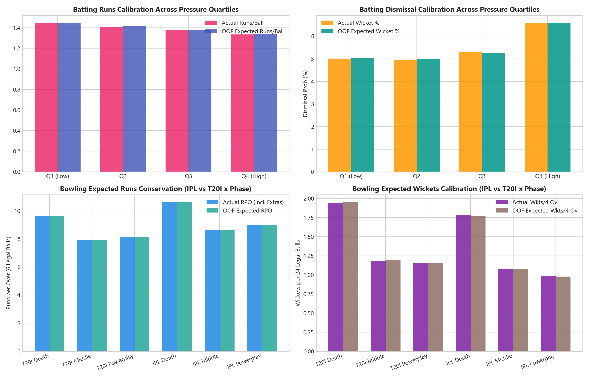
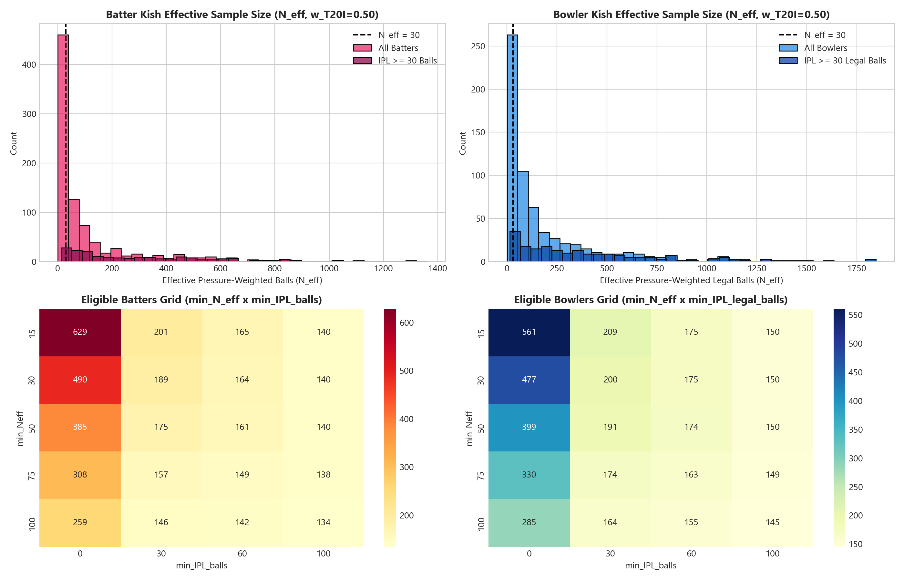
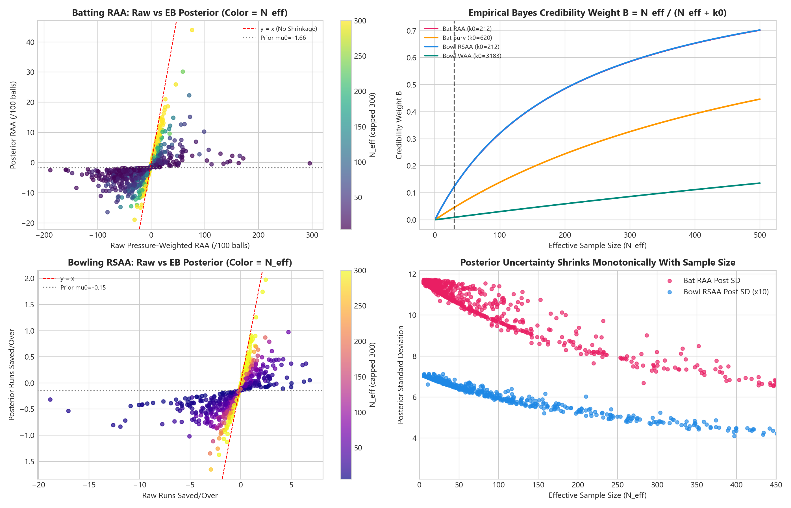
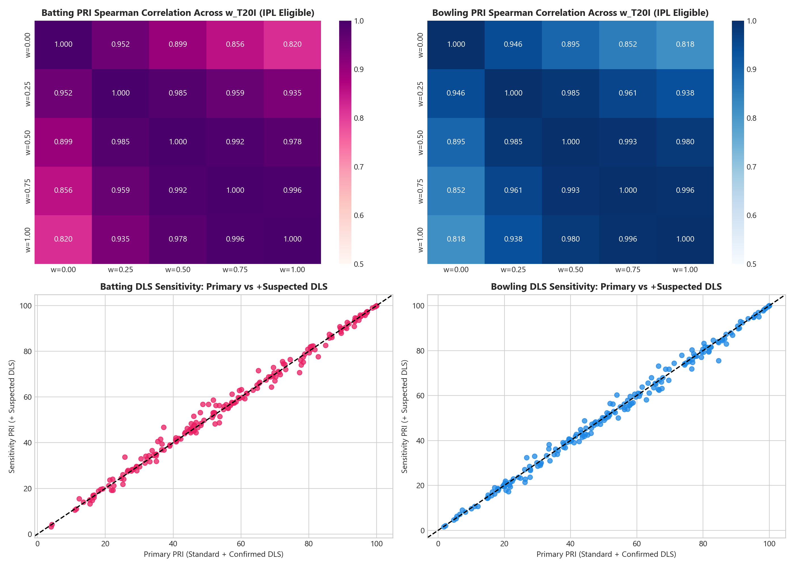
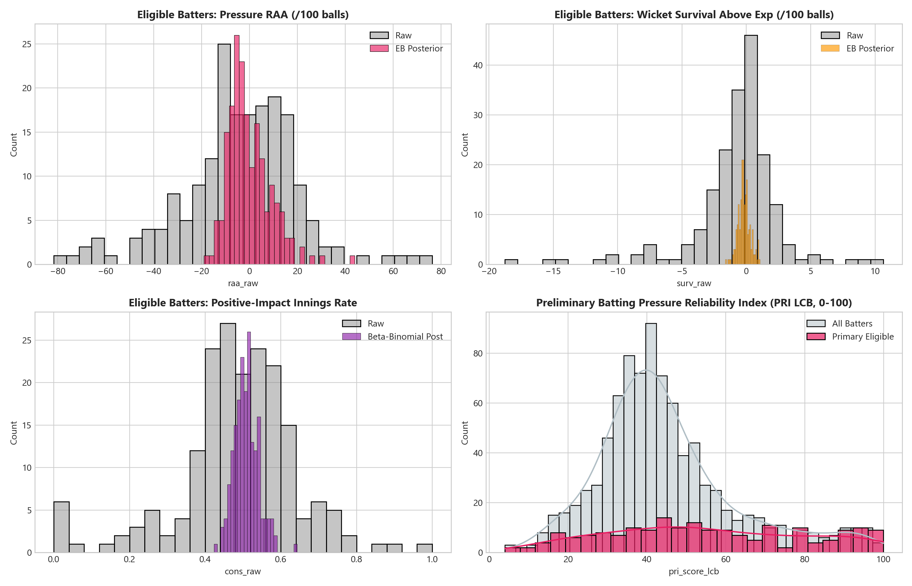
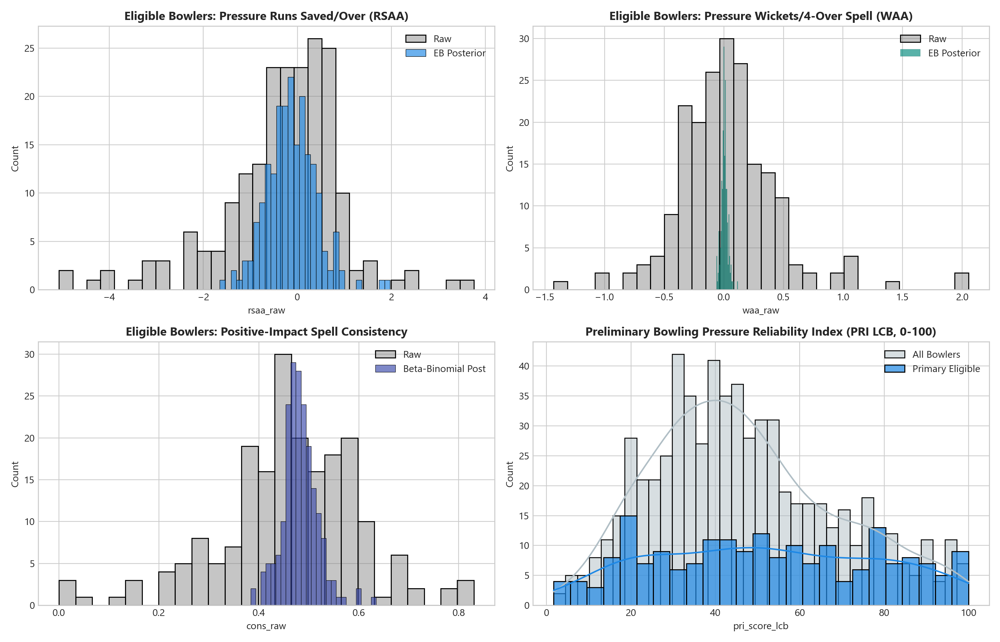
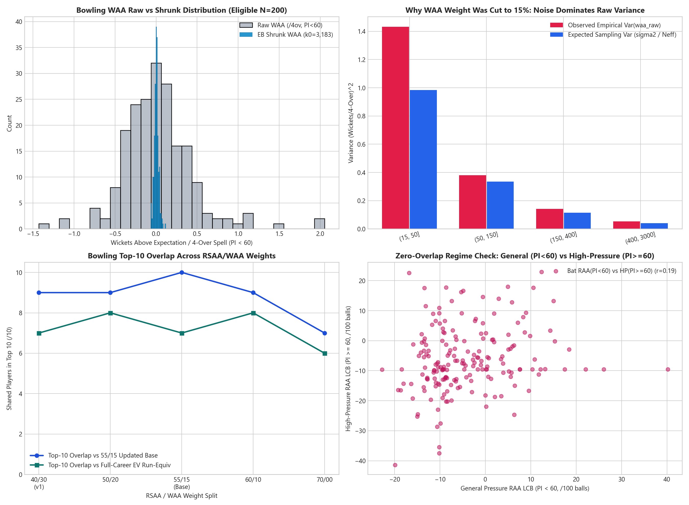
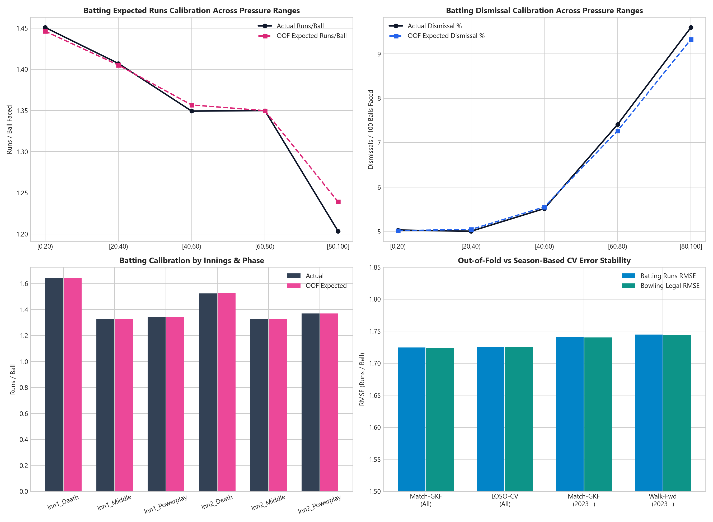
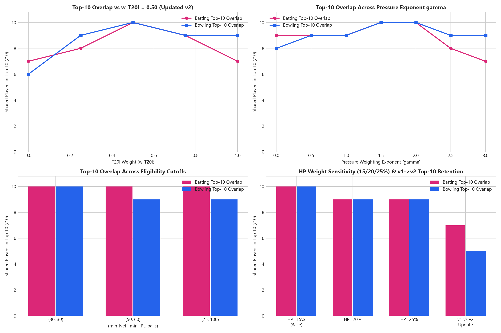

# Phase 3 Methodology, Validation & Preliminary Performance Report (Updated v2)

**Project:** Rajasthan Royals SupeRR Selector 2.0 (IPL 2027 Auction Decision Support)  
**Stage:** Phase 3 — Player Performance Under Pressure (Pre-Ranking Methodology Review & Approval)  
**Scope Policy:** Strictly **zero player names or ranked Top 10 lists** are generated in this report. Final Top 10 generation awaits user approval to begin Phase 4.

> **Approved Updates Implemented (v1 -> v2):**
> 1. **Competition Weighting:** `IPL = 1.00`, `T20I = 0.50` (`w_t20i = 0.50`), retaining Top-10 overlap and sensitivity diagnostics.
> 2. **Eligibility:** Primary `neff >= 30` and `ipl_balls >= 30` (batting balls faced) / `ipl_legal_balls >= 30` (bowling legal balls), retaining `(50, 60)` and `(75, 100)` comparisons.
> 3. **Bowling PRI Weights Updated:** **`55% RSAA / 15% WAA / 15% Consistency / 15% High-Pressure`** (replacing `40/30/15/15`), with full-career EV run-equivalent (`ev_all_lcb`) preserved alongside `PI < 60` (`ev_net_lcb` / `ev_net_po_lcb`).
> 4. **Zero-Overlap Delivery Partition (`PI < 60` vs `PI >= 60`):** General performance pillars (`RAA`, `Surv`; `RSAA`, `WAA`) and match consistency (`Cons`) are computed exclusively on **`PI < 60`**, while the dedicated high-pressure pillar (`HP-RAA`, `HP-Impact`) is computed exclusively on **`PI >= 60`**. No delivery contributes to both groups. Primary HP weight is `15%`, with `20%` and `25%` tested as sensitivity alternatives.
> 5. **Validated Core Retained:** `pressure_gamma = 2.0`, `lcb_z = 0.50`, Beta-Binomial `M0` cap `= 50.0`, 5-fold Match `GroupKFold` (+ LOSO / Walk-Forward season validation), canonical identities intact (`39444 -> 8638`, `36153 != 8729`), and strict DLS partitioning.

---

## 1. DLS & Super Over Filtering Policy

Phase 3 preserves the exact DLS confidence partitions established in Phase 2 via `filter_dls_pool` (`src/performance.py#L74-L92`):

| Pool / Category | `dls_status` / Condition | Deliveries | Treatment in Phase 3 |
|---|---|---:|---|
| **Regular Standard** | `standard` (`innings <= 2`) | 199,320 | **Primary evaluation & OOF baseline training** |
| **Confirmed DLS** | `dls_pre_innings_confirmed` | 797 | **Primary evaluation & OOF baseline training** |
| **Primary Pool Total** | `PRIMARY_DLS_STATUSES` | **200,117** | `192,437` batter balls faced; `191,604` legal bowling balls |
| **Suspected DLS (Break / Post)** | `dls_innings_break_suspected` (`487`) + `dls_post_stoppage_suspected` (`214`) | 701 | **Excluded from primary; added in sensitivity run (`200,818`)** — never used to fit OOF baseline models |
| **Ambiguous DLS** | `dls_pre_stoppage_suspected` (`dls_ambiguous == True`) | 143 | **Always excluded** from baselines, evaluations, and opportunity counts |
| **Super Overs** | `is_super_over == True` (`innings >= 3`) | 38 | **Always excluded** from regular rankings and regular opportunity counts |
| **Raw Dataset Total** | All processed rows (`867` matches) | **200,999** | Verified conserved across all partitions |

---

## 2. Mathematical Methodology & Formula-to-Code Mapping

All Phase 3 calculations live in `src/performance.py` under `PerformanceConfig` (`L47-L71`).

### 2.1 Delivery Weights & Zero-Overlap Partitioning
For regular-pool delivery $i$ faced or bowled by canonical player $j$:

$$w_i = w_{\text{comp}}(i) \cdot \left(\frac{PI_i}{100}\right)^{\gamma}, \qquad w_{\text{comp}}(i) = \begin{cases} 1.00 & \text{if IPL} \\ 0.50 & \text{if T20I} \end{cases}, \qquad \gamma = 2.0$$

To eliminate double-counting between general reliability and high-pressure execution (`disjoint_hp_split = True`), regular deliveries are partitioned strictly into two disjoint sets:
- **General / Moderate-Pressure Set ($\mathcal{G}_j$):** Deliveries with $PI_i < 60.0$ (drives `RAA`, `Surv`, `RSAA`, `WAA`, and `Cons`, with Kish effective sample size $N_{\text{eff, gen}, j}$).
- **High-Pressure Set ($\mathcal{H}_j$):** Deliveries with $PI_i \ge 60.0$ (drives `HP-RAA` and `HP-Impact`, with Kish effective sample size $N_{\text{eff, hp}, j}$).
- **Career Total Effective Size ($N_{\text{eff}, j}$) & Unified Run-Equivalent (`ev_all_lcb`):** Computed over $\mathcal{G}_j \cup \mathcal{H}_j$ for eligibility screening (`neff >= 30`) and single-currency full-career sensitivity benchmarking.

$$\text{Kish } N_{\text{eff}}(S) = \frac{\left(\sum_{i \in S} w_i\right)^2}{\sum_{i \in S} w_i^2} \quad (\text{bowling uses legal-ball weights } wl_i = w_i \cdot \mathbb{I}_{\text{legal}, i})$$

### 2.2 Batting Residuals & Auction-Relevance Pillars (`is_batter_ball_faced`)
1. **General Pressure Runs Above Expectation ($\text{RAA}_j$, `/100 balls`, $PI_i < 60$):**
   $$d_{\text{RAA}, i} = 100 \cdot (r_i - \hat{E}[r_i \mid X_i]), \qquad \widehat{\text{RAA}}_{\text{raw}, j} = \frac{\sum_{i \in \mathcal{G}_j} w_i \, d_{\text{RAA}, i}}{\sum_{i \in \mathcal{G}_j} w_i}$$
2. **General Pressure Wicket Survival ($\text{Surv}_j$, `/100 balls`, $PI_i < 60$):**
   $$d_{\text{Surv}, i} = 100 \cdot (\hat{P}(\text{out}_i \mid X_i) - \text{out}_i), \qquad \widehat{\text{Surv}}_{\text{raw}, j} = \frac{\sum_{i \in \mathcal{G}_j} w_i \, d_{\text{Surv}, i}}{\sum_{i \in \mathcal{G}_j} w_i}$$
3. **General-Innings Consistency ($\text{Cons}_j \in [0, 1]$, $PI_i < 60$):**
   Using only deliveries $i \in \mathcal{G}_{j,m}$ per match-innings $m$, compute innings EV net impact $\bar{d}_{\text{net}, j, m} = \frac{\sum w_i (d_{\text{RAA}, i} + 7.5\,d_{\text{Surv}, i})}{\sum w_i}$, binary success $I_{j, m} = \mathbb{I}(\bar{d}_{\text{net}, j, m} > 0)$, and capped appearance leverage:
   $$u_{j, m} = w_{\text{comp}}(m) \cdot \left(\frac{\max_{i \in \mathcal{G}_{j,m}} PI_i}{100}\right)^{\gamma/2} \cdot \min\!\left(1, \frac{\sqrt{\sum_{i \in \mathcal{G}_{j,m}} w_i}}{1.5}\right), \qquad M_{\text{eff}, j} = \frac{(\sum_m u_{j, m})^2}{\sum_m u_{j, m}^2}$$
4. **High-Pressure Specialist Scoring ($\text{HP-RAA}_j$, `/100 balls`, $PI_i \ge 60$):**
   $$\widehat{\text{HP-RAA}}_{\text{raw}, j} = \frac{\sum_{i \in \mathcal{H}_j} w_i \, d_{\text{RAA}, i}}{\sum_{i \in \mathcal{H}_j} w_i}$$

### 2.3 Bowling Residuals & Auction-Relevance Pillars (All Deliveries Bowled)
Evaluated across all regular deliveries bowled so wides and no-balls directly penalize conceded runs while legal-equivalent expectations are assigned only to legal deliveries (`is_legal_ball == True`):

1. **General Pressure Runs Saved Above Expectation ($\text{RSAA}_j$, `/over`, $PI_i < 60$):**
   $$d_{\text{RSAA}, i} = 6 \cdot \big(\mathbb{I}_{\text{legal}, i} \cdot \hat{E}_{\text{total}}[\text{conc}_i \mid X_i] - \text{conc}_i\big), \qquad \widehat{\text{RSAA}}_{\text{raw}, j} = \frac{\sum_{i \in \mathcal{G}_j} w_i \, d_{\text{RSAA}, i}}{\sum_{i \in \mathcal{G}_j} wl_i}$$
2. **General Pressure Wickets Above Expectation ($\text{WAA}_j$, `/4-over spell`, $PI_i < 60$):**
   $$d_{\text{WAA}, i} = 24 \cdot \big(\text{bowl\_wkt}_i - \mathbb{I}_{\text{legal}, i} \cdot \hat{P}_{\text{total}}(\text{bowl\_wkt}_i \mid X_i)\big), \qquad \widehat{\text{WAA}}_{\text{raw}, j} = \frac{\sum_{i \in \mathcal{G}_j} w_i \, d_{\text{WAA}, i}}{\sum_{i \in \mathcal{G}_j} wl_i}$$
   *Why reduced from 30% to 15%:* Empirical Bayes variance decomposition (Section 8.3) proved single-ball Bernoulli dismissal noise accounts for nearly all observed `WAA` dispersion (`k0 = 3,182.6` in `PI < 60`; `4,602.0` full pool). Giving `WAA` `30%` z-score weight magnified tiny shrunk noise residuals. Reducing `WAA` to **15%** and raising **`RSAA` to 55%** preserves strike-bowling credit while aligning closely with run-equivalent cricket value.
3. **General-Spell Consistency ($\text{Cons}_j$, $PI_i < 60$):** Positive-impact spell rate on $\bar{d}_{\text{net, po}} = d_{\text{RSAA}} + \frac{7.5}{4} d_{\text{WAA}}$ with ramp cap $2.0$ legal-weight units.
4. **High-Pressure Spell Impact ($\text{HP-Impact}_j$, `/over`, $PI_i \ge 60$):** EV-net run value saved per over restricted strictly to $PI_i \ge 60.0$.

### 2.4 Composite Pressure Reliability Index (PRI, $0$–$100$)
For each pillar $k$, Empirical Bayes Lower Credible Bounds ($\text{LCB}_{k, j} = \mu_{\text{post}, k, j} - 0.50\,\sigma_{\text{post}, k, j}$) are $z$-scored on the broad reference pool (`elig_broad`: `neff >= 30`), combined via approved weights, and mapped via $\Phi(\cdot)$:
- **Batting Composite:** $0.45\,z_{\text{RAA}} + 0.25\,z_{\text{Surv}} + 0.15\,z_{\text{Cons}} + 0.15\,z_{\text{HP-RAA}}$
- **Bowling Composite:** **`0.55\,z_{\text{RSAA}} + 0.15\,z_{\text{WAA}} + 0.15\,z_{\text{Cons}} + 0.15\,z_{\text{HP-Impact}}`**
- **Run-Equivalent Benchmarks Preserved:** Full-career EV (`ev_all_lcb`, $V_{\text{wkt}} = 7.5$) and `PI < 60` EV (`ev_net_lcb` / `ev_net_po_lcb`).

### 2.5 Exact Formula-to-Code Mapping

| Mathematical Component | Function / Symbol | Source Location |
|---|---|---|
| Approved v2 config (`55/15/15/15`, `disjoint_hp_split=True`) | `PerformanceConfig` | `src/performance.py#L47-L71` |
| DLS & Super Over eligibility gate | `filter_dls_pool` | `src/performance.py#L74-L92` |
| Context encoding & Ridge/Logit preprocessor | `_prepare_context_columns`, `_make_context_preprocessor` | `src/performance.py#L95-L131` |
| Zero-leakage Match GroupKFold baselines + extras scaling | `fit_predict_oof_baselines` | `src/performance.py#L134-L286` |
| Marginal MLE Normal-Normal shrinkage (`k0`, `LCB`) | `fit_empirical_bayes_normal`, `apply_normal_shrinkage` | `src/performance.py#L289-L373` |
| Precision-weighted Beta-Binomial shrinkage (`M0 <= 50`) | `apply_beta_binomial_shrinkage` | `src/performance.py#L376-L429` |
| Batting disjoint partition, shrinkage & PRI (`0-100`) | `evaluate_batting_pressure` | `src/performance.py#L441-L634` |
| Bowling disjoint partition, shrinkage & PRI (`0-100`) | `evaluate_bowling_pressure` | `src/performance.py#L637-L829` |

---

## 3. Expected Performance Baselines (Zero-Leakage 5-Fold Match `GroupKFold`)

| Baseline Evaluation Metric (Primary Pool, `n = 200,117`) | Actual | OOF Expected | Fit / Calibration Detail |
|---|---:|---:|---|
| Batting runs / ball faced (`n = 192,437`) | `1.39436` | `1.39476` | `RMSE = 1.72454`, `MAE = 1.30534`, `R^2 = 0.02101` |
| Batting striker-out prob / ball faced | `0.05460` | `0.05464` | `LogLoss = 0.20877`, `Brier = 0.05125`, `AUC = 0.59030` |
| Bowling total runs conceded (`n = 200,117` all balls) | `278,295.0` | `278,492.9` | Legal `RMSE = 1.72384` (extras conserved within `0.071%`) |
| Bowling wickets credited (`n = 200,117` all balls) | `10,210.0` | `10,207.7` | Legal `LogLoss = 0.20539`, `AUC = 0.58031` |

---

## 4. Sample-Size & Eligibility Analysis (`887` Batters / `645` Bowlers)

Primary eligibility requires **`neff >= 30.0`** **and `ipl_balls >= 30`** (`ipl_legal_balls >= 30` for bowling), yielding **`189` eligible batters** and **`200` eligible bowlers**:

| `min_Neff` | `min_IPL_balls` | Eligible Batters | Eligible Bowlers | Pool Role |
|---:|---:|---:|---:|---|
| 15 | 0 | 629 | 561 | Full-career EB fitting support (`ev_all`) |
| **30** | **0** | **490** | **477** | **Broad z-score reference pool (`elig_broad`)** |
| **30** | **30** | **189** | **200** | **Approved Primary Eligibility Pool** |
| 50 | 60 | 161 | 174 | Stricter sensitivity floor |
| 75 | 100 | 138 | 149 | Strict veteran-only floor |

---

## 5. Updated Empirical Bayes Shrinkage Hyperparameters

| Role & Metric | Regime | $\mu_0$ | Within SD ($\sigma$) | Between SD ($\tau$) | Implied $k_0$ or $M_0$ | Fit Pool ($n$) |
|---|---|---:|---:|---:|---:|---:|
| **Bat: `raa`** (`/100b`) | $PI < 60$ | `-1.6587` | `170.85` | `11.721` | **$k_0 = 212.5$** | 525 |
| **Bat: `surv`** (`/100b`) | $PI < 60$ | `-0.2163` | `22.25` | `0.894` | **$k_0 = 619.7$** | 525 |
| **Bat: `hp_raa`** (`/100b`) | $PI \ge 60$ | `-0.8801` | `172.83` | `17.387` | **$k_0 = 98.8$** | 411 |
| **Bat: `cons`** | $PI < 60$ | `0.5096` | — | — | **$M_0 = 50.0$** (`unclipped=239.6`) | 338 |
| **Bat: `ev_all`** (`/100b`) | All reg | `-3.8150` | `273.29` | `14.918` | **$k_0 = 335.6$** | 629 |
| **Bowl: `rsaa`** (`/over`) | $PI < 60$ | `-0.1491` | `10.38` | `0.713` | **$k_0 = 211.9$** | 542 |
| **Bowl: `waa`** (`/4ov`) | $PI < 60$ | `+0.0030` | `5.20` | `0.092` | **$k_0 = 3,182.6$** | 542 |
| **Bowl: `hp_impact`** (`/over`) | $PI \ge 60$ | `-0.2295` | `16.84` | `0.849` | **$k_0 = 393.4$** | 384 |
| **Bowl: `cons`** | $PI < 60$ | `0.4838` | — | — | **$M_0 = 50.0$** (`unclipped=121.4`) | 318 |
| **Bowl: `ev_all`** (`/over`) | All reg | `-0.1967` | `16.02` | `0.771` | **$k_0 = 431.8$** | 561 |

---

## 6. Automated Test Verification & Core Sensitivity Overview

- **Automated Test Suite:** `Ran 27 tests in 39.983s — OK` (`0` failures, `0` skipped, including `test_disjoint_hp_partition_and_bowling_weights`).

| Perturbation Variant | Bat Spearman ($\rho$) | Bat MAE | Bowl Spearman ($\rho$) | Bowl MAE |
|---|---:|---:|---:|---:|
| **Include Suspected DLS (`+701` balls)** | **`0.9955`** | `1.4252` | **`0.9968`** | `1.3965` |
| **HP Weight `= 20%` (Prop. Gen `80%`)** | **`0.9960`** | `1.5377` | **`0.9970`** | `1.4013` |
| **HP Weight `= 25%` (Prop. Gen `75%`)** | **`0.9855`** | `3.0789` | **`0.9886`** | `2.8267` |
| Pressure Gamma `= 1.5` (Moderate) | `0.9943` | `2.0045` | `0.9961` | `1.4937` |
| Pressure Gamma `= 1.0` (Linear) | `0.9792` | `4.0962` | `0.9863` | `3.0826` |
| Posterior Mean Only (`lcb_z = 0.00`) | `0.9858` | `3.2875` | `0.9914` | `2.8234` |
| Strict LCB Penalty (`lcb_z = 1.00`) | `0.9920` | `2.7954` | `0.9933` | `2.5363` |
| Scoring / Economy-Heavy Tilt (`55/15` bat, `60/10` bowl) | `0.9797` | `3.6389` | `0.9966` | `1.6192` |
| Surv / Wicket-Heavy Tilt (`35/35` bat, `45/25` bowl) | `0.9747` | `3.8527` | `0.9870` | `3.4318` |
| Previous v1 Model (`Overlap + Bowl 40/30/15/15`) | `0.8455` | `10.4863` | `0.7975` | `12.3497` |
| vs Full-Career EV Run-Equiv (`ev_all_lcb`) | `0.8435` | — | `0.8845` | — |
| vs `PI < 60` EV Run-Equiv (`ev_net_lcb` / `ev_net_po_lcb`) | `0.9521` | — | `0.9573` | — |

- **Suspected DLS Top-10 Stability on v2:** `9/10` Top-10 overlap (`max |Δrank|=2`) in batting (`189 -> 190` eligible), `10/10` (`max |Δrank|=2`) in bowling (`200 -> 200` eligible).

---

## 7. Final Preliminary Player Performance Distributions (Anonymous Only)

### 7.1 Updated Batting Pool — Primary Eligible (`N = 189`)

| Metric | Mean | Std | Min | P10 | P25 | Median | P75 | P90 | P95 | Max |
|---|---:|---:|---:|---:|---:|---:|---:|---:|---:|---:|
| `raa_raw` (`PI<60`) | `-4.13` | `24.63` | `-81.66` | `-34.20` | `-14.60` | `-2.76` | `11.34` | `20.48` | `26.60` | `76.26` |
| `raa_post` (`PI<60`) | `-0.11` | `9.03` | `-18.97` | `-9.22` | `-6.10` | `-2.18` | `4.77` | `12.23` | `14.86` | `43.97` |
| `raa_lcb` (`PI<60`) | `-4.17` | `9.40` | `-22.73` | `-13.53` | `-10.44` | `-6.61` | `0.73` | `8.40` | `12.29` | `40.19` |
| `surv_post` (`PI<60`) | `-0.17` | `0.47` | `-1.62` | `-0.71` | `-0.44` | `-0.21` | `0.06` | `0.48` | `0.70` | `1.07` |
| `cons_post` (`PI<60`) | `0.51` | `0.03` | `0.42` | `0.47` | `0.49` | `0.51` | `0.53` | `0.55` | `0.56` | `0.64` |
| `hp_raa_post` (`PI>=60`) | `0.77` | `10.36` | `-34.96` | `-10.85` | `-5.16` | `-0.68` | `6.70` | `14.23` | `19.57` | `27.65` |
| `ev_all_lcb` (All reg) | `-6.57` | `10.28` | `-37.58` | `-18.43` | `-12.79` | `-7.45` | `-0.50` | `8.01` | `11.45` | `23.86` |
| `pri_score_post` | `53.20` | `24.42` | `3.58` | `21.44` | `36.54` | `50.55` | `70.92` | `89.01` | `95.14` | `99.89` |
| **`pri_score_lcb`** | **`55.00`** | **`25.06`** | **`3.99`** | **`22.08`** | **`35.06`** | **`52.33`** | **`74.47`** | **`92.10`** | **`95.76`** | **`99.94`** |

### 7.2 Updated Bowling Pool — Primary Eligible (`N = 200`)

| Metric | Mean | Std | Min | P10 | P25 | Median | P75 | P90 | P95 | Max |
|---|---:|---:|---:|---:|---:|---:|---:|---:|---:|---:|
| `rsaa_raw` (`PI<60`) | `-0.33` | `1.29` | `-5.07` | `-1.97` | `-0.87` | `-0.15` | `0.43` | `0.82` | `1.11` | `3.76` |
| `rsaa_post` (`PI<60`) | `-0.13` | `0.53` | `-1.66` | `-0.77` | `-0.45` | `-0.15` | `0.21` | `0.45` | `0.79` | `1.97` |
| `rsaa_lcb` (`PI<60`) | `-0.36` | `0.56` | `-1.90` | `-1.06` | `-0.71` | `-0.38` | `-0.03` | `0.23` | `0.59` | `1.82` |
| `waa_raw` (`PI<60`) | `0.03` | `0.44` | `-1.43` | `-0.40` | `-0.23` | `-0.00` | `0.21` | `0.49` | `0.70` | `2.05` |
| `waa_post` (`PI<60`) | `0.00` | `0.03` | `-0.06` | `-0.03` | `-0.01` | `0.00` | `0.02` | `0.04` | `0.05` | `0.12` |
| `cons_post` (`PI<60`) | `0.48` | `0.04` | `0.38` | `0.44` | `0.46` | `0.48` | `0.50` | `0.52` | `0.54` | `0.63` |
| `hp_impact_post` (`PI>=60`) | `-0.21` | `0.37` | `-1.37` | `-0.64` | `-0.42` | `-0.22` | `-0.03` | `0.27` | `0.48` | `0.78` |
| `ev_all_lcb` (All reg) | `-0.44` | `0.49` | `-1.70` | `-1.04` | `-0.80` | `-0.47` | `-0.17` | `0.20` | `0.47` | `1.10` |
| `pri_score_post` | `50.48` | `26.17` | `1.40` | `15.97` | `28.34` | `50.21` | `70.25` | `84.84` | `93.35` | `99.96` |
| **`pri_score_lcb`** | **`51.97`** | **`26.46`** | **`1.69`** | **`18.04`** | **`29.62`** | **`51.03`** | **`75.75`** | **`88.41`** | **`95.31`** | **`99.98`** |

---

## 8. Updated Validation & Deep Audit Results (v2)

### 8.1 Competition Weighting Top-10 Overlap (`vs w_t20i = 0.50`)

| Discipline | `w_t20i` | Eligible | Top-10 (`/10`) | Jaccard | Top-15 / Top-20 | Spearman ($\rho$) | Max `\|Δrank\|` | Worst Rank |
|---|---:|---:|---:|---:|---:|---:|---:|---:|
| **Batting** | `0.00` (IPL only) | 178 | **7** | `0.5385` | 12 / 15 | `0.9209` | `26.0` | `#31` |
| **Batting** | `0.25` | 188 | **8** | `0.6667` | 13 / 17 | `0.9848` | `11.0` | `#16` |
| **Batting** | **`0.50` (Approved)** | **189** | **10** | **`1.0000`** | **15 / 20** | **`1.0000`** | **`0.0`** | `#10` |
| **Batting** | `0.75` | 189 | **9** | `0.8182` | 13 / 20 | `0.9918` | `4.0` | `#11` |
| **Batting** | `1.00` | 190 | **7** | `0.5385` | 12 / 20 | `0.9780` | `9.0` | `#18` |
| **Bowling** | `0.00` (IPL only) | 190 | **6** | `0.4286` | 11 / 15 | `0.9056` | `110.0` | `#120` |
| **Bowling** | `0.25` | 199 | **9** | `0.8182` | 14 / 19 | `0.9850` | `2.0` | `#12` |
| **Bowling** | **`0.50` (Approved)** | **200** | **10** | **`1.0000`** | **15 / 20** | **`1.0000`** | **`0.0`** | `#10` |
| **Bowling** | `0.75` | 200 | **9** | `0.8182` | 14 / 20 | `0.9927` | `1.0` | `#11` |
| **Bowling** | `1.00` | 200 | **9** | `0.8182` | 14 / 19 | `0.9803` | `2.0` | `#11` |

### 8.2 Eligibility Ball-Count Audit & Cutoffs (`(30, 30)` vs `(50, 60)` vs `(75, 100)`)
- Exact delivery verification: **`max_diff = 0`** between `ipl_balls` and `is_batter_ball_faced & is_ipl` (`233` batters with IPL wides excluded); **`max_diff = 0`** between `ipl_legal_balls` and `is_legal_ball & is_ipl` (`214` bowlers with IPL non-legal balls excluded).

| Discipline | Threshold | Eligible | Top-10 (`/10`) | Top-15 / Top-20 | Spearman ($\rho$) | Dropped from Base Top-10 | Max `\|Δrank\|` |
|---|---|---:|---:|---:|---:|---:|---:|
| **Batting** | **`(30, 30)`** | **189** | **10** | **15 / 20** | **`1.0000`** | `0` | `0.0` |
| **Batting** | `(50, 60)` | 161 | **10** | 15 / 20 | `0.9999` | `0` | `1.0` |
| **Batting** | `(75, 100)` | 138 | **10** | 15 / 20 | `0.9997` | `0` | `1.0` |
| **Bowling** | **`(30, 30)`** | **200** | **10** | **15 / 20** | **`1.0000`** | `0` | `0.0` |
| **Bowling** | `(50, 60)` | 174 | **9** | 14 / 19 | `0.9999` | **`1`** | `0.0` |
| **Bowling** | `(75, 100)` | 149 | **9** | 14 / 18 | `0.9997` | **`1`** | `0.0` |

### 8.3 Bowling WAA Shrinkage Deep Dive & Updated `55/15` vs Alternative Weights

| RSAA / WAA Weight Split (`Cons=15%, HP=15%`) | Spearman vs `55/15` Base | Top-10 vs Base (`/10`) | Spearman vs `EV_All` | Top-10 vs `EV_All` (`/10`) | Spearman vs `EV_Gen` | Top-10 vs `EV_Gen` (`/10`) |
|---|---:|---:|---:|---:|---:|---:|
| `40 RSAA / 30 WAA` (v1 Weights) | `0.9677` | `9` | `0.8911` | `7` | `0.8763` | `7` |
| `50 RSAA / 20 WAA` | `0.9968` | `9` | `0.8928` | `8` | `0.9402` | `7` |
| **`55 RSAA / 15 WAA` (Approved Base)** | **`1.0000`** | **`10`** | **`0.8845`** | **`7`** | **`0.9573`** | **`8`** |
| `60 RSAA / 10 WAA` | `0.9966` | `9` | `0.8721` | `8` | `0.9694` | `7` |
| `70 RSAA / 00 WAA` | `0.9760` | `7` | `0.8362` | `6` | `0.9811` | `8` |

### 8.4 Expanded Baseline Calibration & Season-Based CV (`2022–2026`)

| Validation Scheme | Bat Balls | Bat Act / Exp Runs | Bat MAE / RMSE | Bat LogLoss / Brier | Bowl Legal RMSE / LogLoss |
|---|---:|---:|---:|---:|---:|
| Match `GroupKFold` (5-fold, All) | 192,437 | `1.3944 / 1.3948` | `1.3053 / 1.7245` | `0.2088 / 0.0513` | `1.7238 / 0.2054` |
| **Leave-One-Season-Out CV (All)** | 192,437 | `1.3944 / 1.4064` | `1.3118 / 1.7257` | `0.2089 / 0.0513` | `1.7250 / 0.2055` |
| Match `GroupKFold` (`2023+` subset) | 151,740 | `1.4134 / 1.4132` | `1.3243 / 1.7409` | `0.2102 / 0.0517` | `1.7402 / 0.2071` |
| **Walk-Forward Out-of-Time (`2023+`)** | 151,740 | `1.4134 / 1.4385` | `1.3386 / 1.7448` | `0.2105 / 0.0517` | `1.7438 / 0.2073` |

Replacing Match `GroupKFold` with LOSO baselines yields **`10/10` Top-10 agreement** in both batting (`Sp = 0.9933`) and bowling (`Sp = 0.9950`).

### 8.5 Pressure Exponent ($\gamma$), High-Pressure Weight (`15% / 20% / 25%`) & `v1 -> v2` Comparison

| Discipline | `hp_weight` | Top-10 (`/10`) | Jaccard | Top-15 / Top-20 | Spearman ($\rho$) | Max `\|Δrank\|` | Spearman vs `EV_All` |
|---|---:|---:|---:|---:|---:|---:|---:|
| **Batting** | **`0.15` (Primary)** | **10** | `1.0000` | 15 / 20 | **`1.0000`** | `0.0` | `0.8435` |
| **Batting** | `0.20` | **9** | `0.8182` | 14 / 19 | **`0.9960`** | `2.0` | `0.8655` |
| **Batting** | `0.25` | **9** | `0.8182` | 12 / 18 | **`0.9855`** | `3.0` | `0.8822` |
| **Bowling** | **`0.15` (Primary)** | **10** | `1.0000` | 15 / 20 | **`1.0000`** | `0.0` | `0.8845` |
| **Bowling** | `0.20` | **9** | `0.8182` | 14 / 19 | **`0.9970`** | `3.0` | `0.9117` |
| **Bowling** | `0.25` | **9** | `0.8182` | 13 / 18 | **`0.9886`** | `4.0` | `0.9346` |

- **Zero-Overlap Verification & `v1 -> v2` Impact:** `max|sw_gen + sw_hp - sw| = 5.68e-14` (bat) and `max|swl_gen + swl_hp - swl| = 5.68e-14` (bowl); `Corr(gen, HP) = 0.1895` (bat) / `0.3106` (bowl). Eligibility counts are unchanged (`189`, `200`). Full `v1 -> v2` produces `7/10` Top-10 overlap (`Sp = 0.8455`, `max |Δrank| = 19`) in batting and `5/10` (`Sp = 0.7975`, `max |Δrank| = 21`) in bowling, driven primarily by eliminating `PI >= 60` double-counting inside general and consistency pillars (`8/10`, `Sp = 0.9645` from the `40/30 -> 55/15` weight update alone; `5/10`, `Sp = 0.8214` from disjoint splitting alone).

### 8.6 Standardization Variance Shares & `n_matches` Fairness
- **Standardized Variance Shares:** Batting = `55.5% RAA / 15.8% Surv / 17.8% Cons / 11.0% HP`; Bowling = **`66.6% RSAA / 6.7% WAA / 17.5% Cons / 9.3% HP`**.
- **Volume Fairness:** Under `lcb_z = 0.50` and `M0 = 50.0`, `pri_score_lcb` vs `n_matches` Spearman is `0.5744` (bat) / `0.4187` (bowl) while matching `lcb_z = 0.00` at **`9/10` (bat, `Sp = 0.9858`)** and **`10/10` (bowl, `Sp = 0.9914`)** Top-10 overlap.

---

## 9. Readiness for Phase 4 (Awaiting User Approval)

All requested Phase 3 updates, mathematical audits, anonymous distribution checks, and automated tests (`27/27 OK`) are complete. **Zero player names or ranked Top 10 lists have been generated.** Upon approval, Phase 4 will compute final IPL 2027 Top 10 Batting and Bowling rankings, role profiles, and Super Over add-on notes.
