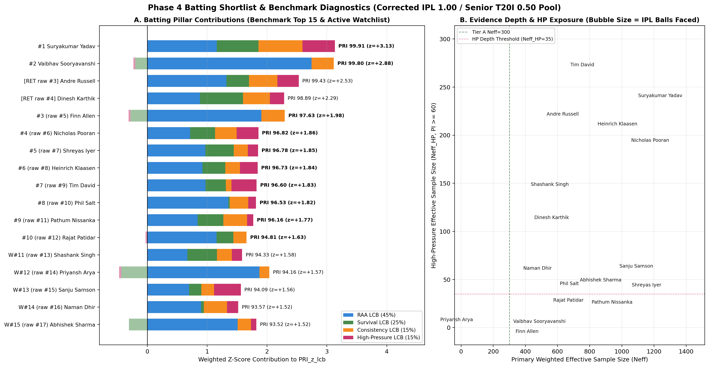
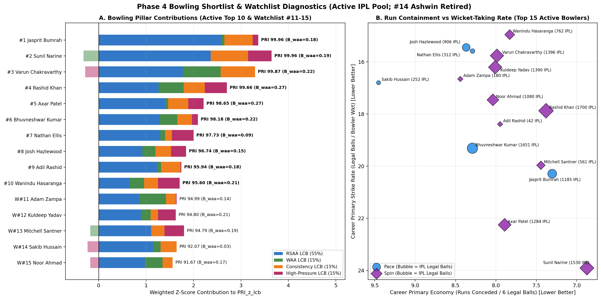
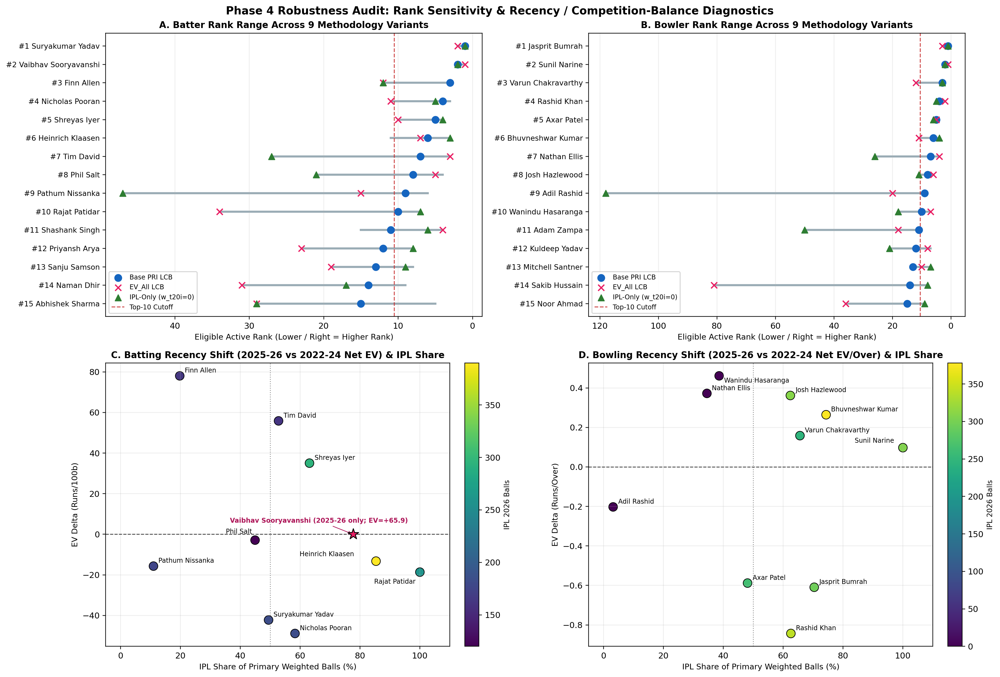
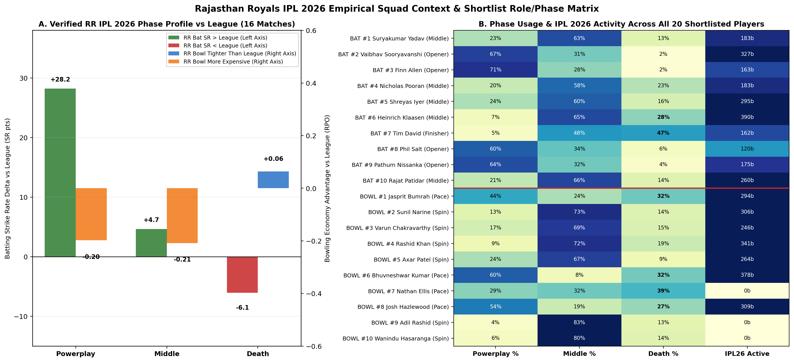
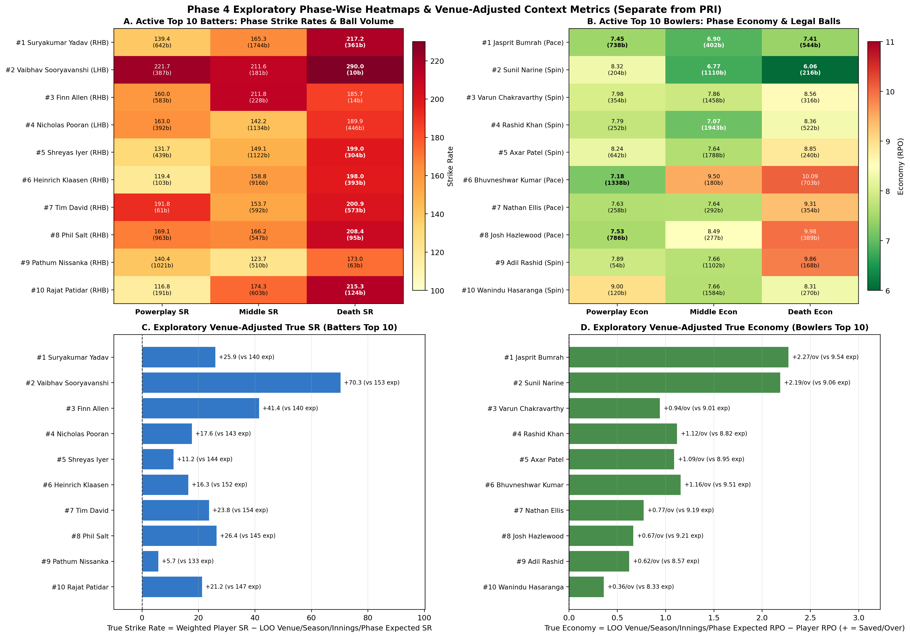
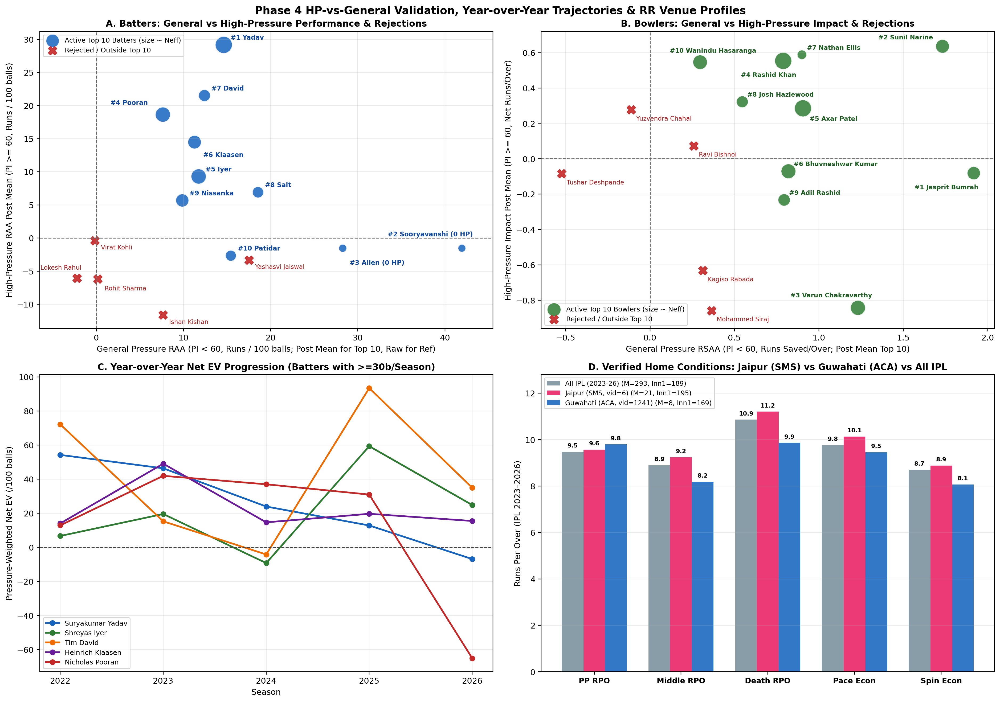

# Phase 4 Scouting Dossier: Player Evaluation Under Pressure, Context & Rajasthan Royals Squad Fit

**Date:** 2026-11-12 | **Governance:** Approved Phase 3 Competition-Tier Corrected Methodology (`IPL = 1.00`, `Senior_T20I = 0.50`, `Emerging_Rising_T20 = 0.00` supplementary)

---

## 1. Executive Summary & Preserved Methodology

Phase 4 evaluates and profiles the highest-performing batters and bowlers from the approved Phase 3 primary pool (`193,144` regular primary/confirmed-DLS deliveries across `837` matches; excluding `143` ambiguous DLS deliveries, Super Overs, and `44` Emerging/Rising matches) into operational war-room shortlists for Rajasthan Royals ahead of the IPL 2027 cycle. All Phase 1–3 code (`src/match_state.py`, `src/pressure.py`, `src/performance.py`) and `data/processed/phase3_*.csv` outputs are preserved untouched.

- **Approved Ranking Basis (`PRI_lcb`):** Composite `pri_z_lcb` (`lcb_z = 0.50`), transformed via standard normal CDF $\Phi(z) \times 100$ strictly as a monotonic comparative scale—**PRI is not a probability** (empirical distributions are right-shifted: eligible primary median PRI = `52.42` for batters `[n=188]`, `50.43` for bowlers `[n=200]`; Q75 = `73.48` / `74.81`; Q90 = `92.23` / `88.01`).
- **Component Weights & Non-Overlapping Partition:**
  - **Batting (`45/25/15/15`):** General RAA (`PI < 60`, 45%), General Survival (`PI < 60`, 25%), General Consistency (`PI < 60`, 15%), High-Pressure RAA (`PI >= 60`, 15%).
  - **Bowling (`55/15/15/15`):** General RSAA (`PI < 60`, 55%), General WAA (`PI < 60`, 15%, heavy empirical Bayes shrinkage $k_0 = 4,139.2$), General Consistency (`PI < 60`, 15%), High-Pressure Net Impact (`PI >= 60`, 15%).
- **Primary Eligibility Gate:** $N_{\text{eff}} \ge 30$ and $\text{IPL balls} \ge 30$ (actual batter balls faced / legal balls bowled), filtering broad-eligible cohorts (`456` batters / `444` bowlers) down to **`188` primary batters** and **`200` primary bowlers**.
- **Strict Separation of Exploratory Context:** Leave-one-player-out (LOO) venue-season-innings-phase baselines (`True SR`, `True Econ`), opposition-tier splits, Jaipur/Guwahati home-ground adjustments, YoY progressions, and public IPL 2026 contract/injury intel are reported **strictly separate** from `PRI_lcb` and never alter rankings.
- **Data Hygiene Fix Applied in Phase 4:** Deterministic deduplication of [`playing_eleven.csv`](file:///C:/Users/sushruth/.gemini/antigravity/scratch/rr_superr_selector/data/raw/playing_eleven.csv) across `35` duplicate `(match_id, team_id, player_id)` keys (`75` redundant rows removed; earliest `batting_order` + logical OR across `is_played`/`is_wk`/`is_captain`/`is_impact`/`is_impact_off`), zero-filtering sentinel `bowl_speed <= 0`, and excluding `T20I_Assoc` confusion via explicit opposition quality buckets.

---

## 2. Unrestricted Statistical Top 10 vs. Operational IPL-Active Top 10

Because three statistical leaders retired from IPL competition between 2024 and 2025 (**Dinesh Karthik** `[ID 143, retired post-IPL 2024]`, **Andre Russell** `[ID 1318, retired pre-IPL 2026]`, and **Ravichandran Ashwin** `[ID 305, retired Aug 2025]`), we publish **both** the unrestricted primary statistical Top 10 (no exclusions) and the operational IPL-active Top 10 + Watchlist (#11–#15):

- **Batting Unrestricted Statistical Top 10 (`raw_pri_lcb_rank` 1–10):**
  1. Suryakumar Yadav (`99.91`, 100.0 pct) | 2. Vaibhav Sooryavanshi (`99.80`, 99.5 pct) | 3. **Andre Russell [IPL Retired]** (`99.43`, 98.9 pct) | 4. **Dinesh Karthik [IPL Retired]** (`98.89`, 98.4 pct) | 5. Finn Allen (`97.63`, 97.9 pct) | 6. Nicholas Pooran (`96.82`, 97.3 pct) | 7. Shreyas Iyer (`96.78`, 96.8 pct) | 8. Heinrich Klaasen (`96.73`, 96.3 pct) | 9. Tim David (`96.60`, 95.7 pct) | 10. Phil Salt (`96.53`, 95.2 pct).
- **Batting Operational IPL-Active Top 10:** #1–#2 same, then #3 Finn Allen, #4 Nicholas Pooran, #5 Shreyas Iyer, #6 Heinrich Klaasen, #7 Tim David, #8 Phil Salt, **#9 Pathum Nissanka** (`raw #11`, `96.16`, 94.7 pct), **#10 Rajat Patidar** (`raw #12`, `94.81`, 94.1 pct). Watchlist (#11–#15 active): #11 Shashank Singh (`94.33`), #12 Priyansh Arya (`94.16`), #13 Sanju Samson (`94.09`), #14 Naman Dhir (`93.57`), #15 Abhishek Sharma (`93.52`).
- **Bowling Unrestricted Top 10 == Operational IPL-Active Top 10:** Because Ravichandran Ashwin sits at `raw #14` (`94.56`, 93.5 pct), the Top 10 list is **identical** under both lenses: #1 Jasprit Bumrah (`99.96`), #2 Sunil Narine (`99.96`), #3 Varun Chakravarthy (`99.87`), #4 Rashid Khan (`99.66`), #5 Axar Patel (`98.65`), #6 Bhuvneshwar Kumar (`98.18`), #7 Nathan Ellis (`97.73`), #8 Josh Hazlewood (`96.74`), #9 Adil Rashid (`95.94`), #10 Wanindu Hasaranga (`95.60`). Watchlist (#11–#15 active): #11 Adam Zampa (`94.99`), #12 Kuldeep Yadav (`94.80`), #13 Mitchell Santner (`94.79`), #14 Sakib Hussain (`raw #15`, `92.07`), #15 Noor Ahmad (`raw #16`, `91.67`).

---

## 3. Master Batting Evaluation Tables (`#1–#10 Active`, `Retired Benchmarks`, `Watchlist #11–#15`)

Objective evidence tiers: **`Strong evidence`** ($N_{\text{eff}} \ge 400$, $\text{IPL} \ge 400$, $N_{\text{eff,HP}} \ge 40$), **`Moderate evidence`** (passes $N_{\text{eff}} \ge 150$, $\text{IPL} \ge 100$ or T20I-heavy/low-HP flag), **`Limited evidence`** (zero recent IPL, $N_{\text{eff}} < 150$, or single-season `NEFF_HP < 15` / zero HP).

### 3A. Quantitative Scores, Percentiles, Exposure & Pillar Contributions (`c_*` sums to `pri_z_lcb`)

| Active Rk (Raw) | Player | PRI LCB / Post | Elig Pct (Prim/Broad) | Matches / Balls (IPL + T20I) | Neff / Neff_HP (Opps) | `c_raa` | `c_surv` | `c_cons` | `c_hp` | Confidence Tier & Key Flags |
|---|---|---:|---:|---:|---:|---:|---:|---:|---:|---|
| **#1** (#1) | Suryakumar Yadav | **99.91** / 99.83 | 100.0 / 100.0 | 138M / 1,358 + 1,389b | 1,284.8 / 231.1 (16) | +1.161 | +0.696 | +0.736 | +0.539 | **Strong evidence** (`CLEAN`) |
| **#2** (#2) | Vaibhav Sooryavanshi | **99.80** / 99.86 | 99.5 / 99.8 | 31M / 449 + 129b | 280.3 / **0.0*** (0) | +2.744 | -0.200 | +0.371 | -0.033 | **Moderate evidence** (`NEFF_HP_LT_15`, `ZERO_HP`, `RR_2026`) |
| *RET* (#3) | Andre Russell [RET] | *99.43* / 99.36 | 98.9 / 99.6 | 57M / 570 + 163b | 488.3 / 219.2 (23) | +1.320 | +0.379 | +0.472 | +0.358 | **Moderate evidence** (Retired pre-2026) |
| *RET* (#4) | Dinesh Karthik [RET] | *98.89* / 98.74 | 98.4 / 99.3 | 61M / 458 + 181b | 411.3 / 111.6 (18) | +0.881 | +0.719 | +0.448 | +0.237 | **Limited evidence** (Retired post-2024; 0 recent) |
| **#3** (#5) | Finn Allen | **97.63** / 97.83 | 97.9 / 99.1 | 51M / 163 + 662b | 294.9 / **0.0*** (0) | +1.906 | -0.281 | +0.390 | -0.033 | **Moderate evidence** (`NEFF_HP_LT_15`, `ZERO_HP`, `T20I_HEAVY`) |
| **#4** (#6) | Nicholas Pooran | **96.82** / 94.92 | 97.3 / 98.9 | 115M / 1,149 + 823b | 1,014.5 / 191.9 (20) | +0.716 | +0.414 | +0.364 | +0.362 | **Strong evidence** (`CLEAN`; T20I ret. 2025) |
| **#5** (#7) | Shreyas Iyer | **96.78** / 95.38 | 96.8 / 98.7 | 98M / 1,177 + 688b | 1,017.9 / 41.1 (7) | +0.970 | +0.475 | +0.235 | +0.170 | **Strong evidence** (`CLEAN`) |
| **#6** (#8) | Heinrich Klaasen | **96.73** / 95.23 | 96.3 / 98.5 | 71M / 1,205 + 207b | 805.1 / 209.0 (17) | +0.923 | +0.378 | +0.246 | +0.296 | **Strong evidence** (`CLEAN`) |
| **#7** (#9) | Tim David | **96.60** / 95.30 | 95.7 / 98.2 | 98M / 647 + 579b | 636.2 / 270.5 (31) | +0.973 | +0.340 | +0.094 | +0.419 | **Strong evidence** (`CLEAN`) |
| **#8** (#10) | Phil Salt | **96.53** / 95.82 | 95.2 / 98.0 | 81M / 721 + 884b | 569.8 / 41.2 (3) | +1.352 | +0.025 | +0.308 | +0.131 | **Strong evidence** (`CLEAN`) |
| **#9** (#11) | Pathum Nissanka | **96.16** / 94.98 | 94.7 / 97.8 | 74M / 175 + 1,419b | 767.5 / 27.5 (4) | +0.841 | +0.430 | +0.395 | +0.104 | **Moderate evidence** (`T20I_HEAVY`, `LOW_HP_DEPTH`) |
| **#10** (#12) | Rajat Patidar | **94.81** / 93.86 | 94.1 / 97.6 | 48M / 918 + 0b | 529.4 / 32.6 (6) | +1.157 | +0.279 | +0.221 | -0.030 | **Moderate evidence** (`IPL_ONLY`, `NEG_HP_OFFSET`) |
| *#11* (#13) | Shashank Singh | *94.33* / 93.68 | 93.6 / 97.4 | 42M / 560 + 0b | 389.8 / 146.1 (16) | +0.670 | +0.492 | +0.250 | +0.171 | **Moderate evidence** (`IPL_ONLY`; Secondary 2-Way) |
| *#12* (#14) | Priyansh Arya | *94.16* / 94.80 | 93.1 / 97.1 | 31M / 471 + 0b | 218.6 / **0.0*** (0) | +1.872 | -0.437 | +0.167 | -0.033 | **Limited evidence** (`NEFF_HP_LT_15`, `ZERO_HP`, `IPL_ONLY`) |
| *#13* (#15) | Sanju Samson | *94.09* / 91.28 | 92.6 / 96.9 | 123M / 1,385 + 846b | 941.2 / 61.2 (5) | +0.700 | +0.202 | +0.212 | +0.447 | **Strong evidence** (`CLEAN`) |
| *#14* (#16) | Naman Dhir | *93.57* / 93.08 | 92.0 / 96.7 | 42M / 433 + 82b | 343.5 / 59.0 (10) | +0.898 | +0.047 | +0.385 | +0.188 | **Moderate evidence** (`CLEAN`; Secondary 2-Way) |
| *#15* (#17) | Abhishek Sharma | *93.52* / 91.13 | 91.5 / 96.5 | 130M / 1,216 + 1,035b | 805.0 / 40.6 (6) | +1.509 | -0.307 | +0.223 | +0.091 | **Strong evidence** (`CLEAN`; Secondary 2-Way) |

*\*`Neff_HP < 15` Flag: Vaibhav Sooryavanshi (`Neff_HP = 0.0`), Finn Allen (`0.0`), and Priyansh Arya (`0.0`) face exclusively general-pressure deliveries (`PI < 60`); their high-pressure pillar shrinks toward the `~ -1.54` prior (`c_hp = -0.033`), so their high ranking rests cleanly on extraordinary `PI < 60` scoring (`RAA_post +41.95 / +28.28 / +28.04`) and requires external verification under chase/death stress.*

### 3B. Phase Roles, Impact Usage, Two-Way Class & Exploratory Context-Adjusted Profiles (Separate from PRI)

| Player | Hand / Order (22-24→25-26) / WK / Imp IN-OUT | PP / Mid / Dth Share & SR | HP60 Balls (Mid / Dth HP EV) | Exploratory LOO True SR / True Bnd% | Opp Split True SR (`IPL` / `Top-8 T20I` / `Other T20I`) | vs Est IPL Bowlers (`>=100b`) True SR |
|---|---|---|---|---:|---:|---:|
| **Suryakumar Yadav** | RHB / #4→#4 / 0 WK / 5-8 | 23% (139.4) / 63% (165.3) / 13% (217.2) | 250b (+71.6 / -33.7) | **+25.9** / +6.25% | +23.0 / +29.2 / +61.6 | **+28.7** (2,067b) |
| **Vaibhav Sooryavanshi** | LHB / –→#2 / 0 WK / 6-1 | 67% (221.7) / 31% (211.6) / 2% (290.0) | 0b (– / –) | **+70.3** / +14.49% | +73.3 / +19.0 (52b) / +69.8 (77b) | **+65.4** (451b) |
| **Finn Allen** | RHB / #1→#2 / 0 WK / 6-4 | 71% (160.0) / 28% (211.8) / 2% (185.7) | 0b (– / –) | **+41.4** / +8.38% | +54.1 (163b) / +41.4 / +10.1 | **+27.8** (377b) |
| **Nicholas Pooran** | LHB / #4→#3 / **58 WK** / 0-1 | 20% (163.0) / 58% (142.2) / 23% (189.9) | 206b (+41.1 / +21.5) | **+17.6** / +3.98% | +19.0 / +13.1 / +19.6 | **+14.4** (1,633b) |
| **Shreyas Iyer** | RHB / #3→#4 / 0 WK / 0-1 | 24% (131.7) / 60% (149.1) / 16% (199.0) | 47b (+29.4 / -29.6) | **+11.2** / +1.27% | +13.3 / +7.2 / -10.9 | **+5.0** (1,384b) |
| **Heinrich Klaasen** | RHB / #5→#4 / **47 WK** / 0-0 | 7% (119.4) / 65% (158.8) / 28% (198.0) | 226b (+48.7 / -15.3) | **+16.3** / +1.79% | +16.9 / +8.4 / +23.9 (23b) | **+14.0** (1,301b) |
| **Tim David** | RHB / #6→#5 / 0 WK / 3-2 | 5% (191.8) / 48% (153.7) / 47% (200.9) | 292b (+58.0 / +46.0) | **+23.8** / +4.62% | +18.0 / +35.9 / +42.9 | **+23.1** (977b) |
| **Phil Salt** | RHB / #1→#1 / **39 WK** / 0-0 | 60% (169.1) / 34% (166.2) / 6% (208.4) | 42b (+43.8 / +91.3) | **+26.4** / +5.50% | +23.3 / +33.7 / +17.9 | **+20.7** (1,156b) |
| **Pathum Nissanka** | RHB / #1→#1 / 0 WK / 0-1 | 64% (140.4) / 32% (123.7) / 4% (173.0) | 29b (+7.5 / +20.7) | **+5.7** / +0.56% | **-7.3** (175b) / **-0.3** (982b) / **+29.6** (437b) | **+5.0** (838b) |
| **Rajat Patidar** | RHB / #3→#4 / 0 WK / 3-6 | 21% (116.8) / 66% (174.3) / 14% (215.3) | 33b (-71.4 / -120.3) | **+21.2** / +3.12% | +21.2 / – / – | **+20.8** (873b) |
| **Shashank Singh** (W#11) | RHB / #6→#6 / 0 WK / 0-1 (Sec 2W) | 4% (136.0) / 49% (131.5) / 47% (195.4) | 150b (+57.0 / +25.5) | **+4.2** / -0.00% | +4.2 / – / – | **+1.8** (532b) |
| **Naman Dhir** (W#14) | RHB / #3→#6 / 0 WK / 0-1 (Sec 2W) | 23% (142.2) / 43% (164.4) / 35% (200.6) | 64b (+46.3 / -10.5) | **+11.2** / +2.52% | +6.2 / +64.4 (82b) / – | **+10.0** (456b) |

**Critical Context Insight (`Pathum Nissanka` vs `Finn Allen`):** Exploratory opposition-quality decomposition exposes why context matters before bidding. **Pathum Nissanka** carries `PRI 96.16` overall (`89.0%` T20I volume), yet his LOO `True SR` is **+29.6** vs T20I Other FM/Associates (`437b`), **-0.3** vs Top-8 FM (`982b`), and **-7.3** in his debut IPL (`175b`)—signaling serious risk of Associate/T20I inflation against IPL-standard attacks. Conversely, **Finn Allen** (`True SR +54.1` in `163` IPL balls, `+41.4` vs Top-8 T20I), **Vaibhav Sooryavanshi** (`True SR +65.4` vs Established IPL Bowlers across `451b`), and **Suryakumar Yadav** (`+28.7` vs Established IPL Bowlers across `2,067b`) hold up strongly against top opposition.

---

## 4. Master Bowling Evaluation Tables (`#1–#10 Active`, `Retired Benchmark`, `Watchlist #11–#15`)

### 4A. Quantitative Scores, Percentiles, Exposure & Pillar Contributions

| Active Rk (Raw) | Player | PRI LCB / Post | Elig Pct (Prim/Broad) | Matches / Legal Balls (IPL + T20I) | Neff / Neff_HP (Opps) | `c_rsaa` | `c_waa` | `c_cons` | `c_hp` | Confidence Tier & Key Flags |
|---|---|---:|---:|---:|---:|---:|---:|---:|---:|---|
| **#1** (#1) | Jasprit Bumrah | **99.96** / 99.94 | 100.0 / 100.0 | 74M / 1,185 + 499b | 1,083.2 / 316.4 (31) | +2.580 | +0.068 | +0.599 | +0.116 | **Strong evidence** (`CLEAN`) |
| **#2** (#2) | Sunil Narine | **99.96** / 99.93 | 99.5 / 99.8 | 67M / 1,530 + 0b | 1,174.9 / 293.4 (28) | +2.363 | -0.319 | +0.788 | +0.494 | **Strong evidence** (`IPL_ONLY`; T20I ret.) |
| **#3** (#3) | Varun Chakravarthy | **99.87** / 99.77 | 99.0 / 99.5 | 95M / 1,396 + 732b | 1,398.6 / 363.4 (38) | +1.776 | +0.794 | +0.727 | -0.284 | **Strong evidence** (`NEG_HP_OFFSET_BY_GEN`) |
| **#4** (#4) | Rashid Khan | **99.66** / 99.31 | 98.5 / 99.3 | 120M / 1,700 + 1,017b | 1,838.2 / 450.4 (42) | +1.264 | +0.529 | +0.444 | +0.466 | **Strong evidence** (`CLEAN`) |
| **#5** (#5) | Axar Patel | **98.65** / 97.56 | 98.0 / 99.1 | 136M / 1,284 + 1,386b | 1,844.9 / 436.8 (52) | +1.404 | +0.061 | +0.424 | +0.322 | **Strong evidence** (`CLEAN`) |
| **#6** (#6) | Bhuvneshwar Kumar | **98.18** / 97.02 | 97.5 / 98.9 | 101M / 1,651 + 570b | 1,359.5 / 367.0 (46) | +1.281 | +0.379 | +0.306 | +0.127 | **Strong evidence** (`CLEAN`) |
| **#7** (#7) | Nathan Ellis | **97.73** / 97.47 | 97.0 / 98.6 | 42M / 312 + 592b | 572.7 / 203.8 (20) | +1.297 | +0.105 | +0.141 | +0.458 | **Limited evidence** (`LOW_RECENT_IPL_25_26`; inj.) |
| **#8** (#8) | Josh Hazlewood | **96.74** / 95.55 | 96.5 / 98.4 | 64M / 906 + 546b | 879.1 / 223.0 (28) | +0.922 | +0.273 | +0.330 | +0.319 | **Strong evidence** (`CLEAN`) |
| **#9** (#9) | Adil Rashid | **95.94** / 94.48 | 96.0 / 98.0 | 61M / 42 + 1,282b | 941.7 / 174.6 (25) | +1.232 | +0.087 | +0.407 | +0.018 | **Limited evidence** (`VERY_LOW_IPL`, `NO_REC_IPL`) |
| **#10** (#10) | Wanindu Hasaranga | **95.60** / 93.25 | 95.5 / 97.7 | 88M / 762 + 1,212b | 1,309.9 / 353.3 (35) | +0.648 | +0.308 | +0.297 | +0.453 | **Strong evidence** (`CLEAN`; IPL 2026 injured) |
| *#11* (#11) | Adam Zampa | *94.99* / 93.48 | 95.0 / 97.3 | 50M / 180 + 936b | 824.3 / 244.4 (20) | +0.856 | +0.562 | +0.210 | +0.016 | **Limited evidence** (`T20I_HEAVY`, `LOW_REC_IPL`) |
| *#12* (#12) | Kuldeep Yadav | *94.80* / 92.14 | 94.5 / 97.1 | 88M / 1,390 + 506b | 1,300.2 / 361.1 (31) | +0.893 | +0.202 | +0.157 | +0.373 | **Strong evidence** (`CLEAN`) |
| *#13* (#13) | Mitchell Santner | *94.79* / 92.61 | 94.0 / 96.8 | 83M / 561 + 1,176b | 1,164.8 / 264.3 (31) | +1.106 | -0.177 | +0.283 | +0.412 | **Strong evidence** (`CLEAN`) |
| *RET* (#14) | R. Ashwin [RET] | *94.56* / 92.53 | 93.5 / 96.6 | 61M / 1,212 + 192b | 1,069.3 / 275.3 (26) | +1.061 | -0.022 | +0.331 | +0.234 | **Strong evidence** (Retired Aug 2025) |
| *#14* (#15) | Sakib Hussain | *92.07* / 93.11 | 93.0 / 95.9 | 11M / 252 + 0b | 183.6 / 64.3 (4) | +1.149 | +0.155 | +0.340 | -0.235 | **Limited evidence** (`IPL_ONLY`, `MOD_HIGH_SHRINK`) |
| *#15* (#16) | Noor Ahmad | *91.67* / 88.74 | 92.5 / 95.7 | 69M / 1,080 + 369b | 1,012.7 / 236.4 (24) | +0.975 | +0.373 | +0.212 | -0.177 | **Strong evidence** (`NEG_HP_OFFSET_BY_GEN`) |

### 4B. Pace/Spin Speeds, Two-Way Class, Death Shifts & Exploratory Context-Adjusted Metrics

| Bowler | Type / Mean Speed (`valid%`) | Two-Way Class (`bat other_PRI`) | PP / Mid / Dth Econ (Dth Shift 22-24→25-26) | Exploratory LOO True Econ (+ Saved) | Opp Split True Econ (`IPL` / `Top-8` / `Other`) | vs Est IPL Batters (`>=100b`) True Econ |
|---|---|---|---|---:|---:|---:|
| **Jasprit Bumrah** | RFM `137.9 kph` (72.5%) | Specialist (18.4) | 7.45 / 6.90 / 7.41 (34.5%→30.6%) | **+2.27/ov** (+6.77% dot) | +2.39 / +0.81 / +3.74 | **+1.90/ov** (1,272b) |
| **Sunil Narine** | Off-break `94.0 kph` (74.8%) | **Genuine All-Rounder** (45.3) | 8.32 / 6.77 / 6.06 (13.8%→14.6%) | **+2.19/ov** (+8.08% bnd) | +2.19 / – / – | **+2.05/ov** (1,447b) |
| **Varun Chakravarthy** | Leg-break/Myst `95.3 kph` (74.6%) | Sec. 2-Way (31.0) | 7.98 / 7.86 / 8.56 (16.9%→13.0%) | **+0.94/ov** (+4.83% dot) | +0.92 / +0.57 / +3.18 | **+0.58/ov** (1,673b) |
| **Rashid Khan** | Leg-break `94.0 kph` (60.7%) | **Genuine All-Rounder** (**75.1**) | 7.79 / 7.07 / 8.36 (20.6%→17.3%) | **+1.12/ov** (+4.21% bnd) | +0.88 / +1.40 / +2.24 | **+0.72/ov** (1,771b) |
| **Axar Patel** | SLAO `94.3 kph` (71.7%) | **Genuine All-Rounder** (**51.3**) | 8.24 / 7.64 / 8.85 (7.6%→10.7%) | **+1.09/ov** (+3.83% bnd) | +1.22 / +0.42 / +2.62 | **+0.56/ov** (1,928b) |
| **Bhuvneshwar Kumar** | RM `132.4 kph` (72.7%) | Sec. 2-Way (17.3) | 7.18 / 9.50 / 10.09 (29.3%→35.9%) | **+1.16/ov** (+3.74% bnd) | +1.24 / +0.40 / +2.31 | **+0.97/ov** (1,754b) |
| **Nathan Ellis** | RM `132.7 kph` (69.5%) | Specialist (16.0) | 7.63 / 7.64 / 9.31 (37.0%→42.7%) | **+0.77/ov** (+2.78% bnd) | +0.51 (312b) / +0.84 / +2.72 | **+0.22/ov** (630b) |
| **Josh Hazlewood** | RFM `136.5 kph` (73.4%) | Specialist (38.2) | 7.53 / 8.49 / 9.98 (28.0%→25.6%) | **+0.67/ov** (+5.80% dot) | +0.63 / +0.79 / – | **+0.17/ov** (1,134b) |
| **Adil Rashid** | Leg-break `84.0 kph` (66.3%) | Specialist (29.0) | 7.89 / 7.66 / 9.86 (8.7%→19.4%) | **+0.62/ov** (+2.39% bnd) | +0.69 (42b) / +0.62 / +0.59 | **+0.33/ov** (671b) |
| **Wanindu Hasaranga** | Leg-break `84.4 kph` (74.8%) | Sec. 2-Way (12.4) | 9.00 / 7.66 / 8.31 (15.7%→9.7%) | **+0.36/ov** (+1.25% dot) | +0.32 / **+0.11** (834b) / +1.08 | **-0.09/ov** (1,200b) |

**Key Bowling Reality Checks:**
- **Varun Chakravarthy (#3)** has elite general containment/wicket-taking (`rsaa_post +1.23/ov`, `c_waa +0.794` from 135 wickets @ SR 15.8), but his **HP Net Impact is deeply negative (`-0.84/ov` post, `c_hp -0.284`)** across `399` HP legal balls (PP HP `-2.17/ov`, Mid HP `-1.57/ov`, Dth HP `-1.36/ov`). He must be deployed in attack/middle overs rather than defended as a high-pressure closer.
- **Wanindu Hasaranga (#10)** shines in high-pressure spots (`hp_impact_post +0.55/ov`, `c_hp +0.453`), yet his `True Econ` vs Established IPL Batters (`1,200b`) is **-0.09/ov** (`+0.11/ov` vs Top-8 T20I; inflated by `+1.08/ov` vs Other FM/Assoc and released by RR pre-2026).

---

## 5. Sensitivity Analysis, Ages, YoY Development (2022–2026) & Availability Risk

Across **9 methodology variants** (`base_lcb`, `post_mean`, `strict_lcb z=1.0`, `ipl_only`, `t20i=0.25`, `t20i=1.00`, `hp=25%`, `+suspected_dls`, `ev_all_lcb`):
- **Bulletproof Core (`8–9/9` Top-10 Hits):** **Suryakumar Yadav** (`1–2` across all 9), **Vaibhav Sooryavanshi** (`1–2` across all 9), **Jasprit Bumrah** (`1–3` across all 9), **Sunil Narine** (`1–2`), **Rashid Khan** (`2–5`), **Axar Patel** (`5–6`), **Nicholas Pooran** (`8/9`), **Shreyas Iyer** (`9/9`), **Heinrich Klaasen** (`8/9`), **Phil Salt** (`8/9`), **Varun Chakravarthy** (`8/9`, drops to #12 only under `EV_All`), **Bhuvneshwar Kumar** (`8/9`), **Josh Hazlewood** (`8/9`).
- **T20I-Weight Vulnerable:** Eliminating T20Is (`ipl_only`) pushes **Adil Rashid** `#9 -> #118` (`42` IPL balls), **Pathum Nissanka** `#9 -> #47` (`175` IPL balls), **Tim David** `#7 -> #27`, **Nathan Ellis** `#7 -> #26`, **Phil Salt** `#8 -> #21`, and **Adam Zampa** `#11 -> #50`.
- **YoY Development Trajectories (`>= 30` balls/season, 2022–2026):**
  - **Rising Curves:** **Vaibhav Sooryavanshi** (Age 15, DOB `2011-03-27`) surged from IPL 2025 debut (`122b, SR 206.6, EV +27.7`) to 2026 breakout (`456b, SR 223.2, EV +83.5`). **Finn Allen** (Age 27) flipped from `2022–23` (`-12.8 / -56.2`) to `2024–26` (`+52.7 / +150.8 / +59.3`). **Shreyas Iyer** (Age 31) jumped from 2024 (`-9.2`) to `2025–26` (`+59.4 / +24.9`). **Abhishek Sharma** (`-26.2` in 2023 to `+52.6` in 2025, `SR 210.3` in 2026). **Sunil Narine** (Age 38) rebounded in 2026 (`306b, 6.65 econ, 20.4 SR, +2.91/ov` EV).
  - **2026 Warning Signals / Dip Curves:** **Nicholas Pooran** crashed to `183b, SR 127.9, EV -65.1` in IPL 2026 (also retired from T20Is in 2025). **Suryakumar Yadav** (Age 36) trended down YoY in pressure-weighted Net EV (`+54.3 -> +46.4 -> +24.0 -> +12.8 -> -6.8` in 2026 despite `SR 167.3`). **Phil Salt** dipped to `EV -8.2` in 2026 (`216b, SR 156.0`). **Jasprit Bumrah** posted his loosest IPL-era season in 2026 (`444b, 8.36 econ, 40.4 SR, +0.34 EV`, though IPL/T20I 2024–25 was dominant). **Josh Hazlewood** slipped to `9.59 econ / -1.20 EV` in 2026.

---

## 6. Rajasthan Royals IPL 2026 Diagnosis & Verified Home Venue Conditions

### 6A. RR IPL 2026 Phase Profile (16 Matches, `9-7` Record: Guwahati `3/3`, Jaipur `1/4`)

Empirical delivery audit across all `16` RR IPL 2026 matches (`26` squad members in `phase4_rr_2026_roster.csv`, Riyan Parag `14` captaincy apps, Dhruv Jurel `16` WK apps) exposes a clear structural asymmetry:
- **RR Batting:** Dominant Powerplay (`SR 187.3` vs `159.1` league, `+28.2 SR`, driven by Vaibhav Sooryavanshi `327` IPL 2026 balls + Yashasvi Jaiswal `16/16` apps) and solid Middle (`153.0` vs `148.3`, `+4.7 SR`), **but a Death-over bottleneck (`SR 163.4` vs `169.4` league, `-6.1 SR`; `8.82%` wicket rate vs `7.44%` league)**—mirroring Shimron Hetmyer playing just `8/16` matches and Dasun Shanaka `7/16`.
- **RR Bowling:** Competitive at the Death (`10.60` vs `10.67`, `+0.06/ov` saved, anchored by Jofra Archer `16/16` & Nandre Burger `13/16`), **but leaking in Powerplay (`10.15` vs `9.95`, `-0.20/ov`) and Middle overs (`9.43` vs `9.22`, `-0.21/ov`)**, with RR pace (`1,244` balls) conceding `10.21 RPO` (`vs 9.97` league) while spin (`576` balls, Ravi Bishnoi played `9/16` & Ravindra Jadeja `14/16`) matched league par (`9.29` vs `9.29`).

### 6B. Verified Home Grounds: Jaipur (`venue_id=6`) vs. Guwahati (`venue_id=1241`) (`2023–2026`)

| Environment (IPL 2023–26) | Matches | 1st Inn Avg | Overall RPO | PP RPO | Mid RPO | Death RPO | Pace Econ | Spin Econ | Spin Share | Bnd% | Chase Win% |
|---|---:|---:|---:|---:|---:|---:|---:|---:|---:|---:|---:|
| **All IPL (2023–26)** | 293 | 188.5 | 9.51 | 9.48 | 8.89 | 10.86 | 9.77 | 8.70 | 36.1% | 21.0% | 48.5% |
| **Jaipur (SMS, `vid=6`)** | 21 | **194.5** | **9.78** | 9.57 | **9.24** | **11.21** | **10.13** | 8.88 | 38.0% | **21.7%** | **42.9%** |
| **Guwahati (ACA, `vid=1241`)** | 8 | **168.9** | **9.06** | 9.79 | **8.19** | **9.86** | **9.46** | **8.07** | 37.5% | 19.8% | **62.5%** |

**Strategic Implication (`Guwahati 3/3` vs `Jaipur 1/4` in 2026):** RR swept `3/3` at lower-scoring Guwahati (`Mid RPO 8.19, Spin Econ 8.07`), yet went **`1/4` at high-scoring Jaipur** where first-innings totals jump `+25.6` runs (`194.5`), pace goes for `10.13 RPO`, Death scoring hits `11.21 RPO`, and chasing teams win only `42.9%`! RR's PP-heavy batting stalled when chasing or finishing at SMS Death (`-6.1 SR` vs league) while its `10.21 RPO` pace unit lacked middle/new-ball control.

### 6C. Market Tiers, Public Contracts (Checked `2026-11-12`) & IPL 2027 Governance Note

Per public reporting checked `2026-11-12` (`livemint.com`, `ipl2027in.com`), the **IPL 2027 retention deadline is `2026-11-17`** and the **mini-auction is `2026-12-16` in Goa**; final IPL 2027 released lists and purses are **not yet published**. Pre-2026 RR spent `₹108.95 Cr` retaining/trading 16 players (`₹16.05 Cr` pre-auction purse), trading in Ravindra Jadeja (`₹14 Cr`), Sam Curran (`₹2.4 Cr`), Donovan Ferreira; trading out Sanju Samson (`₹18 Cr` CSK) & Nitish Rana (DC); and adding Ravi Bishnoi (`₹7.20 Cr`), Adam Milne (`₹2.40 Cr`), Brijesh Sharma (`₹30L`).

| Acquisition Lane | Players (Ages & Public IPL 2026 Status, Checked `2026-11-12`) | Strategic Fit & Actionable Guidance for RR |
|---|---|---|
| **Core Retained Franchise Anchors (Unlikely Release / Trade Targets Only)** | **Suryakumar Yadav** (36, MI `₹16.35 Cr`), **Jasprit Bumrah** (32, MI `₹18.00 Cr`), **Sunil Narine** (38, KKR `₹12.00 Cr`), **Varun Chakravarthy** (35, KKR `₹12.00 Cr`), **Rashid Khan** (28, GT `₹18.00 Cr`), **Axar Patel** (32, DC `₹16.50 Cr`), **Shreyas Iyer** (31, PBKS `₹26.75 Cr`), **Nicholas Pooran** (31, LSG `₹21.00 Cr`), **Heinrich Klaasen** (35, SRH `₹23.00 Cr`), **Josh Hazlewood** (35, RCB `₹12.50 Cr`), **Phil Salt** (30, RCB `₹11.50 Cr`), **Rajat Patidar** (33, RCB `₹11.00 Cr`) | Benchmark gold standards; unrealistic as open-market buys unless shock release occurs (`Pooran` or `Klaasen` only if purse squeeze triggers release pre-Nov 17). |
| **Internal Core Retain & Protect** | **Vaibhav Sooryavanshi** (`#2 Bat`, 15, **RR `₹1.10 Cr`**, `16/16` apps, `True SR +70.3`, `0 HP` risk flag) | **Untouchable franchise cornerstone** at `₹1.10 Cr`; surround him with proven #5/#6 Death closers (`PI >= 60`) so RR does not rely solely on 6-over blitzes. |
| **Targetable Trade / Value Release Candidates (`₹2–4 Cr`)** | **Tim David** (`#7 Bat`, 30, RCB `₹3.00 Cr`), **Finn Allen** (`#3 Bat`, 27, KKR `₹2.00 Cr`), **Pathum Nissanka** (`#9 Bat`, 28, DC `₹4.00 Cr` — T20I risk flag), **Shashank Singh** (`#11`, 34, PBKS `₹5.50 Cr`), **Naman Dhir** (`#14`, 26, MI `₹5.25 Cr`) | **Tim David** (`Dth SR 200.9, HP RAA +21.5, c_hp +0.419`) directly plugs RR's `-6.1 SR` Death bottleneck if ever available via trade/release. **Naman Dhir** (`Dth SR 200.6`, secondary spin) offers an Indian multi-phase finisher option. |
| **Injury / Rebound & Unsold Value Lanes (High Upside / Risk)** | **Nathan Ellis** (`#7 Bowl`, 32, CSK squad -> traded SRH pre-2027, missed IPL 2026 w/ hamstring tear), **Wanindu Hasaranga** (`#10 Bowl`, 29, LSG `₹2.00 Cr`, missed IPL 2026 w/ hamstring tear; ex-RR 2025), **Adil Rashid** (`#9 Bowl`, 38, Unsold IPL 2026), **Adam Zampa** (`#11`, 34, Opted out 2026) | **Nathan Ellis** (`39% Dth, +0.59 HP Impact`) is a high-IQ Death/PP seamer if fitness clears; **Adil Rashid** & **Adam Zampa** offer pure unsold/free-agent overseas wrist-spin cover at base price (`~₹1.5–2 Cr`) if RR splits spin burden from Bishnoi (`#44`). **Hasaranga** has elite HP (`+0.55`) but failed IPL-batters `True Econ` (`-0.09`) and left RR pre-2026. |

---

## 7. Scouting Portfolio Balance & Key Gaps

Across our active Top 10 Batters and Top 10 Bowlers (`build_portfolio_balance_summary`):
- **Batting Top-10 Composition:** `8` RHB / `2` LHB (`Sooryavanshi`, `Pooran`); `4` Openers, `5` Middle-order (`#4–5`), `1` Finisher (`Tim David`); `3` Wicketkeeper options (`Pooran`, `Klaasen`, `Salt`); `2` flags for `Neff_HP < 15` (`Sooryavanshi`, `Allen`). **Scarcity Note:** Genuine finishers (`#6+`) are thin (`1` in active Top 10 once Russell & Karthik retired), making **Tim David** (`#7`), **Shashank Singh** (`#11`), and **Naman Dhir** (`#14`) disproportionately valuable.
- **Bowling Top-10 Composition:** `4` Pace / `6` Spin (`4` wrist/mystery: `Varun`, `Rashid Khan`, `Adil Rashid`, `Hasaranga`; `1` SLAO: `Axar Patel`; `1` finger off-break: `Narine`); **`0` Left-arm pacers** in Top 10 (Nandre Burger / Kwena Maphaka remain RR's existing internal left-arm pace depth); **`3` Genuine All-Rounders** (`Narine`, `Rashid Khan`, `Axar Patel`) + `3` Secondary/Part-Time Two-Way (`Varun`, `Bhuvneshwar`, `Hasaranga`).

---

## 8. Rejected-Player & Exclusion Audit (`phase4_bat_rejected_audit.csv`, `phase4_bowl_rejected_audit.csv`)

Every prominent exclusion or lower rank traces cleanly to quantitative, non-arbitrary mechanisms:

1. **IPL Retired Benchmarks (Moved Out of Operational List, Kept in Unrestricted Top 15):**
   - **Andre Russell** (`raw #3 Bat, PRI 99.43, RAA +31.5, HP +18.2`): Retired pre-IPL 2026.
   - **Dinesh Karthik** (`raw #4 Bat, PRI 98.89, HP +12.0`): Retired post-IPL 2024.
   - **Ravichandran Ashwin** (`raw #14 Bowl, PRI 94.56, RSAA +0.86`): Retired Aug 2025.
2. **Failed Primary `IPL >= 30` Gate (`elig_broad = True`, `elig_primary = False`):**
   - **Fakhar Zaman** (`PRI 92.61, 863 T20I, 0 IPL`), **Babar Azam** (`PRI 91.33, 1,181 T20I, 0 IPL`), **Mohammad Nawaz** (`PRI 96.25, 1,004 T20I, 0 IPL`), **Haris Rauf** (`PRI 95.40, 1,027 T20I, 0 IPL`). High T20I PRI scores are blocked from primary rankings due to zero IPL exposure.
3. **High Raw Scoring / Volume Starved of Survival or Pressure (`PI < 60` vs `PI >= 60`):**
   - **Jake Fraser-McGurk** (`raw #31 Bat, PRI 86.59`): Extreme scoring (`RAA +71.2`) negated by catastrophic dismissal cost (`Surv -3.88`, `0` HP balls).
   - **Virat Kohli** (`raw #25 Bat, PRI 89.38`): Positive survival (`+1.64`) but neutral scoring vs expectation (`RAA -0.17`, `True SR -0.01`, `True SR -1.18` vs Est IPL bowlers) and **tiny HP exposure (`Neff_HP = 6.98 < 15`, HP post `-0.40`)**.
   - **Yashasvi Jaiswal [RR Incumbent]** (`raw #22 Bat, PRI 90.90`): Strong `RAA +17.51`, held back by negative survival (`-0.50`), negative HP (`post -3.32`), and **`Neff_HP = 1.00 < 15`**.
   - **Ishan Kishan** (`raw #56, PRI 71.43, HP post -11.63`), **Lokesh Rahul** (`raw #58, PRI 70.72, RAA -2.20, HP -6.05`), **Rohit Sharma** (`raw #108, PRI 47.97, Surv -1.02, HP -6.19`).
4. **High-Profile Bowlers Penetrated Under Pressure or Expensive vs Context:**
   - **Mohammed Siraj** (`raw #69 Bowl, PRI 61.85`): Mild general economy (`RSAA +0.37`), severe HP collapse (`HP Impact post -0.86, raw -1.91`).
   - **Kagiso Rabada** (`raw #32 Bowl, PRI 81.70`): Strong WAA (`+0.29`), undermined by negative HP (`post -0.63`) and slightly negative `True Econ` (`-0.07/ov`).
   - **Yuzvendra Chahal** (`raw #26, PRI 84.15, RSAA -0.11/ov`), **Ravi Bishnoi [RR]** (`raw #44, PRI 77.49, RSAA +0.26, WAA -0.001, True Econ +0.12/ov` overall / **`-0.22/ov` in IPL**), **Ravindra Jadeja [RR]** (`raw #37, PRI 78.86, HP post -0.21`), **Avesh Khan** (`raw #88, PRI 53.68, RSAA -0.25`), **Tushar Deshpande [RR]** (`raw #142, PRI 32.79, RSAA -0.52, True Econ -0.51/ov`).

---

## 9. Emerging / Rising T20 Supplementary Watchlist (Strictly Separated from Primary)

Per competition-tier governance, players with `comp_tier == Emerging_Rising_T20` and zero primary eligibility (`>= 30` Emerging balls) remain strictly separated (`needs_external_verification = True`—small sample, non-IPL/non-senior-T20I opposition, requires external domestic cricket audits):
- **Emerging Batters (`phase4_emerging_only_bat_supp.csv`):** **Milan Rathnayake** (`SL A`, `52b`, `23 HP b`, `EV +70.6`, `Asia Cup Rising Stars 2025`), **Habibur Rahman Sohan** (`BAN A`, `125b`, `0 HP`, `EV +44.6`), **SM Meherob Hasan** (`BAN A`, `53b`, `EV +44.2`), **Saad Masood** (`PAK A`, `57b`, `EV +14.6`).
- **Emerging Bowlers (`phase4_emerging_only_bowl_supp.csv`):** **Maaz Sadaqat** (`PAK A`, `72b SLAO`, `EV +6.32/ov`), **Treveen Mathew** (`SL A`, `72b Off-break`, `EV +4.83/ov`), **Abdul Rahmani** (`AFG A`, `60b Pace`, `EV +4.45/ov`), **Nishant Kumar Sindhu** (`IND A / CSK / GT`, `36b SLAO`, `EV +3.98/ov`—only Indian Emerging-only bowler in Top 10 supplementary; monitor SMAT/Syed Mushtaq Ali Trophy).

---

## 10. Limitations, Open Risks & Verification Sign-Off

1. **Missing Non-IPL Domestic T20 Data:** The hackathon pack omits SMAT, Vitality Blast, BBL, CPL, and SA20. Uncapped/young Indian and overseas emerging players with `< 30` IPL balls cannot enter `elig_primary`, and Emerging Asia Cup samples are too thin for primary ranking (`36–148b`).
2. **IPL 2027 Uncertainty Window (`2026-11-12`):** Retention deadline (`2026-11-17`) and auction (`2026-12-16`) occur after this report; active team labels and prices reflect verified IPL 2026 squads.
3. **Fielding Absence & Tracking Gaps:** Zero fielder attribution in [`ball_by_ball.csv`](file:///C:/Users/sushruth/.gemini/antigravity/scratch/rr_superr_selector/data/raw/ball_by_ball.csv) limits fielding to wicketkeeping flags (`playing_eleven.csv`); speed tracking (`bowl_speed > 0`) covers `60–75%` of top bowlers' deliveries.
4. **`Neff_HP < 15` Extremes:** **Vaibhav Sooryavanshi**, **Finn Allen**, and **Priyansh Arya** have zero `PI >= 60` deliveries in the dataset—coach/video scouting under high chase pressure is mandatory.
5. **Reproducible Code & Tests:** Full suite [`python -m unittest discover -s tests -v`](file:///C:/Users/sushruth/.gemini/antigravity/scratch/rr_superr_selector/tests/test_phase4_analysis.py) executed after all Phase 4 code, table, figure, and test updates: **`Ran 40 tests in 85.846s — OK`** (`0` failures, `0` errors, `0` skipped).

---

## 11. Independent Proposal Audit & Exploratory Extensions (Supplementary B / Experimental C)

Twelve independent cricket-analytics proposals were audited against the approved Phase 1–3 pipeline in [`src/phase4_extensions.py`](file:///C:/Users/sushruth/.gemini/antigravity/scratch/rr_superr_selector/src/phase4_extensions.py) without modifying any approved primary tables or rankings. Full comparative tables, Top-10 overlaps, and Figures 29–32 are documented in [`reports/phase4_extensions_report.md`](file:///C:/Users/sushruth/.gemini/antigravity/scratch/rr_superr_selector/reports/phase4_extensions_report.md).

- **Audit Classifications (`1` Already Implemented, `7` Partially Implemented, `4` Missing & Worth Implementing, `0` Rejected Unconditionally):**
  - **Approved Foundation (A):** Item 12 (`Data & Match-State Validation`) passed automated verification across all `200,999` raw deliveries and `867` matches (`0` regressions across all 9 invariants; `38` Super Over deliveries flagged and excluded from modeling).
  - **Strong Robustness Confirmations (`Experimental C`):**
    - **Item 4 (`Match-Cluster Bootstrap, B=400`):** Median intra-match `DEFF = 1.083` (Batters) / `1.200` (Bowlers); replacing Kish SEs with cluster SEs preserves **Bat $\rho = 0.9954$ (`10/10` Top 10)** and **Bowl $\rho = 0.9920$ (`10/10` Top 10)**.
    - **Item 7 (`Weighted Wicket Quality WQA/B/C`):** Excluding `459` non-bowler dismissals, order/batter-PRI weighting keeps heavy EB shrinkage ($k_0 = 4,861.6\text{–}8,951.2$) and leaves Bowling `PRI_lcb` virtually identical (**$\rho = 0.9983\text{–}0.9989$**, `9–10/10` Top 10).
    - **Item 2 (`Enriched RoE`) & Item 9 (`Season x Phase + Hierarchical Venue EB`):** Enriched OOF $R^2$ rises negligibly (`+0.0014` Bat, `+0.0013` Bowl); hierarchical venue shrinkage (`venue -> country -> tier`) cuts max `season x phase` drift (`6.32 -> 2.38` runs/100b) while maintaining `10/10` Bat Top-10 stability ($\rho = 0.9932$).
    - **Item 5 (`Consistency & Split-Half Repeatability`):** Match-to-match T20 residuals show low single-match repeatability (`Bat SB = 0.20–0.22`, `Bowl SB = -0.09 to -0.02`), justifying EB shrinkage; approved `cons_post` is uncorrelated with match SD (`Bat rho = +0.057`, `Bowl rho = -0.009`), yet an Inv-SD swap still preserves `9/10` Bat and `8/10` Bowl Top-10 spots.
  - **Divergent / Diagnostic Comparators:**
    - **Item 1 (`WP & Leverage`):** Innings 2 Chase WP reaches OOF `AUC = 0.8962` (`Brier = 0.1311`), but Innings 1 `Corr(PI, LI) = -0.3733` causes `LI >= 10%` rankings to diverge sharply (`Bat rho = 0.2190, 1/10 Top 10`; `Bowl rho = 0.3469, 4/10`).
    - **Item 8 (`Two-Way Matchup Ridge`) & Item 10 (`Bridge Calibration`):** Bipartite network is `100%` single-component (`182` bridge batters, `143` bowlers); paired bridge gaps confirm softer T20I scoring vs IPL (`-5.21` vs Top-8 FM, `-13.92` vs Other FM/Associates for batters), and Opponent-Tiered `(1.0 / 0.65 / 0.25)` retains `10/10` Bat & `9/10` Bowl Top 10.
  - **Retained Supplementary Context (`Supplementary B`):** Item 3 (`Pressure Delta +/- 1 SE`), Item 6 (`Opportunity-Neutral Equal-Phase PDI`, highlighting role specialists like `Patidar`, `Klaasen`, and `Adil Rashid`), Item 7 Pace `Yorker %` / `Full Toss %` profiles (`J. Bumrah 16.73%` Death Yorker), and Item 11 (`tenure_months` left-censored for `72.9%` Bat / `62.0%` Bowl / `84.8%` bio audit, $r = 0.3496$ vs verified DOB age).
- **Updated Test Sign-Off:** Re-running [`python -m unittest discover -s tests -v`](file:///C:/Users/sushruth/.gemini/antigravity/scratch/rr_superr_selector/tests/test_phase4_extensions.py) across all Phase 1–4 + extension suites passed **`Ran 48 tests in 72.546s — OK`** (`0` failures, `0` errors, `0` skipped).
