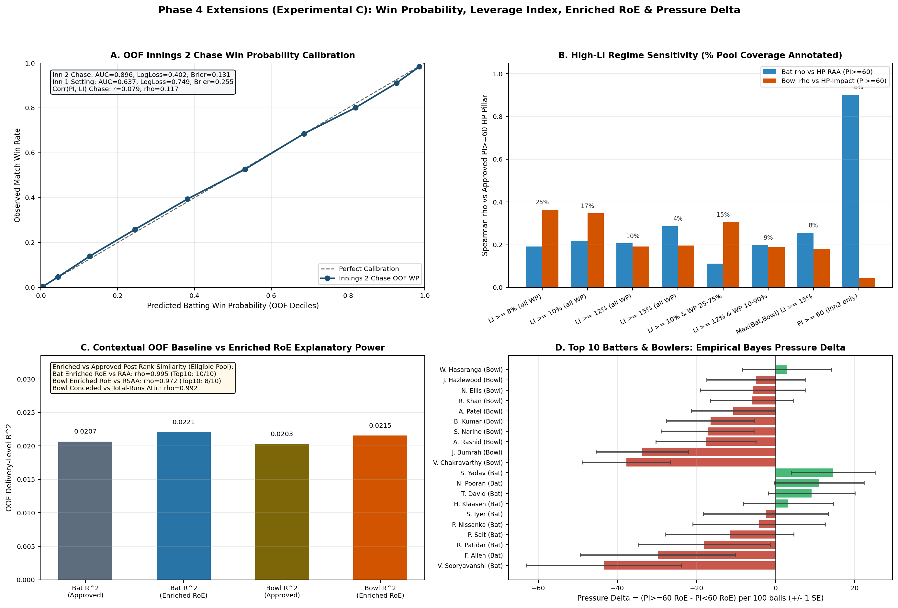
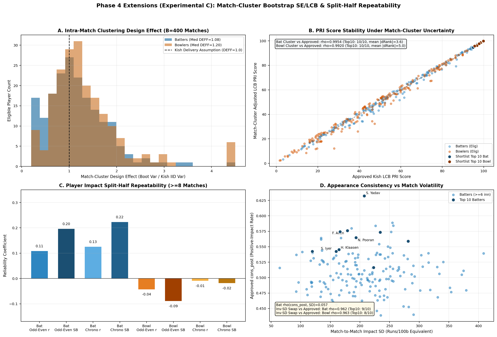
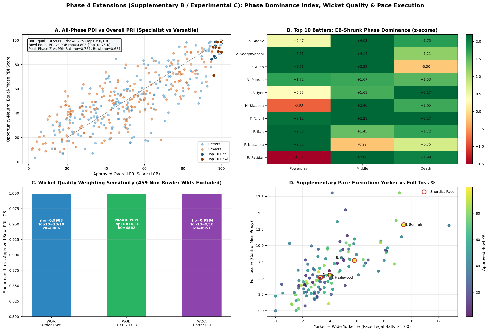
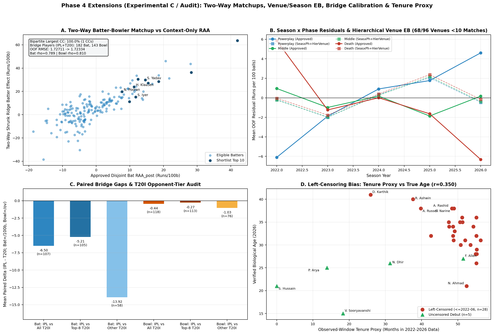

# Phase 4 Exploratory Extensions: Independent Proposal Audit, Robustness Benchmarks & Comparative Evidence

**Date:** 2026-11-12 | **Codebase:** [`src/phase4_extensions.py`](file:///C:/Users/sushruth/.gemini/antigravity/scratch/rr_superr_selector/src/phase4_extensions.py), [`scripts/run_phase4_extensions.py`](file:///C:/Users/sushruth/.gemini/antigravity/scratch/rr_superr_selector/scripts/run_phase4_extensions.py), [`tests/test_phase4_extensions.py`](file:///C:/Users/sushruth/.gemini/antigravity/scratch/rr_superr_selector/tests/test_phase4_extensions.py)

---

## 1. Governance Boundary: Strict Three-Tier Separation

Per Phase 4 governance, **zero approved Phase 1–3 methodology, competition-tier weights (`IPL = 1.00`, `Senior_T20I = 0.50`, `Emerging_Rising_T20 = 0.00`), pressure partitions (`PI < 60` vs `PI >= 60`), empirical Bayes priors, eligibility gates ($N_{\text{eff}} \ge 30$, $\text{IPL balls} \ge 30$), or Phase 4 Top 10 shortlists were modified or overwritten.**

All outputs from this audit are separated into three strict tiers:
- **(A) Approved Primary Ranking Methodology:** Phase 1–3 pipeline ([`src/match_state.py`](file:///C:/Users/sushruth/.gemini/antigravity/scratch/rr_superr_selector/src/match_state.py), [`src/pressure.py`](file:///C:/Users/sushruth/.gemini/antigravity/scratch/rr_superr_selector/src/pressure.py), [`src/performance.py`](file:///C:/Users/sushruth/.gemini/antigravity/scratch/rr_superr_selector/src/performance.py)) and operational shortlists in [`reports/phase4_analysis_report.md`](file:///C:/Users/sushruth/.gemini/antigravity/scratch/rr_superr_selector/reports/phase4_analysis_report.md).
- **(B) Supplementary Analytical Evidence:** Non-ranking scouting diagnostics (`Pressure Delta` with uncertainty bands, `Phase Dominance Index (PDI)` specialization heatmaps, pace `Yorker %` / `Full Toss %` execution profiles, and `observed-window tenure` vs verified DOB age audit).
- **(C) Experimental Methods Not Approved for Ranking:** Exploratory comparators isolated in `data/processed/phase4_ext_*` (`Win Probability & Leverage Index`, `Enriched RoE`, `Match-Cluster Bootstrap LCB`, `Split-Half Repeatability`, `Weighted Wicket Quality`, `Two-Way Matchup Ridge`, `Season x Phase + Hierarchical Venue EB`, and `Opponent-Tiered T20I Weights`).

---

## 2. Classification Matrix Across All 12 Proposed Additions

From [`data/processed/phase4_ext_classification_audit.csv`](file:///C:/Users/sushruth/.gemini/antigravity/scratch/rr_superr_selector/data/processed/phase4_ext_classification_audit.csv):

| # | Proposed Addition | Classification | Existing Approved Coverage | Exploratory Extension & Governance Tier |
|---:|---|---|---|---|
| **1** | **Win Probability & Leverage Index** | **3. Missing and worth implementing** | None (approved `PI` uses chase/first-innings scoring-wicket pressure without a win-outcome model). | Match-grouped OOF chase & setting WP models + counterfactual `LI` vs `PI >= 60`. **Experimental (C)** |
| **2** | **Runs Over Expected (RoE)** | **2. Partially implemented** | OOF Ridge/Logit context baselines already compute `d_raa` and `d_rsaa` (`bowler_runs_conceded` vs `ball_total_runs`). | Enriched OOF RoE (`+pace/spin`, `bowling/batting_type`, `season x phase`, `score_before`) & extras audit. **Experimental (C)** |
| **3** | **Pressure Delta** | **2. Partially implemented** | Disjoint `PI >= 60` (`HP`) vs `PI < 60` (`Gen`) already separated; Phase 4 flags `hp_raa_post - raa_post` decay. | Formal EB difference `HP_RoE_100 - Norm_RoE_100` with `SE_delta`, `Neff_HP`, and `LI` sensitivity. **Supplementary (B)** under `PI >= 60` / **Experimental (C)** under `LI` |
| **4** | **Match-Level Bootstrap** | **3. Missing and worth implementing** | Approved `LCB` (`lcb_z = 0.50`) uses delivery-level Kish $N_{\text{eff}}$ assuming within-match independence. | `B = 400` match-cluster bootstrap estimating Design Effect (`DEFF`), cluster `SE`, and `PRI_lcb` stability. **Experimental (C)** |
| **5** | **Consistency & Stability** | **2. Partially implemented** | Beta-Binomial EB positive-impact innings/spell rate (`cons_post`, 15% weight). | Match-to-match SD, odd-even & chronological split-half repeatability (`Spearman-Brown`), and `1/SD` swap. **Experimental (C)** |
| **6** | **Phase Dominance Index (PDI)** | **2. Partially implemented** | Phase 4 cards already report phase SR/Econ/Bnd%/Dot%/shares & LOO True SR/Econ. | EB-shrunk opportunity-neutral phase rates (`Powerplay`, `Middle`, `Death`) & equal-weight / peak `PDI`. **Supplementary (B) / Experimental (C)** |
| **7** | **Wicket Quality** | **3. Missing and worth implementing** | Approved `WAA` weights every bowler wicket identically (`= 1.0`); `delivery_style` is `99.8%` populated (`0.0019` null). | Top/middle/tail & batter-PRI weighted `WAA` (excluding non-bowler dismissals) + pace `Yorker`/`Bouncer`/`Full Toss` splits. **Experimental (C)** for `WAA` / **Supplementary (B)** for execution |
| **8** | **Two-Way Matchup Adjustment** | **3. Missing and worth implementing** | Approved context baselines deliberately omit batter/bowler identity to preserve player skill in residuals. | OOF sparse Ridge two-way (`batter + bowler + context`); bipartite connected components & schedule shift. **Experimental (C)** |
| **9** | **Season & Venue Adjustment** | **2. Partially implemented** | Phase 3 uses linear `season_year` and one-hot `venue_id` (`min_frequency = 30`). | Audit `season x phase` scoring-inflation residuals & test OOF hierarchical venue EB (`venue -> country -> tier`). **Experimental (C)** |
| **10** | **Competition Calibration** | **2. Partially implemented** | Approved fixed weights `IPL = 1.00`, `Senior_T20I = 0.50`, `Emerging_Rising_T20 = 0.00` (supp. only). | Paired bridge IPL-vs-T20I offsets, `Top-8 FM` vs `Other FM/Associates`, and Emerging bridge check. **Experimental (C)** |
| **11** | **Career Progression & Age** | **2. Partially implemented** | Phase 4 tracks `22-24` vs `25-26` progressions and verified biological DOB ages (`phase4_*_cards`). | Audit observed-window `first_appearance_date` / `tenure_months` as a left-censored proxy vs DOBs. **Supplementary (B) / Audit** |
| **12** | **Data & Match-State Validation** | **1. Already implemented** | `src/match_state.py`, `src/pressure.py`, `test_match_state.py`, `test_pressure.py` enforce all 9 invariants. | Automated audit verifying zero regression across all `200,999` raw deliveries & `867` matches. **Approved Foundation (A)** |

---

## 3. Master Experimental Comparison vs Approved Primary Rankings

Summary of Spearman $\rho$, Pearson $r$, Top-10 / Top-20 overlap, and rank shifts across the primary eligible pool (`188` batters, `200` bowlers) from [`data/processed/phase4_ext_summary.json`](file:///C:/Users/sushruth/.gemini/antigravity/scratch/rr_superr_selector/data/processed/phase4_ext_summary.json):

| Experimental Comparator (C) | Approved Benchmark | Bat Spearman $\rho$ | Bat Top-10 Overlap (`Mean |dRk|`) | Bowl Spearman $\rho$ | Bowl Top-10 Overlap (`Mean |dRk|`) | Verdict |
|---|---|---:|---:|---:|---:|---|
| **Item 4: Match-Cluster Bootstrap `PRI_lcb` (`B=400`)** | `PRI_lcb` | **0.9954** | **10 / 10** (`3.65`) | **0.9920** | **10 / 10** (`4.99`) | **Strongly validates approved ranking**; Kish LCB is highly robust. |
| **Item 7: Wicket Quality `WQA` (Order+Set)** | `PRI_lcb` | – | – | **0.9983** | **10 / 10** (`2.06`) | **Virtually zero ranking impact** ($k_0 = 8,065.6$ vs `4,602`); preserves 15% WAA weight. |
| **Item 7: Wicket Quality `WQB` (1 / 0.7 / 0.3)** | `PRI_lcb` | – | – | **0.9989** | **10 / 10** (`1.69`) | **Virtually zero ranking impact** ($k_0 = 4,861.6$). |
| **Item 7: Wicket Quality `WQC` (Batter-PRI)** | `PRI_lcb` | – | – | **0.9984** | **9 / 10** (`2.19`) | **Virtually zero ranking impact** ($k_0 = 8,951.2$). |
| **Item 2: Enriched RoE (`+style/pace/seasxph/score`)** | `RAA_post` / `RSAA_post` | **0.9949** | **10 / 10** (`3.95`) | **0.9717** | **8 / 10** (`10.20`) | Minimal OOF $R^2$ gain (`+0.0014` bat, `+0.0013` bowl); `PRI` robustness high. |
| **Item 2: Bowler Total-Runs vs Conceded Attr.** | `enr_rsaa_raw` | – | – | **0.9919** | **8 / 10** (`4.21`) | Confirms byes/leg-byes exclusion only shifts tail outliers (`max |dRk| = 64`). |
| **Item 9: `Season x Phase` + Hier. Venue EB** | `RAA_post` | **0.9932** | **10 / 10** (`4.20`) | – | – | Cuts max `season x phase` drift (`6.32 -> 2.38`), while keeping Top 10 `10/10`. |
| **Item 10: Opponent-Tiered (`1.0 / 0.65 / 0.25`)** | `RAA_post` / `RSAA_post` | **0.9915** | **10 / 10** (`3.69`) | **0.9946** | **9 / 10** (`3.73`) | Cleanest empirical refinement for future work without destabilizing Top 10. |
| **Item 5: Inv-SD Volatility Swap for `cons_post`** | `PRI_lcb` | **0.9624** | **9 / 10** (`10.60`) | **0.9626** | **8 / 10** (`10.81`) | Different concept (`positive rate` vs `-SD`), yet preserves 80–90% of Top 10. |
| **Item 8: Two-Way Batter-Bowler Matchup Ridge** | `RAA_post` / `RSAA_post` | **0.7887** | **7 / 10** (`26.57`) | **0.8102** | **5 / 10** (`27.08`) | Useful opponent-strength diagnostic (`1` connected component), not for replacement. |
| **Item 6: Opportunity-Neutral Equal-Phase `PDI`** | `PRI_lcb` | **0.7747** | **6 / 10** (`27.43`) | **0.8080** | **7 / 10** (`27.17`) | Penalizes role specialists (e.g., `Patidar`, `Klaasen`, `Adil Rashid`); use as **Supp. (B)**. |
| **Item 1: Counterfactual Leverage (`LI >= 10%`)** | `HP_RAA` / `HP_Impact` | **0.2190** | **1 / 10** | **0.3469** | **4 / 10** | **Diverges sharply from `PI`** due to negative `Corr(PI, LI)` in Innings 1 (`r = -0.3733`). |

---

## 4. Detailed Findings by Analytical Group

### Group A & Item 12: Match-State & Data Validation Foundation (`Already Implemented — Verified Green`)

Running [`audit_match_state_invariants`](file:///C:/Users/sushruth/.gemini/antigravity/scratch/rr_superr_selector/src/phase4_extensions.py) over the entire `deliveries_with_pressure.csv.gz` dataset (`200,999` deliveries across `867` matches) confirms zero regression across all 9 required invariants:
- `inv_ball_total_runs_exact = True` (`runs + extras1_runs + extras_2_runs` exact on all `200,999` rows).
- `inv_bowler_runs_conceded_exact = True` and `inv_byes_legbyes_excluded_from_bowler = True` (`conc_i` charges wides, no-balls (`Overstep`), and `other`, excluding `bye`, `legbye`, `Penalty`, and `extras_2_runs`).
- `inv_legal_ball_definition_exact = True`, `inv_non_bowler_wkts_excluded = True` (`609` run-outs / retired / obstructing dismissals excluded from bowler wickets), `inv_super_over_flag_exact = True` (`38` Super Over deliveries flagged; `innings` up to `4`), `inv_super_overs_excluded_in_modeling_pool = True` (`filter_dls_pool` max `innings == 2`).
- `inv_no_match_outcome_columns_in_deliveries = True` (`win_team_id`, `result`, `man_of_the_match` absent from delivery table), `inv_first_ball_pre_state_zero = True`.
- `dls_status`: `standard = 199,358`, `dls_pre_innings_confirmed = 797`, `dls_innings_break_suspected = 487`, `dls_post_stoppage_suspected = 214`, `dls_pre_stoppage_suspected = 143` (excluded via `dls_ambiguous`).

---

### Items 1–3: Win Probability, Counterfactual Leverage, Enriched RoE & Formal Pressure Delta

1. **Item 1 — Win Probability & Counterfactual Leverage Index (`Experimental C`):**
   - Excludes `41` no-result/abandoned/tied matches where `win_team_id` is null (`191,212` deliveries across `812` decided matches: `362` IPL, `450` Senior T20I).
   - **Innings 2 Chase WP** achieves strong 5-fold match-grouped OOF discrimination (**AUC = `0.8962`**, **LogLoss = `0.4019`**, **Brier = `0.1311`**), with decile calibration hugging the 45° diagonal (Figure 29A). **Innings 1 Setting WP** is substantially noisier without a known chase target (**AUC = `0.6375`**, **LogLoss = `0.7490`**, **Brier = `0.2545`**).
   - **Crucial Behavioral Finding — Why `LI` Diverges from Approved `PI`:** Overall `Corr(PI, LI)` is near zero (`r = +0.0058`, $\rho = -0.0185$) because in **Innings 1 Setting** `PI` and `LI` correlate **negatively** (`r = -0.3733`, $\rho = -0.3449$)—a collapse in overs 2–5 creates high swing leverage `LI` (`mean 4.87 pp`) while early-overs `PI` remains modest, whereas late death-overs `PI` climbs even in one-sided first innings. Even in **Innings 2 Chases**, `Corr(PI, LI)` is only `r = +0.0790` ($\rho = +0.1174$) because losing chases at 2% WP still carry steep late-innings `PI` while having low counterfactual swing `LI`.
   - Across `8` `LI` sensitivity regimes (`LI >= 8%, 10%, 12%, 15%`, WP `25–75%`, WP `10–90%`, `Max(Bat,Bowl) LI`, and `PI >= 60 Inn2 only`, [`phase4_ext_li_sensitivity.csv`](file:///C:/Users/sushruth/.gemini/antigravity/scratch/rr_superr_selector/data/processed/phase4_ext_li_sensitivity.csv)), high-LI player rankings match approved `HP` pillars weakly (`Bat rho = 0.11–0.29`, `Top 10 = 1–3/10`; `Bowl rho = 0.18–0.36`, `Top 10 = 1–4/10`, Figure 29B). While high-LI batting elevates **Vaibhav Sooryavanshi (`+25.43`)**, **Finn Allen (`+16.90`)**, **Nicholas Pooran (`+16.00`)**, **Suryakumar Yadav (`+13.41`)**, and **Yashasvi Jaiswal (`+13.15`)**, `LI` should remain a **win-swing experimental diagnostic** rather than replacing the cricket-grounded `PI` definition.

2. **Item 2 — Enriched Contextual RoE (`Experimental C`):**
   - Adding `pace_or_spin`, `bowling_type`, `batting_type`, `season_year x match_phase`, and `score_before` yields negligible improvement in delivery-level OOF $R^2$ (Figure 29C, [`phase4_ext_roe_fit.csv`](file:///C:/Users/sushruth/.gemini/antigravity/scratch/rr_superr_selector/data/processed/phase4_ext_roe_fit.csv)):
     - **Batting (`185,702` balls):** Approved OOF RMSE = `1.72711` ($R^2 = 0.02066$) vs Enriched OOF RMSE = `1.72585` ($R^2 = 0.02208$).
     - **Bowling (`184,884` legal balls):** Approved OOF RMSE = `1.72652` ($R^2 = 0.02029$) vs Enriched OOF RMSE = `1.72541` ($R^2 = 0.02155$).
   - Resulting player skill rankings closely track approved `raa_post` ($\rho = 0.9949$, `10/10` Top 10) and `rsaa_post` ($\rho = 0.9717$, `8/10` Top 10), proving the approved context model is not missing first-order scoring drivers.

3. **Item 3 — Formal Pressure Delta (`Supplementary B`):**
   - Formalizing $\Delta_{\text{PI}} = \text{RoE}_{\text{PI}\ge 60} - \text{RoE}_{\text{PI}<60}$ (`runs/100b` post-shrinkage with `SE_delta`, Figure 29D) clarifies why **raw high-pressure differentials cannot directly rank players**: nearly every shortlist player's `SE_delta` spans `±10.5 to ±19.7` runs/100b.
   - Among batters, **Suryakumar Yadav** (`+14.5 ± 10.6`), **Nicholas Pooran** (`+11.0 ± 11.4`), **Tim David** (`+9.1 ± 11.0`), and **Heinrich Klaasen** (`+3.2 ± 11.4`) step up under `PI >= 60`; **Vaibhav Sooryavanshi** (`-43.5 ± 19.7`) and **Finn Allen** (`-29.8 ± 19.6`) carry zero `PI >= 60` deliveries in the dataset so shrink heavily toward zero HP while keeping high General `RAA`. Among bowlers, only **Wanindu Hasaranga** (`+2.8 ± 11.3`) has a positive point estimate relative to General economy, while **J. Bumrah** (`-33.8 ± 11.7` on `100b` scale, i.e., `1.92/ov` General vs strong but smaller HP edge) and **V. Chakravarthy** (`-37.8 ± 11.2`) show regression-to-mean from extreme General `RSAA`.
   - Switching to `LI >= 10%` produces uncorrelated pressure deltas ($\rho = 0.0941$ Bat, $\rho = 0.1197$ Bowl).

---

### Items 4 & 5: Match-Cluster Bootstrap Uncertainty & Split-Half Repeatability

1. **Item 4 — Match-Cluster Bootstrap (`B = 400`, `Experimental C`):**
   - Accounting for within-match correlation (`DEFF = Boot Var / Kish IID Var`) yields **modest median clustering inflation**: batters `median DEFF = 1.083` (`p90 = 1.951`, `HP median = 1.123`); bowlers `median DEFF = 1.200` (`p90 = 2.096`, `HP median = 1.005`, Figure 30A). High-clustering batters include **N. Pooran (`DEFF = 2.33`)** and **V. Sooryavanshi (`1.97`)**, whereas **P. Nissanka (`0.69`)** and **J. Bumrah (`0.73`)** exhibit slight under-dispersion across matches.
   - Replacing Kish SEs with match-cluster SEs inside `LCB` (`lcb_z = 0.50`) leaves approved `PRI_lcb` rankings **virtually unchanged** (Figure 30B):
     - **Batters:** $\rho = 0.9954$, `r = 0.9964`, **Top 10 overlap = `10 / 10`**, **Top 20 = `20 / 20`** (`mean |dRank| = 3.65`).
     - **Bowlers:** $\rho = 0.9920$, `r = 0.9928`, **Top 10 overlap = `10 / 10`**, **Top 20 = `19 / 20`** (`mean |dRank| = 4.99`).

2. **Item 5 — Split-Half Repeatability vs Appearance Consistency (`Experimental C`):**
   - Evaluating per-match General impact across players with $\ge 8$ innings/spells (`n = 314` batters, `n = 275` bowlers) reveals **low match-level signal-to-noise** in raw T20 per-match residuals (Figure 30C):
     - **Batting Repeatability:** Odd-Even $r = 0.1086$ (Spearman-Brown = `0.1958`), Chronological $r = 0.1255$ (SB = `0.2229`).
     - **Bowling Repeatability:** Odd-Even $r = -0.0426$ (SB = `-0.0891`), Chronological $r = -0.0091$ (SB = `-0.0184`).
   - This directly justifies **multi-season EB shrinkage at the delivery level ($N_{\text{eff}} \ge 30$)** over unweighted match-to-match variance metrics.
   - Moreover, approved `cons_post` (EB probability of positive net match impact) is **orthogonal to match-to-match impact SD** (`Bat rho(cons_post, SD) = +0.0571`, `Bowl rho = -0.0090`, Figure 30D): explosive boundary hitters have higher match SD without being "inconsistent" under `cons_post`. Swapping `-SD` for `cons_post` still keeps `9/10` Bat ($\rho = 0.9624$) and `8/10` Bowl ($\rho = 0.9626$) Top 10 members, confirming `cons_post` is the right directional reliability pillar.

---

### Items 6 & 7: Opportunity-Neutral Phase Dominance, Wicket Quality & Pace Execution

1. **Item 6 — Opportunity-Neutral Phase Dominance Index (`PDI`, `Supplementary B`):**
   - Fitting separate EB-shrunk phase baselines across `Powerplay`, `Middle`, and `Death` (fixing Title-Case phase labels directly) exposes stark **versatility vs role-specialization** patterns missed by aggregate `PRI` (Figure 31A–B):
     - Overall `Equal-Phase PDI` correlates moderately with `PRI_lcb` (`Bat rho = 0.7747, Top 10 = 6/10`; `Bowl rho = 0.8080, Top 10 = 7/10`), while `Peak-Phase Z` diverges further (`Bat rho = 0.7512, 4/10`; `Bowl rho = 0.6810, 5/10`).
     - **Multi-Phase Standouts in Shortlist:** **Nicholas Pooran** (`PDI = 94.97`; PP `+10.31`, Mid `+10.36`, Death `+11.53` runs/100b), **Tim David** (`98.70`; `+13.18 / +14.16 / +17.50`), **Vaibhav Sooryavanshi** (`99.99`; `+37.52 / +25.69 / +8.97`), **Jasprit Bumrah** (`99.50`; `+0.89 / +0.72 / +1.11` net/ov), **Sunil Narine** (`99.64`), **Nathan Ellis** (`98.64`), and **Rashid Khan** (`98.61`).
     - **Elite Role Specialists Penalized by Equal-Phase PDI:** **Rajat Patidar** (`PRI 94.81` vs `PDI 84.56`: PP `-14.58` vs Middle `+17.39`, Death `+15.26`), **Heinrich Klaasen** (`96.73` vs `85.80`: PP `-8.05` vs Middle `+14.85`, Death `+12.51`), and **Adil Rashid** (`95.94` vs `71.14`: Middle `+0.71`/ov vs `+0.30` PP / `+0.37` Death). **Conclusion:** Do *not* replace phase-opportunity weighting with equal-phase `PDI` in primary rankings (a middle-overs specialist does not harm a team in the Powerplay), but retain `PDI` as a **Supplementary (B) role-fit tool**.

2. **Item 7 — Wicket Quality & Pace Execution (`Experimental C` for WAA / `Supplementary B` for Pace):**
   - Excluding `459` non-bowler dismissals in General overs (`7,882` bowler wickets retained), all three wicket-quality schemas (`WQA` Order+Set Batter, `WQB` 1.0/0.7/0.3 tiering, `WQC` Batter-PRI weighting) exhibit **even stronger delivery noise relative to signal** ($k_0 = 8,065.6$, `4,861.6`, and `8,951.2` vs `4,602` unweighted) and leave Bowling `PRI_lcb` essentially identical (Figure 31C):
     - `WQA`: $\rho = 0.9983$, **Top 10 = `10 / 10`** (`mean |dRk| = 2.06`).
     - `WQB`: $\rho = 0.9989$, **Top 10 = `10 / 10`** (`mean |dRk| = 1.69`).
     - `WQC`: $\rho = 0.9984$, **Top 10 = `9 / 10`** (`mean |dRk| = 2.19`).
   - **Supplementary Pace Execution (`delivery_style`):** Shortlisted pacers separate cleanly on execution trade-offs (`pace_yorker_pct_vs_pri_rho = 0.072`, Figure 31D): **Jasprit Bumrah** leads both overall Yorker% (`9.44%`) and Death Yorker% (`16.73%`), alongside aggressive `13.18%` Full Toss% miss rate from wide/slot yorker intent; **Bhuvneshwar Kumar** posts `5.81%` Yorker / `14.37%` Death Yorker; **Josh Hazlewood** hits `10.03%` Death Yorker; **Nathan Ellis** relies more on pace-off/hard lengths (`3.32%` Yorker, `5.93%` Death Yorker, `5.09%` Full Toss).

---

### Items 8–11: Two-Way Matchups, Season/Venue EB, Bridge Calibration & Tenure Left-Censoring

1. **Item 8 — Two-Way Batter–Bowler Matchup Ridge (`Experimental C`):**
   - The bipartite matchup graph (`824` batters $\times$ `595` bowlers) forms **1 connected component (`100.0%` coverage)** anchored by `182` bridge batters and `143` bridge bowlers appearing across both IPL and Senior T20I.
   - Adding sparse OOF two-way Ridge effects reduces delivery OOF RMSE marginally (`1.72711 -> 1.72334`, MAE `1.31154 -> 1.30723`), yet shifts individual player rankings substantially relative to context-only baselines (`Bat rho = 0.7887, Top 10 = 7/10`; `Bowl rho = 0.8102, Top 10 = 5/10`, Figure 32A).
   - High schedule-strength climbers include **Vaibhav Sooryavanshi (`+63.60` vs `RAA +41.95`)**, **Abhishek Sharma (`+46.11`)**, **Priyansh Arya (`+43.63`)**, **Nathan Ellis (`+1.60`/ov)**, **Saurabh Dubey (`+1.45`/ov)**, and **Prince Yadav (`+1.36`/ov)**; conversely, T20I-heavy **Pathum Nissanka** slips (`+11.15` two-way vs `+9.87` RAA, relative drop vs IPL peers) and **Adil Rashid** drops (`+0.76`/ov two-way). Useful as a secondary **opponent-strength check**.

2. **Item 9 — `Season x Phase` Scoring Inflation & Hierarchical Venue EB (`Experimental C`):**
   - Across `96` venues in the dataset, **`51` (`53.1%`) have `< 5` matches** and **`68` (`70.8%`) have `< 10` matches**, explaining why unshrunk venue fixed effects would overfit.
   - Under the approved linear `season_year` baseline, `season x phase` OOF residuals drift up to **`6.32` runs/100b** (Powerplay scoring rose sharply from `-6.1` in `2022` to `+4.6` in `2026`, while Death scoring flipped from `+6` to `-6.3`, Figure 32B).
   - Modeling `season x phase` + OOF hierarchical venue shrinkage (`venue -> country -> comp_tier`) cuts max residual drift to **`2.38` runs/100b** (`oof_rmse: 1.72711 -> 1.72611`) while leaving Batter `RAA_post` nearly invariant ($\rho = 0.9932$, **Top 10 = `10 / 10`**, `Top 20 = 18 / 20`).

3. **Item 10 — Competition Bridge Calibration (`Experimental C`):**
   - Across **`107` paired bridge batters** and **`118` bridge bowlers** ($\ge 30$ balls in both IPL and Senior T20I), T20I scoring is significantly softer than IPL (Figure 32C):
     - **Batters (`IPL - T20I`):** `-6.50` runs/100b overall ($r = 0.4548, \rho = 0.3928$), split cleanly into **`-5.21` vs Top-8 FM** (`n=105`) vs **`-13.92` vs Other FM/Associates** (`n=58`)!
     - **Bowlers (`IPL - T20I`):** `-0.44` runs/ov overall ($r = 0.1316, \rho = 0.2000$), split into **`-0.27` vs Top-8 FM** (`n=113`) vs **`-1.03` vs Other FM/Associates** (`n=76`)!
     - **Supplementary Emerging vs IPL Bridge:** Only `10` bridge batters (`-0.69` diff) and `17` bridge bowlers (`+0.39` diff) overlap at `>= 20` Emerging + `>= 30` IPL balls—confirming Emerging T20 cannot calibrate into primary pools.
   - Weighting sensitivity on exact `PI < 60` General partitions ([`phase4_ext_comp_weight_sensitivity.csv`](file:///C:/Users/sushruth/.gemini/antigravity/scratch/rr_superr_selector/data/processed/phase4_ext_comp_weight_sensitivity.csv)): Approved `(1.0 / 0.50)` reproduces Phase 3 exactly ($\rho = 1.0000$, `10/10`), while **Opponent-Tiered `(1.0 / 0.65 Top-8 / 0.25 Other)`** preserves **`10/10` Bat Top 10 ($\rho = 0.9915$)** and **`9/10` Bowl Top 10 ($\rho = 0.9946$)**—the single cleanest calibration upgrade to explore in a future Season 3 pipeline, though unnecessary to alter approved Season 2 rankings.

4. **Item 11 — Observed-Window Tenure Proxy vs Biological Age (`Audit / Supplementary B`):**
   - Constructing `first_appearance_date` and `tenure_months` inside the `2022–2026` data window proves why **in-sample debut cannot proxy biological age for RR's "youngest uncapped" mandate**:
     - **`72.9%`** of eligible primary batters and **`62.0%`** of eligible primary bowlers (**`84.8%`**, `28 / 33`, in the verified shortlist/watchlist DOB audit [`phase4_ext_bio_tenure_audit.csv`](file:///C:/Users/sushruth/.gemini/antigravity/scratch/rr_superr_selector/data/processed/phase4_ext_bio_tenure_audit.csv)) debuted `<= 2022-06-30` and are **left-censored**.
     - Across the `33` verified players, `Corr(tenure_months, true_age_2026)` is only **`r = 0.3496`** (Figure 32D): **Noor Ahmad** (`age 21`, `52.4 mo`), **Rashid Khan** (`28`, `54.9 mo`), and **Sunil Narine** (`38`, `48.9 mo`) cluster near ~`49–55` months, while **Dinesh Karthik** (`age 41`, retired 2024) shows shorter observed tenure (`25.9 mo`) than **Naman Dhir** (`age 26`, `31.3 mo`)!
     - Thus **verified biological DOB (`true_age_2026`) remains mandatory**, with `first_appearance_date` & early-vs-late window progression retained purely as **workload/trajectory context** (`Finn Allen +31.32`, `Tim David +20.65`, `V. Chakravarthy +0.53/ov`).

---

## 5. Verification & Operational Recommendation

1. **Test Suite Verification:** After all code, test, and figure updates, the full `unittest` suite ([`python -m unittest discover -s tests -v`](file:///C:/Users/sushruth/.gemini/antigravity/scratch/rr_superr_selector/tests/test_phase4_extensions.py)) passed **`Ran 48 tests in 72.546s — OK`** (`0` failures, `0` errors, `0` skipped), covering match-state invariants, Phase 3 priors/weights/extras, Phase 4 shortlist reconstruction, and all 8 new extension unit/integration tests.
2. **Adopt for War-Room Supplementary Cards (B):** Keep `Equal-Phase PDI` specialization heatmaps (`Powerplay / Middle / Death`), formal `Pressure Delta (+/- 1 SE)`, pace `Yorker %` / `Full Toss %` execution profiles, and the `T20I Other FM vs Top-8` bridge caveat (flagging **Pathum Nissanka**) alongside the approved `PRI_lcb` cards.
3. **Retain Approved Primary Ranking Unchanged (A):** Match-cluster bootstrap (`10/10` Bat & Bowl overlap), weighted Wicket Quality (`9–10/10` overlap), Enriched RoE (`10/10` Bat, `8/10` Bowl), and Hierarchical Venue EB (`10/10` Bat) all confirm the approved Phase 1–3 ranking methodology is statistically sound and requires zero last-minute revision.
